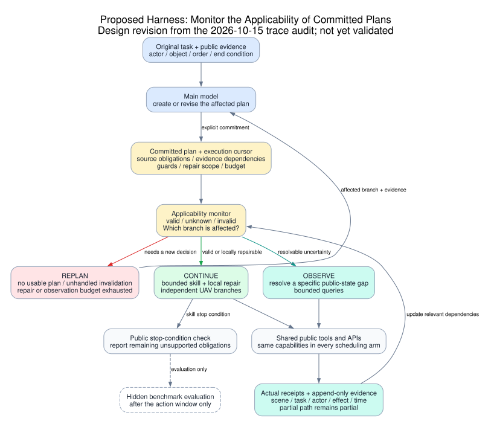

# 基于计划适用性的 Harness 架构与验证方案

本方案依据 [204 次执行的轨迹审计](REPORT_CN.md)修订。目标是让主模型负责计划生成与必要的计划调整，让执行层在计划仍适用时持续推进，并对局部不确定性优先查证。当前已有证据账本、公开搜索技能和部分航线监控；**统一的计划对象、适用性监控器与模型门控尚未实现，也没有在线收益结论**。

## 架构的控制中心



此前义务—证据匹配回答“还欠什么”。新增的计划状态回答“已经决定下一步做什么、决定在什么条件下仍成立”。这两种状态不能合并：发现某目标只更新位置知识；指定机本题是否访问仍由实际回执支持；任务还欠一个动作也不意味着当前路线可执行。

主模型输出短计划；运行时保存游标与依赖，逐步执行已有技能。每个完成批次更新事件账本，并只检查可能受影响的计划分支。门控在三个选项之间选择：

| 选择 | 条件 | 执行行为 |
|---|---|---|
| CONTINUE | 有已承诺下一步，相关适用条件成立，或异常处于技能声明的修复能力内 | 继续短技能或有界局部修复，保存真实回执 |
| OBSERVE | 下一步依赖的状态未知／过期／效果不确定，存在能消除该缺口的公开查询 | 发出最少必要查询；无有效查询或查询预算耗尽则交模型 |
| REPLAN | 没有可执行计划、原义务有歧义、相关假设失效且技能不能修复、局部修复预算耗尽 | 主模型接收变化摘要及原始证据引用，只调整受影响分支 |

停止与完成报告独立于这三项选择：只有对应任务的可观测停止条件成立，才停止该技能；全任务报告保留未支持义务。其他独立 UAV 分支不被局部异常自动暂停。存在同步要求或共享资源依赖时，暂停传播到真实依赖的分支。

“新观察”本身不是失效事件。新障碍与当前路线无交集时继续；在搜索技能允许的候选重选范围内处理受阻；新目标满足原文下一项定位依赖时可激活该分支；新证据改变指定对象、顺序或资源可行性时才重评计划。不能仅用错误字符串或 token 数作为门控。

## 最小计划接口

```text
DecisionFrame
  plan_id, plan_version, task_id, scene_epoch
  source_obligations[]        原文片段及仍未支持的语义
  actor_bindings[]            来自公开工具的 name → id 绑定
  steps[], cursor            技能名、确定参数、依赖、顺序
  evidence_refs[], versions  本计划实际依赖的公开事实
  continue_guards[]           已实现、可核对的继续条件
  invalidators[]              哪些事件影响哪条依赖或分支
  local_repair_scope         技能可改哪些参数，禁止改哪些义务
  observation_policy         可查询的缺口、查询次数和时限
  stop_condition             任务来源、比较运算符、作用域
  deadline, api_budget, repair_budget
```

适用性监控器返回 `valid / invalid / unknown` 及证据引用，不把 unknown 当成动作禁令。为避免旧合同 harness 的失败，只对已实现的窄谓词做强约束，例如有效 actor 绑定、真实路径前缀、工具参数协议、单机顺序、严格进度 `>95`。模型生成的推测性前置条件不能自动升级成全局硬约束。不能解析的任务保留原文并回到原有工具循环。

每个技能声明输入、效果、可修复异常、停止条件与预算。例如：

- **有序短动作技能**：起飞—转向／爬升—悬停；一步一个真实回执，不跨越未知状态盲目执行。适合作为生命周期及 actor/顺序正确性的验收探针。
- **公开反馈搜索技能**：使用现有公开状态与障碍信息；候选受阻后可在预算内换候选，继续感知和进度检查；候选耗尽、非预期回执或资源不足才升级。现有 400 秒触发阈值仅是历史开发选择，不是通用自适应算法。
- **后续候选：显式航点剩余段技能**：R3 监控器提供真实完成前缀，局部绕障不得丢弃原任务中间点。须先确认残余失败和回归，再纳入性能主张。

第一版不用另一个 LLM 做门控，否则可能用一次新推理替换一次旧推理。类型化规则作为可审计起点；只有规则边界有系统误差且数据量支持时，再研究学习型门控。模型可按 API 支持选择推理预算属于另一变量，不与“是否发起模型请求”混在同一实验里。

## 必须补齐的观测

旧请求哈希足以支持边界一致性审计，但不足以解释调用是否必要。新增结构化日志应包含：

1. `model_request_id / middleware_id / attempt_id` 与单调时钟起止，区分逻辑调用、HTTP 重试、排队和传输；供应商返回的 token/usage 单独记录。模型内部思考时长不可由墙钟差猜测。
2. 计划提交及修订、下一步、actor、关键依赖版本、技能进入与退出、公开工具发起与结束、事件来源与所属任务窗口。
3. 每次门控的前缀快照摘要、判定、原因、被影响的分支、选择的观察／修复／重规划，以及剩余预算。仅记录当时已知信息。
4. 实际执行分支与 shadow 建议分开。shadow 中构造的建议计划不能伪称模型当时已经承诺的计划。
5. 500 秒截止、取消与清理分别记录；截止后的回执保留但不能用于此前的评分窗口或在线门控证据。

不要求收集模型隐藏思维。下一步判定所需的计划接口、公共证据及实际动作已经足够形成可审计协议。

## 验证顺序与固定对照

### 阶段 A 离线语义和接口验收

使用本审计作开发材料，补齐运行时接口与测试，不改变生产执行策略。必须覆盖：错误 actor、同名不同 ID、跨任务旧完成证据、部分路径、并发回执、同步依赖、动作结果未知、重复照片／广播的副作用、参数包装与缺参的区别、严格 `>95`、终态与历史到达的区别。

为局部性构造最小反例：UAV A 受阻时，无依赖的 UAV B 应继续；存在原文同步屏障时 B 应等待；新的无关障碍不应重规划；技能内可处理的受阻不应全部升级。协议解析失败应回退原循环，不产生新的全队死锁。

### 阶段 B 记录计划与影子门控

先在冻结开发子集上增加可审计计划接口，分别记录原策略与门控建议，检查观测开销及协议回归。若计划接口本身改变了模型提示或动作集合，单设“仅计划接口”对照；不能把它当成完全无干预的 shadow。影子回放只评估当时建议的语义，不能证明另一条执行轨迹的效果。

在真正的新确认数据上，按场景分层抽取继续、观察、重规划和拒绝判断样本，标注者只看到截止前的任务、计划及公共证据。记录分歧并仲裁；不以本次规则自己的输出作为正确答案。没有独立标注者时明确报告单人／单模型审阅限制。

### 阶段 C 同技能的在线调度对照

| 实验臂 | 共享能力 | 决定何时再调用模型 |
|---|---|---|
| B0 | 原 R2 工具与公开信息 | 原调度；作为历史底座的同期重跑 |
| B1 | 相同计划接口、相同短动作和搜索技能、相同公开信息 | 每个预定义的可中断执行边界返回主模型 |
| B2 | 与 B1 相同 | 固定 K 个执行步骤返回；K 仅用开发集选择后冻结 |
| B3 | 与 B1 相同 | 工具失败或技能退出时返回 |
| B4 | 与 B1 相同 | 相关证据使计划失效、未知且不可观察消解、修复预算耗尽时返回 |

技能边界必须统一公开：相同导航、候选选择、感知频率、局部修复能力和参数，不能 B4 使用一个 240 步黑盒而 B1 只能调用原始移动。固定 K 和失败唤醒臂共享必要的 actor、API 协议、截止和副作用保护。B0→B1 的变化检验技能／计划接口，B1/B2/B3→B4 才检验调度。资源不足时先比较 B0/B1/B4，并将另外两臂留在冻结的主子集；缩减须在查看新结果前决定。

保留每场任务原顺序与题间状态继承，所有臂同模型、500 秒预算、信息权限和停止协议。各运行的臂顺序应均衡；种子或重复次数、分母与失败处理在运行前固定，不只重跑失败题。主结果在场景层聚合；重复的 52 题不能伪装成额外未见样本。

在可复现相同环境快照时，可额外做同一 checkpoint 的分支实验：继续技能 vs 返回模型，使用相同公开前缀且把真实环境快照只供仿真恢复、不给 agent。若平台不能忠实恢复随机数、历史、黑板与资源状态，就不声称配对分支具有完全相同初态，采用整场重复配对。

### 指标与停止条件

主指标为完整任务通过率、W/L 和超时。资源指标为窗口内 middleware 请求、HTTP 尝试、token、模型等待墙钟、工具/API 数、技能时长、P50/P95 墙钟。把触发前预算也报告出来，避免晚期救援和早期调用减少混为一谈。

机制指标采用全部适用分母：

- **误继续**：判定继续后，执行了当时已知违反计划依赖／原义务的动作；任务后来碰巧通过也要计入。
- **错过重规划**：相关失效且超出局部处理能力，仍继续原分支。
- **不必要唤醒候选**：独立前缀标注认为可继续或可查询解决；真实“无损删调用”另由在线分支确认。
- **局部性**：某机异常是否无故暂停其他就绪分支；影响范围与真实依赖是否一致。
- **作用域错误与恢复**：错 actor、漏点、重复副作用、使用前题完成证据、局部修复预算耗尽和回退耗时。
- **判定覆盖率**：保留 unknown 比例及原因；不能靠一直 unknown 获得高精度，也不能靠激进继续降低请求数。

出现确定性的错 actor、丢弃必需动作、效果未知后重复副作用、任务越界或新死锁即停止该配置晋级。减少调用但任务退步，不算成功；小开发集的正净收益只进入下一阶段。若要声称成功率非劣，必须在正式运行前制定容忍界限、场景样本量与统计方法，不能用“差异不显著”代替非劣证明。fast100 及现有 52 题仅作开发回归；新确认集必须明确未用于门槛调优的场景或种子。

## 实现顺序与论文表述

接下来先完成计划／门控日志和两个技能的统一可中断接口，再跑离线语义反例与仅计划接口的回归；随后开展同技能门控配对。不要在此阶段同时加入多 LLM 侦察、通用合同、学习预算器和全面实体重定位。现有路线仍能研究，但难点集中在计划可执行化、证据相关性、局部修复边界和因果对照，而不是再画更多模块。

可检验的主张草案是：**在部分可观测、多执行者、有截止时间的任务中，以任务与执行者作用域内的证据监控已承诺计划，将模型调用与动作步数解耦，在保持任务可靠性的同时减少不必要的串行决策。**

对应贡献候选是计划适用性与证据依赖的表示、继续／观察／局部重规划的执行协议，以及同技能对照下的任务可靠性与开销验证。第三项目前尚未成立，前两项也须完成实现和相关工作差异审查。不能将事件触发、技能调用或外部记忆本身称为首次创新。若最后收益仅来自搜索策略，则收束成搜索技能贡献；若跨两类技能的门控消融成立，才以 harness 架构为论文主贡献。
