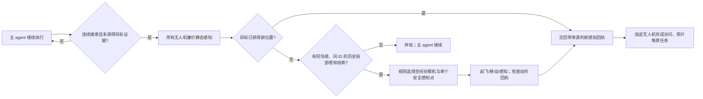

# 观察工人下一步：基于真实回执的选点与触发审计

2026-10-09。**判断：证据优先的单点侦察在一个旧个案上通过了控制器与证据账本的离线机制核验，但尚未显示出足以支撑论文主贡献的得分机会。**本报告不构成新的在线评分。个案复算见 [geometry.json](geometry.json)及[脚本](../../../experiments/analysis/audit_observation_worker_next_step.py)；场景不重合的 baseline 机会审计见 [baseline-lead-prevalence.json](baseline-lead-prevalence.json)及[脚本](../../../experiments/analysis/audit_prior_area_leads_baseline.py)。

## 证据链

| 观察 | 直接证据 | 对设计的含义 |
|---|---|---|
| 现版工人没有找到目标 | 新鲜配对试验两组均为 11/12 题、42/44 检查、0 超时；唯一出动的工人没有定位 Fixed Target 9 | 目前不能声称多 agent 带来分数提升；[原试验报告](../../results/m1r2-observation-worker-prefix-20261009/REPORT_CN.md) |
| 三点选址无有效感知覆盖 | 工人所选三点距缺失目标分别为 380.948、380.422、375.528 米；逐点交给原服务端感知实现，均未检测到该目标；该机感知半径为 50 米。三点全在该场景标称 1024×768 画布之外，三个感知圆与画布的交集约 958 平方米，仅占 0.12% | 现有 `_valid_plan` 只约束公开无人机坐标外扩范围、电量与非指定 actor，没有衡量信息增益或已有线索。画布在其他场景并非严格世界边界，因此应作软搜索范围线索，而非一律硬限制 |
| 工人实际上阻塞主 agent | 中间件在主模型请求前同步运行 `runner`；唯一一次额外工人模型调用耗时 41.866 秒、11,005 tokens，随后还有三次移动 | 角色拆分本身没有产生并行加速；应先设廉价价值门槛，并比较无额外模型调用的规则 |
| 旧轨迹存在一条有来源的可复核线索 | 前一题 `64b6560e` 的成功局部感知回执 `e43`，由无人机 `45ddface` 获得 Polygon Target 7 的 ID、坐标和形状，动作命令 `fa9c2c5d`；当前任务 `529c0622` 触发时 blackboard 仍保有相同数据 | 历史位置可作侦察假设，不能直接当作当前任务完成或指定无人机访问证据 |
| 线索优先方案几何上可行 | 只用触发时公开数据选空闲侦察机 `3d246fb0` 和单个停靠点 `(1599.516,1129.482,12)`，飞行直线 43.25 米，距目标边界 30 米；用旧任务开始前的完整快照在原服务端控制器回放，起飞和移动均成功，感知到该目标，`reached_by` 未增加侦察机 | 目标可在“能感知、不会冒领访问”的位置重观测；尚未证明原任务能因此通过 |
| 对完全未知目标无证据支持盲搜 | 旧 `22e1e1c5` 触发时，Fixed Target 9 没有可核对的历史位置线索；证据优先规则选择弃权 | 无约束的三点猜测不应由昂贵模型调用自动触发；全局搜索需另设任务区域与覆盖评估 |

在唯一在线触发的那条实际轨迹中，按公开感知回执和每架无人机的 50 米感知半径重建足迹：主 agent 触发前已感知约 **20.45%** 的该场景标称画布；最后三次完成感知移动分别新增约 **6370、7392、1215 平方米**。前两步仍显著扩展覆盖，所以“做了 8 次却未定位”并不等于空间探索已经停滞。工人的三点只向标称画布内新增至多约 **958 平方米**的端点感知区域。面积只是几何覆盖指标，不是目标发现概率；部分场景的目标和无人机在画布之外，不能把标称画布硬编码成世界边界。

这里的 blackboard **没有丢失 Polygon Target 7 的坐标**：完整条目存于 `facts.position`，摘要条目存于顶层 `position`。旧 R2 将跨题继承的面状目标位置标为 `reported_only`，这是合理的保守语义；问题在于现版工人没有优先核验这条线索。离线脚本还把当前条目的目标 ID、坐标、形状与前一题的真实成功感知回执逐项匹配；包含完整目标数据的系统快照只在选点完成后用于评估感知几何，未进入规划输入。

进一步把控制器可感知结果按原工具的**摘要回执格式**送入不变的 R2 账本，Polygon Target 7 从 `reported_only` 变成 `localized`，新位置来源为本次侦察事件 `e35`；执行状态仍为 `unattempted`，required actor 仍为 `711ca589`，侦察 actor 为 `3d246fb0`。把同一移动后的感知结果改成空列表作负对照，状态仍为 `reported_only/unattempted`。两次重放均无 observer error。候选侦察机在原任务触发前没有动作回执，故任务开始快照中的该机位置与触发时公开位置一致；这仍不是完整的在线暂停点重放。

## 场景不重合的机会核验

为防止只围绕 `529c0622` 讲故事，我们读取已核验的全量 B0 运行，剔除 R2 fast100 的 5 个开发场景，留下 **70 场景、1400 题**。线索判定只读每题开始前、由同场景上一题保存的**公开 blackboard**；任务要求从当前原文解析；失败检查仅在筛选完成后用于事后交叉核对。这里的 B0 轨迹不是 R2 行为，blackboard 也没有动作来源字段，故计数只是领域机会的宽松上界，不能当作 R2 触发率或侦察成功率。

| 指标 | 数量 |
|---|---:|
| 明确要求指定无人机访问命名圆形/多边形目标的题 | 191 |
| 开题前已有至少一个对应目标的公开坐标与形状 | 177 |
| 上述 177 题最终通过 / 失败 | 153 / 24 |
| 24 个失败题中，有失败目标检查的题 | 18 |
| 失败目标检查指向**已有形状线索的同一 target ID** | **0** |
| 失败目标检查总数；其中目标 ID 到任务结束仍未进入公开 blackboard | 21；**20** |

也就是说，已有面状目标线索本身很常见，但这些题的失败检查并没有落在已知线索目标上。18 个存在失败目标检查的题中，17 个至少有一个失败目标到任务结束仍不在公开 blackboard；21 项失败目标检查中仅 1 项的目标 ID 出现在任务结束的 blackboard，该项是照片检查。**这支持把后续观察研究重点放在尚未发现的目标，而不是重访已有线索的目标**；blackboard 缺失本身仍不能证明目标完全未被传感器短暂看到，也不能证明额外侦察必能找到。例子是 `9b21081a/def2d318`：开题前已有 Polygon Target 2 的形状线索，失败的却是随后 Circle Target 2 的到达和照片；目标 ID 已用事后快照核对。另有失败检查集中于定向移动。对 R2 开发集，把搜索阈值从 8 次放宽到 5 次或 3 次，触发题数从 2 增至 3 或 6，但**带来源且可安全侦察的线索始终只有 `529c0622` 一例**；放宽阈值额外触及已成功题。

## 建议改成的最小流程

先保留 R2、原触发阈值、500 秒期限与原工具；只把工人的 LLM 三点猜测替换为“**有来源线索时单点核验，无线索时弃权**”。侦察机必须避开指定 actor，校验电量、路线与障碍；对面状目标停在任务到达半径之外、感知半径之内。工人返回目标 ID、观察 actor、原来源、当前动作回执及目标位置；主 agent 仍负责指定无人机访问与拍照。任何失败、受阻、过期或身份不一致的回执不得升级为已定位事实。当前离线脚本只验证一个候选路径，不能视为完整在线实现。

## 是否值得进入下一轮在线试验

旧 100 题的同一开发轨迹上，连续感知移动阈值为 3、5、8 时分别触发 **6、3、2** 题；8 次规则只暴露两道旧失败题，其中仅 **1/2** 有满足本方案的带来源线索。新鲜配对试验中，两道旧失败候选的对照组都已通过，且工人组只在其中一题触发、未找到目标。再加上 70 场景的宽松机会审计未找到失败检查与已有线索目标的交集，**现阶段不建议为这个单点核验改动启动新的付费在线对照**。

若继续研究观察工人，下一候选应针对**真正未知的目标位置**：先用公开感知回执量化已覆盖与未覆盖区域，找到由任务给定的有效搜索范围，再估算新增一次侦察能覆盖多少、需多少时间；没有可信搜索范围时继续弃权。这个方向尚无有效选点或得分证据，需要先做离线覆盖与反例审计。对近期单变量在线实验，更有根据的备选是已能在真实回执中识别“跳过明确中间航点”的 R3 路线义务监视器；它必须单独验证，不能与观察工人捆绑主张收益。

**限制：**控制器复算从该任务开始前快照重建世界，并用触发时公开状态更新侦察机，不是在线任务暂停点的精确世界；R2 回执是控制器结果构成的模拟工具摘要，不是新在线请求。`529c0622` 还缺 Circle Target 6 与指定无人机的访问/照片，因此即使 Polygon Target 7 被重新发现，也不能推断四项检查会通过。现版额外模型等待 41.866 秒可直接归属工人，但两组完成时间差受模型采样和动作路径共同影响，不可全部当作工人延迟。
