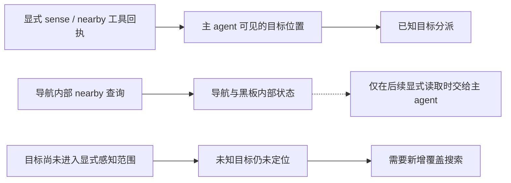

# R2 总进度超时题：未知目标搜索机会核对

2026-10-09。本轮承接[目标知识核对](../r2-aggregate-timeout-knowledge-20261009/REPORT_CN.md)，分析同一场景 `823c15d5` 的三道 30 机、100 固定目标、500 秒总进度题。只重建原 R2 运行中**最后一次公开进度查询之前**的显式感知覆盖；没有新模型调用、额外动作或改动评分。[逐目标数据](rows.json)由[脚本](../../../experiments/analysis/audit_r2_aggregate_search_opportunity.py)复算。感知、目标、障碍和导航相关源码与该运行封存的 `source.zip` 逐字节一致。

## 核对结果

| 题目 | 最后公开进度 | 显式感知样本 | 新增覆盖面积¹ | 最后覆盖率¹ | 题后未达目标中：在显式感知范围外 | 底层查询已见、模型工具回执未定位 | 静态图中与无人机同一自由空间分量² |
| --- | ---: | ---: | ---: | ---: | ---: | ---: | ---: |
| `5e743d21` | 81% | 90 | 25.3 万 m² | 13.4% | 19/19 | 2 | 19/19 |
| `24ac1838` | 88% | 92 | 27.3 万 m² | 12.8% | 11/12 | 0 | 12/12 |
| `7cdefb56` | 93% | 43 | 3.1 万 m² | 7.2% | 6/6 | 0 | 6/6 |

¹ 覆盖面积是无人机在**真实显式感知端点**的 50 米半径圆盘并集；“新增”是首次全机感知之后增加的面积。覆盖率分母是任务开始时公开 30 机 XY 外接矩形向外扩 200 米的**软搜索区域**，不是服务端保证的世界边界或目标分布。三题该区域面积分别约 346、357、347 万 m²。

² 完整题后快照和静态障碍只用于事后几何核对。每个剩余目标中心均不在障碍物内，中心 20 米到达半径内有自由位置；在软搜索区域减去静态障碍后，目标与至少一架无人机处在同一连通自由空间。**这只是拓扑与局部位置筛查**，不能证明具体规划器一定找到路径、电量足够或能在原 500 秒完成。第三题最后公开读数为 93%，题后快照为 94%；`6/6` 针对题后剩余目标。

**主要发现：缺口首先是感知覆盖。**上一轮确认题后未定位的剩余目标分别有 18、11、6 个。本轮发现它们全都在原执行的显式感知圆盘之外；没有发现“已处于显式感知范围却被感知接口漏报”的剩余未定位目标。三题所有题后剩余目标都位于公开初始机群构造的软搜索区域内，且没有被静态障碍局部封死。

首题还有一个**工具信息交接损失**：导航内部的公开 `/drones/{id}/nearby` 请求在最后进度查询前分别看见了最终未达的 `Fixed Target 90`、`Fixed Target 91`，但已完成的模型工具回执没有把这两个目标的位置交给主 agent。`navigate_to` 在遇到障碍时会读取附近实体并更新黑板，返回值却只包含导航结果和障碍 ID；这些目标若没有随后被显式感知或查询，就不会成为主 agent 当时可直接分派的定位候选。补上这类回执有意义，但这两目标也不足以单独补齐首题从 81% 到 96% 的 15 个目标缺口。

## 复算方法与边界

1. 按工具回执完成顺序，使用公开 `list_drones` 初始位置和成功飞行回执的**实际终点**维护每架无人机的位置。仅 `sense_nearby_entities`、`get_nearby_entities` 以及带感知的移动工具返回的目标集合计入“主 agent 可见的显式感知”；普通移动路径不假设连续感知。三题共 225 个端点样本，没有未知终点需要代填。
2. 冻结端点后，才用完整场景目标坐标验证每次应返回的目标集合。按原服务端“目标几何到无人机距离 ≤ 感知半径”的规则，**225/225 个样本的预测目标集合与真实回执完全一致**。这给端点位置重建提供了逐样本校验，而不是用隐藏目标位置反推飞行端点。
3. 冻结覆盖后，才用完整题后快照找出未达目标，计算它们到显式感知边界的距离；用完整障碍快照做局部自由位置和连通性筛查。底层 `/nearby` API 结果单独统计，不混作已交给模型的工具回执。

这些分析只能说明**搜索型改动有明确的机会空间**，不是协调搜索的成功率证据。软区域覆盖率不等于目标发现概率；静态自由空间连通不等于飞行预算可行。现有轨迹也不能把非本地 API 时间全部归于模型推理。

## 下一步单变量试验的入场建议

先构建一个**只用公开状态规划感知端点**的离线候选：输入初始机群、公开障碍与已覆盖圆盘，冻结一个有限端点预算与无人机分配，再用隐藏目标仅事后评价“预计能新发现多少未达目标”和路径局部合法率。不能把题后目标坐标用于选点。若离线候选在三题上仍找不到足够新增目标，暂停在线开发；若有空间，再把可关闭的协调搜索工具加入 R2，保持原 500 秒、同任务序列与原检查，并单独报告感知覆盖、目标发现、模型调用和整题通过率。到达状态刷新及导航内部感知外露应分别做独立消融，避免把多个改动记成一个创新增益。
