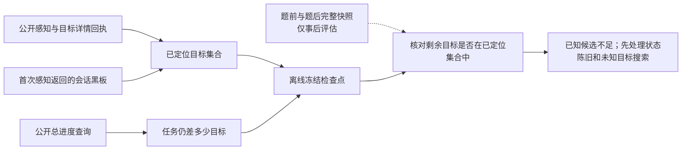

# R2 三道总进度超时题：公开目标知识核对

2026-10-09。核对对象是 R2 fast100 原运行中同一场景 `823c15d5` 的三道 30 机目标分派题，目标均为“总进度 **>95%**”，原动作窗口均为 500 秒。这里只复算封存轨迹，没有新模型调用、重跑题目或改动原评分。[逐检查点数据](rows.json)由[复算脚本](../../../experiments/analysis/audit_r2_aggregate_timeout_knowledge.py)生成。

## 结论

**这三道题不适合作为“已知目标批量分派”工具的首个成功率试验。**三题开始时，公开感知及会话黑板中定位的未完成目标（用题目前场景状态事后核对）分别只有 **7、3、1 个**，而达到 96% 分别还需新增 **32、15、7 个**。最后一次公开进度查询时，已定位目标 ID 分别为 63、72、77 个；对照运行后的完整场景，最终仍未完成的目标中仅 **1/19、1/12、0/6** 出现在这些已定位集合里。其余 18、11、6 个的位置没有出现在本题保存的公开目标定位回执中。

另一个直接观察到的问题是**到达状态陈旧**：首次完整感知返回的黑板中，标记 `is_reached=false`、但在这道题开始前已经到达的目标分别有 **50、57、58 个**。本场景 100 个目标均为固定目标，已观察到的位置可以复用；`is_reached` 却不能当作实时事实。若直接按黑板里的未到达标记批量执行，会把许多已完成目标当成候选；这说明候选生成必须有到达状态的刷新或回执对账。

| 原题 ID | 首次公开定位数 | 其中题前实际未达¹ | 首次黑板误标未达¹ | 最后公开进度 | 距截止时间 | 该时点定位数 | 运行后仍未达：已定位 / 未定位¹ |
| --- | ---: | ---: | ---: | ---: | ---: | ---: | ---: |
| `5e743d21` | 59 | 7 | 50 | 81% | 34.4 s | 63 | 1 / 18 |
| `24ac1838` | 69 | 3 | 57 | 88% | 64.8 s | 72 | 1 / 11 |
| `7cdefb56` | 77 | 1 | 58 | 93% | 45.9 s | 77 | 0 / 6 |

¹ “实际”与“运行后”来自仅供**离线评估**的完整 `.before.json` / `.after.json`；这些真值没有输入给 agent，也没有参与构造已定位目标集合。

第三题在最后公开读数 93% 之后继续执行，原运行后快照为 94%，所以表中 `0/6` 是**运行后剩余目标**与最后一次公开定位集合的交集，不等于宣称在 93% 那一刻已知剩余目标为零。其他两题运行后进度分别仍为 81% 和 88%。三题截止后记录到的动作请求分别为 4、5、14 次，服务端均以 `403 Task action window is closed` 拒绝。

## 如何核对

1. 以原 job 创建时间匹配唯一异常轨迹；三题均为原 500 秒窗口内 `cancelled`。读取 `task_progress.events` 的完成顺序，只从 `sense_nearby_entities`、`get_nearby_entities`、`get_target_info` **成功工具回执**提取目标 ID 和位置。首次 `sense` 的 `blackboard` 会把之前同一场景的记忆显式返回，因此计入这次公开知识集合。出错工具不计；没有目标坐标的飞行回执也不凭名字推造坐标。
2. 从 `get_mission_progress` 真实回执取总数与百分比。按调用顺序与 `/sessions/current` API 请求对应，计算截止前的查询时刻；原 API 轨迹对会话响应做了摘要，因此进度值以工具回执为准。
3. **先冻结每个检查点的可见目标集合，再**用完整题前、题后场景快照评价它覆盖了多少实际未达目标，以及黑板状态是否过期。完整场景没有作为 agent 输入，也没有为未知目标补坐标。

## 对下一步实验的影响

- **批量分派不是这三题的主处理臂。**即使在运行末尾把所有已定位且仍未完成的目标立即分派，单靠它们也不足以把 81/88/94 提到 96。更早执行可能释放搜索时间，但这需要在线对照验证，不能从本审计直接推断收益。
- 先做一个**零模型的状态对账与搜索机会审计**：从公开动作回执和新感知更新目标状态，记录状态来源及观测时刻；再按实际感知位置重建已搜索区域，用隐藏目标位置只在冻结后评价剩余目标是否落在未搜索且可达区域。先区分“未搜索到”与“已覆盖仍未见到 / 局部不可达”。
- 若审计表明剩余目标可由有限新增覆盖发现，再做一个单变量、可关闭的**协调搜索工具**试验：输入公开无人机状态及已知障碍，在原 500 秒预算中分配互不重复的感知路径，返回逐机真实回执和新目标；主 agent 保留任务判断与最终动作。对照原 R2 的同场景同任务序列，报告公开进度、原检查、模型请求数和新增有效感知面积。状态对账应固定为两臂共同的观测规则，或单独先测，避免把两个改动混成一个增益。

本审计不能证明本地 API 之外的时间全部花在模型推理上，也不能证明剩余未知目标都可达。对 500 秒超时的时间分解，仍以[此前六题 API 时间核对](../r3-original-recovery-20261009/REPORT_CN.md)为准。
