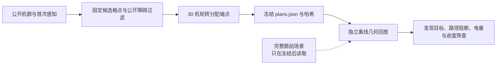

# 公开信息协调搜索：冻结方案与离线回放

2026-10-09。本轮承接[显式感知覆盖核对](../r2-aggregate-search-opportunity-20261009/REPORT_CN.md)，针对同一场景的三道 30 机总进度超时题，先生成一个**只读公开回执**的协调搜索方案，再以独立脚本读取完整场景做事后评估。没有新模型调用、修改原评分或运行在线 agent。公开方案见[plans.json](plans.json)，评估见[evaluation.json](evaluation.json)；两个阶段分别由[生成脚本](../../../experiments/analysis/build_public_aggregate_search_plan.py)和[评估脚本](../../../experiments/analysis/evaluate_public_aggregate_search_plan.py)实现。

## 预先冻结的方案

生成器只读取任务的 `list_drones` 和首次完整 `sense_nearby_entities` 工具回执：公开机群位置、电量、50 米感知半径，以及当时黑板中已观察的 67/78/83 个障碍。搜索区域沿用先前预设的“初始机群 XY 外接矩形向外扩 200 米”，用 70 米方格产生候选感知端点；每轮给每架机选一个对尚未覆盖区域有增益、且从当前计划位置到端点的直线不穿过**公开已知障碍**的候选。固定每机最多 16 个端点，预先查看 4、8、16 轮三个预算前缀。规划器没有读取 `.before.json`、`.after.json`、完整场景文件、隐藏目标位置或原检查结果。

三题生成的端点数分别为 **427、436、412**。方案在事后评估前冻结，SHA-256 为 `8ab8cd3f7bc381b67d8edd54ccd860eafb6090d635a29991036d9239f80e0d45`；评估脚本若发现哈希变化会拒绝运行。规划参数没有根据本轮隐藏目标结果回调调整。

## 结果：开环搜索不足以支撑在线收益声明

评估从每道题**原本的题前状态独立开始**，模拟先起飞、再沿冻结直线端点移动；使用封存版本的服务端碰撞、耗电、感知及沿途目标到达规则。某机首个端点或路径被完整障碍图挡住后，该机剩余静态方案不再执行。没有自动绕障、重新分派或模型等待；这是离线几何回放，**不是实际服务端执行或 500 秒限时试验**。

| 题目 | 原题起点 | 16 轮计划 / 几何接受端点 | 首次阻断无人机 | 新发现题前未达目标 | 几何回放进度 | 原 R2 题后进度 |
| --- | ---: | ---: | ---: | ---: | ---: | ---: |
| `5e743d21` | 64% | 427 / 181 | 23/30 | 12 | 78% | 81% |
| `24ac1838` | 81% | 436 / 256 | 19/30 | 5 | 87% | 88% |
| `7cdefb56` | 89% | 412 / 237 | 20/30 | 8 | 97% | 94% |

三题首个阻断分别为 23、19、20 架机，**全部由首次感知时尚未见过的障碍触发**，不是已公开障碍过滤遗漏；没有无人机因模拟电量不足首先停机。只计较早的 8 轮，第三题几何回放到 **95%**；16 轮为 **97%**。但该回放不模拟工具调用、提供方等待或 500 秒截止，不能报告为 benchmark 通过。前两题的几何回放还低于原 R2 运行结果，故现有“开环格点批量移动”不能作为已证实的改进。

作为机会**上界**，若忽略所有新增障碍、假定每个规划端点都可到达，16 轮可额外发现题前未达且首次黑板未知的目标分别为 **29、15、10 个**；把实际障碍计入后，仅为 **12、5、8 个**。这说明候选区域本身有目标覆盖潜力，主要损失发生在执行反馈之后没有重规划。上界只是发现数，不等同于到达数或成功率。

## 一个需要显式报告的阈值差异

三道原任务文字写“进度 **超过 95%**”，但原隐藏检查均为 `/check/task_progress?expected_progress=0.95`，其服务端判定为**大于等于 95%**。本轮评估同时记录两种阈值：第三题 8 轮的 95% 达到原检查阈值，但不满足题面严格“大于”；16 轮的 97% 两者都满足。论文中的成功率应始终用**原检查**，任务理解讨论则明确这个文字与检查的差异。

## 决策与下一步

**暂不把这份静态方案接入 R2 作为在线试验臂。**它没有解决最主要的执行失败：感知后遇到新障碍，计划需要重新定位、重选端点并继续搜索。下一项应只改变这一机制，在同一个已冻结的公开格点与端点预算上，离线模拟“动作失败 → 读取公开障碍回执 → 局部重规划/改派 → 继续感知”的闭环执行，并记录每次额外公开信息的来源。其后先在隔离服务端副本中实际回放，核对回执、耗时和原检查；只有稳定跨过阈值且保持原 500 秒预算，才进入同模型、同任务序列的 R2 在线单变量对照。

三题属于**同一原场景的连续任务**，本轮却分别从各自的原题前状态做独立回放。因此表格不能合成一个新的连续场景成绩，也不能解释为与 R2 配对的成功率增益。
