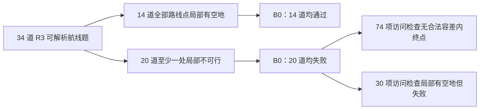

# R3 场景不重合航线题：可行性筛查与下一步判断

2026-10-09。**结论：当前这批题不提供一个干净的“R3 单独救回整题”在线候选。**在与 R2 开发场景不重合的 70 个场景、1,400 题中，R3 严格语法只识别 **26 场景的 34 道航线题**。其中 **14 道**所有路线点和落地区在指定高度下都有局部合法位置，旧 B0 运行全部通过；其余 **20 道**至少有一个路线点或落地区局部不可行，旧 B0 运行全部失败。这个对应关系是诊断证据，不是 R2/R3 的反事实效果。

## 筛查口径

先沿用[预先确定的 34 题语法队列](../r3-next-step-20261009/disjoint-opportunity.json)，不按 B0 得分增删；逐题读取原命令、原检查定义和该题执行前的场景障碍。服务端碰撞模型、检查器和生成器源码与 B0 冻结包逐字节一致。所有 34 题的 `is_distance_3d=false`，访问检查按 XY 距离计算，容差均为 **3 米**。对每项检查，用障碍几何判断整个 3 米圆盘是否被禁止区域覆盖；“有局部空地”**只说明存在合法终点，不证明无人机有可达路径、足够电量或执行时间**。

每个显式路线点按原文指定高度单独判定。检查器允许在不同高度取得 XY 访问分，但任务要求在指定高度飞行，因此另报“升至无人机最高允许高度后仍被阻断”的结果，不把改变高度所得分数等同完成原任务。终点再按落地高度 `z=0` 判定。18 个路线起点没有独立访问检查，统一用 3 米范围作**仅供诊断**的几何判定。只有全部路线点与落地区均有局部空地，才标作“局部几何干净”；这仍不是整条航线可飞证明。完整逐点记录见[screen.json](screen.json)，复算见[脚本](../../../experiments/analysis/audit_r3_disjoint_feasibility.py)。

## 全量结果

| 场景家族 | R3 识别题 | 局部几何干净 | 有阻断的题 | 被阻断的访问检查 | B0 失败题 |
|---|---:|---:|---:|---:|---:|
| 区域分配与巡逻 | 6 | 5 | 1 | 1 | 1 |
| 区域搜索 | 5 | 4 | 1 | 1 | 1 |
| 目标分配 | 23 | 5 | 18 | 72 | 18 |
| **合计** | **34** | **14** | **20** | **74/796** | **20** |

796 项原访问检查中，**74 项的整个 3 米容差区域在原任务高度没有合法目的地**；即使升至对应无人机的最高允许高度，数量仍为 74。直接覆盖这些点的障碍高度均为 **0**，按服务端规则在所有高度不可进入。这 74 项在 B0 均失败，**没有一项“几何判定不可行、B0 却通过”的矛盾**。另有 **2/74 项终点位置检查**在地面高度的整个 3 米范围内被障碍覆盖，均出自任务 `79b207ff/118d85eb`；还有 1 个未单独评分的起点被阻断。官方任务与检查器没有修改，所有 34 题和 796 项访问检查都保留在分母中。

B0 共失败 **104 项访问检查**，其中上述 **74 项被阻断**；剩余 **30 项局部有空地**。其中 **27 项位于同一架无人机首个局部不可行路线点之后**，仅靠提醒首个缺口无法令完整顺序路线通过。另 **3 项**在本机路线中没有此前的局部阻断，但其所在任务的另一架无人机仍有不可行点：

| 场景 / 题目 | 无人机与失败点 | 截至题末的场景路径历史最近点 | 本题 B0 动作证据 |
|---|---|---:|---|
| `58fe4605/d05e138b` | Drone 5，第 7 点 `(195,549,20)` | 7.0 米 | 没有请求进入 3 米范围。 |
| `dcae50c1/8424974a` | Drone 1，第 6 点 `(178,483,29)` | 5.39 米 | 没有请求进入 3 米范围。 |
| `1a9c1abc/4092e0a1` | Drone 6，第 4 点 `(173,279,23)` | 5.0 米 | 曾在 `move_along_path` 请求精确点，但该次路径在第 1 段被 Polygon Obstacle 4 阻断。 |

这三项是**局部检查或导航诊断样本**，并非整题成功率候选；按原检查的 AND 逻辑，另一条路线的不可行点仍会让整题失败。B0 是旧基线，不能以它的失败推断 R2 必失败，更不能推断 R3 能救回。两道被筛到的 B0 任务 `job.status=cancelled`，也提醒不能将全部局部有空地的失败直接解释为记忆缺陷。

## 生成链路发现

冻结版本的[航线模板](../../../controller/default_templates.py)通过带范围的随机坐标占位符生成路线，内容与评分检查复用同名随机值。[占位符实现](../../../controller/template_placeholders.py)中，`generate_coordinated_position` 尝试调用 `check_collision` 避障，但后者**没有直接使用传入的障碍列表**，而是查询当前在线 API；若 API 无响应或抛错，它返回 `False`，即“无碰撞”。用一个中心恰在高度 0 圆形障碍内的模拟点、让 API 返回空值，冻结代码也返回了 `False`；步骤及边界见[可复现探针](generator-probe.json)和[探针脚本](../../../experiments/analysis/probe_route_generation_collision.py)。这证明生成器存在**失效时放行**的代码路径；**尚不能证明**历史 74 项具体都由 API 无响应造成，也不排除其他生成时序或几何问题。

## 研究决策

1. **暂停 R3 单独的第二场景在线扩展。**按事先设定的“可行漏点产生实际补点并改善原检查”门槛，第一场景未达标；这 34 题中又没有“全部路线点局部合法且 B0 曾漏访问点”的候选。继续挑这些历史失败题做整题通过率试验，会把不可行检查与 agent 改进混在一起。
2. **先审基准任务有效性，再构造新的验证集。**原 benchmark 分数仍完整报告；另行对路线模板建立生成后验证：检查每个目标的容差区域、指定高度、终点落地位置和连续路径，失败则重采样或标记实例，不在旧评测结果上事后删除题目。可行性标准与生成过程先冻结，再创建未参与 R3 开发的新场景；保留单独的盲测集。
3. **决定下一种方法的目标指标。**若仍研究 R3，先在局部合法但历史漏点的诊断样本上检验“反馈是否补得一项原检查”，明确只是叶检查机制，不宣称整题成功。若目标是整题通过率，优先寻找或生成全部任务目标可行、仍有 R2 漏点的场景，并从同一题前世界与 blackboard 快照做 R2/R3 配对。若目标转向超时与稳健性，可研究在**公开观测**下识别阻断、停止无效重试和把预算转给其余义务；离线使用的完整障碍快照不能直接喂给 agent。

当前结论的范围是 R3 严格语法识别的 34 道场景不重合任务，不代表全部 1,400 题或全部无人机任务。几何“局部有空地”不等于路径、能耗、时间都可行；观测到的 B0 对应关系也不构成 R3 性能估计。
