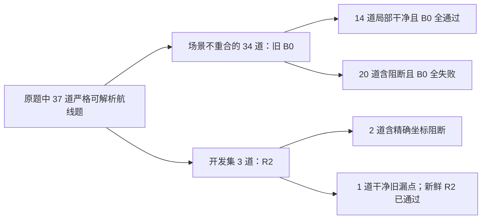

# 原始失败复筛：R3 是否仍有机会，下一项先测什么

2026-10-09。**决策：暂停 R3-only 航线成功率扩展，下一项先研究减少连续模型决策回合的超时机制。**本轮只读取封存的 B0/R2 运行、任务前状态、原检查和工具回执；没有新模型调用、改动原评分或重跑失败题。可复算数据分别见[开发集航线几何](r2-route-geometry.json)、[终止声明](r2-terminal-claims.json)、[超时本地 API 时间](r2-timeout-local-api.json)。

## 1. 原题还有“合法漏点，R3 能救回”的样本吗

与 R2 开发场景不重合的 1,400 题已在[先前全量筛查](../r3-disjoint-feasibility-20261009/REPORT_CN.md)中检查：R3 严格语法识别 34 道，14 道所有路线点局部有合法位置且旧 B0 全通过；20 道有局部阻断且旧 B0 全失败。这不是完整路径可达性证明，也不是 R2/R3 反事实。

本次补齐 R2 fast100 中**全部 3 道**同一严格语法可识别的航线题。脚本先逐字节核对 R2 冻结服务端的障碍和检查源码，再按任务前障碍，对每个指定坐标及落地位置用原碰撞规则判定“精确点是否合法”，对原访问检查另计算 3 米容差圆盘中是否有局部合法位置。结果如下：

| R2 题目 | 原检查 | 精确航点阻断 | 容差内也无合法位置 | 落地点阻断 | 结论 |
| --- | ---: | ---: | ---: | ---: | --- |
| `823c15d5/08332988` | 37/39 | 2 | 2 | 1 | 两个漏点含阻断终点；提示原坐标不能完成原任务 |
| `35ce64d8/f777f4e3` | 20/26 | 6 | 4 | 0 | 至少 4 项原访问检查没有合法容差内目的地 |
| `35ce64d8/cf8ee51f` | 38/39 | **0** | **0** | 0 | 唯一局部几何干净的 R2 漏点题 |

最后一题确有旧 R2 跳过第 11 个航点的轨迹，因此仍是有价值的**机制案例**。但在后来的新鲜 R2/R3 前缀配对中，R2 自己已得到 **39/39**，R3 也是 39/39；在本轮独立生成且服务端试飞通过的两道新题中，R2 也都是 **26/26**。这些复现说明当前没有一个已观察到的、稳定的 R2 可执行漏点失败可供 R3 救回。它们**不能证明** R3 对所有路线语言或所有未来场景无效；本结论只覆盖上述严格语法队列和已保存运行。旧 benchmark 失败及分母全部保留。

## 2. “agent 成功、外判失败”主要是验证误判吗

R2 fast100 的 21 道失败里，6 道在 500 秒动作窗口超时；其余 15 道 job 为 `completed`、runtime `success=true`，但原检查失败。固定 R2 源码只要求输出非空且含 `[TASK DONE]`，随后返回 `success=true`，**没有执行确定性的整题完成验证**。所以 runtime success 不是外判成功的代理变量。

对 15 个原始末尾回答逐一读取并用短语回查原文：**13 个明确承认目标未找到、坐标被障碍阻断或任务有偏差**，但仍输出 `[TASK DONE]`；1 个三机覆盖案例宣称覆盖完成，任务文本与“每个指定无人机到达 Waypoint”的隐藏检查存在语义分歧；只有 1 个长航线 `cf8ee51f` 明确说所有坐标均已到达，而原检查与动作证据仍有一项漏点。逐案分类、输出哈希及支持片段见[终止声明账本](r2-terminal-claims.json)。

因此可做一个小型**终止状态语义修正**：区分 `completed / partial / unknown / constraint_conflict`，不要把“停止并如实报告未完成”记作“验证通过”。但这主要提高声明可靠性，不会自动找到未知目标或穿过障碍；不能拿 15 个 runtime/外判不一致直接宣传 verifier 可救回 15 题。`cf8ee51f` 是清晰的遗漏检测案例，但新鲜 R2 已通过，仍缺在线成功率对照机会。

## 3. 六道超时的时间真正用在哪里

从每题原 500 秒窗口及匹配的异常轨迹，计算窗口内 agent→本地服务端 HTTP 请求的时间。即使**把所有本地 API 请求时长简单相加**（重叠请求会重复计时），六题最大也只有 **32.939 秒**；按时间区间合并后的本地 API 占用为 **0.619–9.507 秒**。六题异常轨迹分别记录 19–55 次 wire 模型请求（计数含完整轨迹，不保证每次都在 500 秒内）。因此本地飞行/查询 API 的响应时间不是这六次超时的主要墙钟占用；其余时间包含模型提供方等待、agent 本地构造/调度及请求间隔，现有记录不能再可靠拆分。

其中 3 道“场景目标总进度 >95%”题在最后一次公开进度读数分别为 **81%、88%、93%**，均已出动 30 架无人机；每题保存了数百次工具调用。另 3 道分别是长航线、目标搜索和单机未知目标任务，不能用一个加速技巧概括。单纯加入“高速移动”也缺乏本平台时间依据：服务端动作直接更新模拟状态，当前测到的本地 API 时长很短。把 500 秒改 600 秒会改变评测预算，不能充当同预算 harness 增益。

## 下一项单变量试验的入场条件

优先针对 3 道 30 机总进度超时题，研究**减少连续 LLM 决策回合**，而不是再加一个 LLM 观察工人。先做一轮零模型机会审计：在各题公开 `get_mission_progress` 和目标/无人机观测的时间线上，区分“剩余目标已由公开回执定位，但仍需大量逐机分派”与“剩余目标根本未知”；统计可由确定性工具安全批量执行的独立动作、现有重复决策回合及可用预算。若主要缺的是未定位目标，批量执行工具不能解决，应转向覆盖搜索而不是加速执行。

只有离线证明确有公开可行动的批量机会，再增加**一个可关闭的确定性批量执行工具**作为 R2 的单独处理臂：输入由主 agent 给出的已知 actor–目标计划，工具检查 ID、公开位置、电量与碰撞，在 500 秒原窗口内执行并返回逐项真实回执；不读取隐藏检查或完整目标真值。对照保持同模型、原场景任务序列和原评分，先在候选题及匹配成功控制上检查“节省了多少模型回合、原通过是否保住、是否引入新碰撞/错 actor”，之后才谈整题收益。观察工人、R3、额外 100 秒和 verifier 改动都不混入此臂。

这个方向目前仍是**待验证假设**：本轮证明了时间瓶颈不在本地 API，却没有证明确定性批量执行一定能提高 >95% 进度或完整通过率。下一步先审公开可行动信息，避免写完工具才发现需要的是探索未知目标。

## 复算入口

- [R2 三道路线几何脚本](../../../experiments/analysis/audit_r2_route_recovery_candidates.py)，输入为冻结 R2 first run 与完整三题离线探针。
- [15 道完成声明脚本](../../../experiments/analysis/audit_r2_terminal_claims.py)，源于同一冻结运行和 R2 固定提交。
- [六道超时本地 API 时间脚本](../../../experiments/analysis/audit_r2_timeout_local_api.py)，按原动作截止过滤请求，保留超时后被拒请求计数。
- [独立新路线配对结果](../../results/r3-valid-route-20261009/REPORT_CN.md)与[原前缀 R2/R3 结果](../../results/m1r3-route-prefix-20261009/REPORT_CN.md)。
