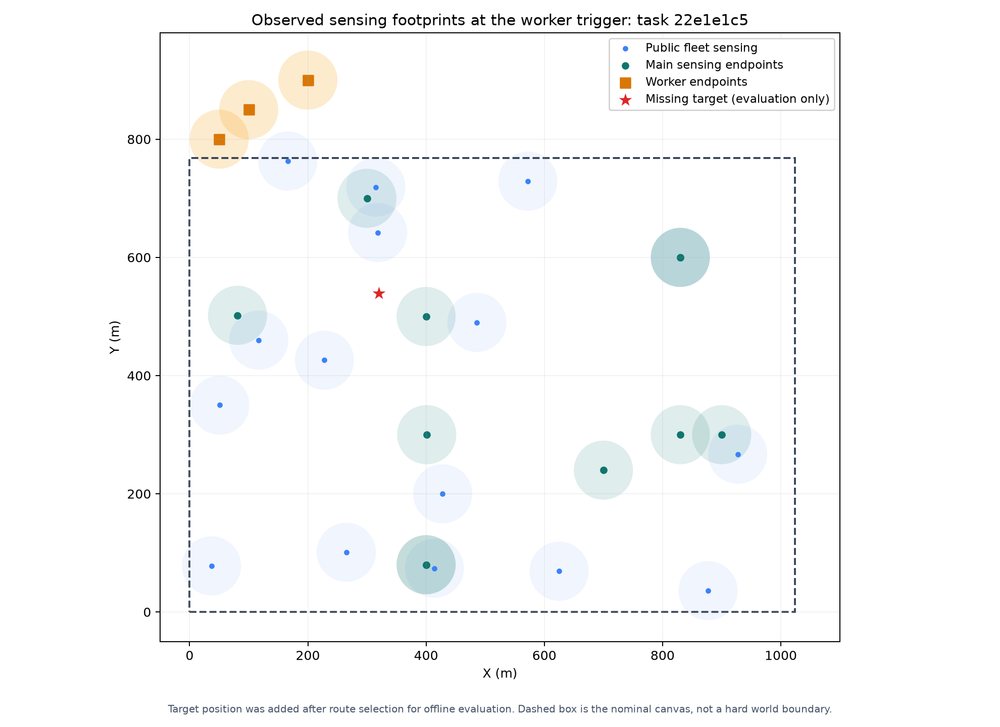

# 未知目标搜索：公开范围与实际感知覆盖审计

2026-10-09。**结论：现有证据不足以支持再给观察工人增加“三点盲搜”或单纯放宽触发阈值。**在旧 R2 的六道目标未定位失败题中，任务文本没有可直接采用的目标坐标；现有公开信息能构造一个经验性的搜索范围，但范围很大，且不能保证包含所有目标。四道有历史停滞触发点的题，在触发前最后几次已完成的感知移动仍带来新的覆盖，所以“目标证据没有增加”和“空间覆盖没有增加”是两个不同问题。这是**冻结轨迹的离线审计**，没有新增在线得分。

复算材料：[搜索范围数据](audit.json)、[公开感知覆盖数据](coverage.json)、[搜索范围脚本](../../../experiments/analysis/audit_unknown_target_search_space.py)、[覆盖脚本](../../../experiments/analysis/audit_public_sensing_coverage.py)。上一步[观察工人试验](../../results/m1r2-observation-worker-prefix-20261009/REPORT_CN.md)两组均为 11/12 题、42/44 检查、0 超时；唯一在线触发的工人未找到目标，额外模型调用耗时 41.866 秒。

## 研究问题与信息边界

本审计先只用任务原文、`list_drones` 的公开坐标与感知半径、实际工具回执，重建候选搜索范围及已经感知的端点。目标真实位置与完整场景快照**只在搜索范围和覆盖范围冻结之后**用于评估包含率及距离；绝不进入候选选点。六道题来自已经识别的 R2 开发轨迹失败集，是解释性样本，不代表总体失败率。

公开机群初始坐标的最小包围矩形向四周扩 200 米，是现版观察工人已经使用的 `_valid_plan` 边界规则；坐标下界按其规则截到 0。它在下文称为**软搜索范围**：可以限制异常远的提议，但不是任务给出的目标位置先验，更不是环境的物理边界。标称 1024×768 画布也不是可靠硬边界。

## 搜索范围到底有多大

六题共有 **8 项未定位的访问义务**：7 项 `unknown`，1 项 `reported_only`；任务原文中 **0 项显式坐标元组**。事后快照显示 **5/8** 项目标在标称画布外，故直接把画布作为硬搜索边界会排除真实目标。8 项都在上述机群软范围内，但这不能证明软范围永远正确：剔除 R2 开发场景后的 B0 **70 个不同场景、1067 个目标**里，仍有 **7 个目标、分布在 7 个场景**落在机群软范围之外。B0 与 R2 的策略和轨迹不同；这里仅检验初始公共状态构造的范围，不把 B0 成绩当成 R2 效果。

六道失败题的软范围约为 **1.09–3.72 平方公里**。这批无人机最大感知半径为 **50 米**。即使假定一次感知能无重叠地贡献一个完整半径 50 米圆盘，想覆盖整个软范围，面积上的**必要条件**也要至少 **139–474 个感知端点**；三个端点理论上至多覆盖范围面积的 **0.63%–2.17%**。该面积下界只说明“三点不能保证扫遍这个范围”，**不是**找到目标所需动作数的估计，也**不是**发现概率或耗时下界；如果未来得到可靠的目标先验，少量定点观察仍可能有效。场景不重合的 70 个 B0 软范围的对应面积必要条件中位数为 **135.5 个端点**（最小 50、最大 485）。

| R2 失败题 | 未定位目标数 | 软范围面积 km² | 全范围端点数必要下界 | 三端点面积占比上界 |
|---|---:|---:|---:|---:|
| `529c0622` | 2 | 3.72 | 474 | 0.63% |
| `ce97a68d` | 1 | 3.60 | 459 | 0.66% |
| `13a30905` | 1 | 3.60 | 459 | 0.66% |
| `c6e28e3b` | 2 | 3.48 | 443 | 0.68% |
| `9e46da10` | 1 | 3.48 | 443 | 0.68% |
| `22e1e1c5` | 1 | 1.09 | 139 | 2.17% |

按服务端使用的目标几何体而非仅按中心计算，全部 8 项缺失目标与最近初始公开无人机的二维距离为 **73.3–411.2 米**，仍超过各机的 50 米感知半径；事后几何检查的“原地可感知”计数为 **0/8**。因此在这六题的初始状态，单纯再次让全部无人机原地感知也不能直接发现这些目标；后续移动、既有线索或外部指定区域才可能改变这一点。固定点目标的二维距离是三维场景中的乐观下界。

## 实际感知有没有停滞

按 R2 真实工具回执重建端点感知圆：`sense_nearby_entities` 用回执列明的无人机；移动后感知工具只在回执能确认实际终点时计入，不能确认的终点不拿请求坐标代替；沿飞行路径不虚构连续感知。六题的此类未知终点跳过数均为 **0**。感知圆与软搜索范围相交后求并集，重复观察只计一次。对旧停滞规则，优先读取每题的 `k=8` 触发点；若无则读取 `k=5`、`k=3`，否则用任务终点。**k=3 是离线放宽阈值的假设触发，现版 k=8 只有两道旧失败题触发；**后两道“任务终点”也不是工人实际可介入的触发点。

| R2 失败题 | 分析时点 | 已覆盖软范围 | 最近至多三次**完成**的感知移动新增面积 m² | 缺失目标距最近感知范围的事后二维最小间隙 m |
|---|---|---:|---|---|
| `529c0622` | k=8 触发 | 1.79% | 7841、7841、7841 | 目标 7：189.7；目标 6：100.6 |
| `ce97a68d` | k=3 触发 | 7.20% | 7841、7841、7841 | 目标 59：230.2 |
| `13a30905` | 任务终点，无触发 | 7.25% | 7841、7106 | 目标 75：144.0 |
| `c6e28e3b` | 任务终点，无触发 | 7.30% | 2085 | 目标 59：315.7；目标 55：100.8 |
| `9e46da10` | k=3 触发 | 6.96% | 7435、5682、7841 | 目标 97：361.2 |
| `22e1e1c5` | k=8 触发 | 15.94% | 3259、7841、7825 | 目标 9：53.0 |

四道有触发点的题，最近三次已完成感知移动的边际面积均大于零，而且多数接近一个完整 50 米圆盘的 **7854 平方米**。未定位目标还远离已感知范围，但主 agent 当时正在探索新区域。由此，若新增“覆盖增量很低才触发工人”的门槛，**这些历史触发点反而大概率不会触发**；它不能被先验宣称为更好的救援策略。表中的间隙是事后诊断值，不是运行时可用的距离。覆盖率依赖宽大的软范围，不能读成环境的真实已探索比例。

下图展示唯一曾在线触发工人的 `22e1e1c5`：蓝色是公开机群感知，绿色是主 agent 到触发点的端点感知，橙色是工人后来选择的三点，红色目标仅用于事后评估。标称画布用虚线表示，并非强制搜索边界。

## 对下一步设计和实验的约束

1. **先做公开证据账本，再谈覆盖触发。**可将每条实际感知回执记录为“无人机、真实位置、半径、时间、已见目标、未见目标”，并在选点时只使用这些公开数据。这是测量基础，不是已经验证有效的论文创新；移动目标、过期观察和未知终点须保留不确定性，不能据旧的负观察排除目标。
2. **没有可信任务区域或目标先验时，工人应允许弃权。**软机群范围缺少完备性，三点面积覆盖极小；把未发现目标直接交给第二个 LLM 猜位置，目前只有额外开销、无在线增益证据。已有历史感知线索的单点核验在另一旧个案中通过离线机制检查，但[机会审计](../observation-worker-next-step-20261009/REPORT_CN.md)未找到它可解释的失败检查，因此也不应直接扩成在线主实验。
3. **新搜索策略先过离线门槛。**若将来提供任务有效搜索区、可复核的目标先验，或实现固定调用/移动/时间预算的公开数据选点器，应先冻结规则，在场景不重合的轨迹上比较“新增目标定位数、实际新增感知面积、受阻率和额外时间”；目标真值只用于最终评分。未显示优于 R2 同预算轨迹之前，不启动昂贵的 100 题在线工人对照，也不声称多 agent 提速。
4. **近期单变量实验应转向已有更直接的流程故障。**[前序 R2 机会审计](../m1r2-action-opportunities-20261009/REPORT_CN.md)已经在真实回执里识别到“明确中间航点被跳过”的路线义务；[R3 离线回放](../../results/m1-revision3-offline-20261008/REPORT_CN.md)验证了监视器能识别该缺口，但还没有在线收益。下一次新鲜配对应保持工人关闭、500 秒规则不变，只启用 R3 路线监视器。该方向仍是待测假设，不能把本覆盖审计当作它的效果证据。

**限制。**这是对六道已失败 R2 题的事后解释，样本经结果筛选；四个历史触发点也不能保证新鲜运行会重现。面积必要下界忽略障碍、重叠、飞行时间、目标分布与可能的先验；只描述端点感知，不代表飞行路径上的访问检查。软范围在场景不重合数据中确有漏目标。图中的隐藏目标标记及表中的目标间隙均为评估信息，绝不能混入可执行选点器。此前 12 题新鲜在线配对中两道旧失败候选的对照组已经通过，因此旧轨迹的“可救回题”不能转写成新方法的真实增益。
