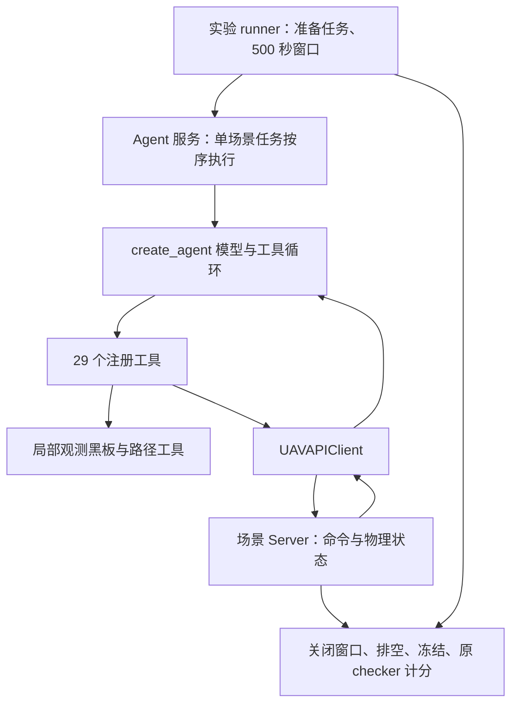

# B0 原版执行架构与导航缺陷的因果复核

日期：2026-10-06。本文件只还原 B0 并核对首次执行证据，不设计、修改或运行新版 Agent。

**B0 确实有导航接口缺陷，但“轨迹出现缺陷”不等于“任务由该缺陷导致失败”。** 首次 DeepSeek 的 748 个成功任务也出现了“导航 success=false、实际剩余距离为 0”的矛盾。部分模型明确识别了这层误报并继续执行；一些失败则来自距离语义误解、临界值取整或不可达任务要求。此前把这类矛盾主要当作失败机制线索，有必要补上成功样本与因果边界。

## 1. 本次取证范围

源码为 [20261003 原始 source.zip](./experiments/runs/20261003-143255-full-5c501118/source.zip)，执行版本 `1794e45e421fb5de03094f0b63f9ca95f86ab42f`。本次重新比对 `uav_agent.py`、`uav_langchain_tools.py`、`uav_api_client.py`、`blackboard.py`、`template/system_prompt.py` 的归档字节与该 Git 版本，五个文件全部一致。

任务账本使用 [baseline-deployment/tasks.json](./docs/results/baseline-deployment-20261005/tasks.json) 中 `model=deepseek`、`cohort=first_attempt_no_replay`、`generation=1` 的固定 1500 条。**没有直接采用 run 根目录最终 results.json，也没有采用旧 failure-analysis 的最终收束任务集合**：例如 `ae503ad1` 在首轮第 4 题中断，最终收束记录却可能指向 `retries/0002`。本文件只使用第一次执行路径，不包含 Qwen 或任何第二代重放。

1500 条中：1243 条有效成功、203 条可观察任务失败、37 条终止性 provider 错误、17 条未评分（1 条中断、16 条未运行）。后三类不混称为“模型任务能力失败”。导航统计来自 1483 个已计分任务的工具轨迹；17 条仍在固定分母及审计账本中，但没有伪造其导航行为。

逐题按场景目录、完全相同的 `job.command` 和最近的 `trace.started_at` 对应，要求距 `job.created_at` 小于 10 秒。1480 份轨迹与 74 个首次场景 `complete.json` 的 SHA-256 一致；未封存的首轮 `ae503ad1` 中另有 3 份已评分轨迹，只记录输入哈希，不称为已封存。分类、逐题计数、六个案例原始步骤、源码校验和及输入哈希见 [tool-audit.json](./docs/results/b0-failure-reassessment-20261006/tool-audit.json)。

下文源码行号均为上述 B0 归档内行号，不是当前工作区行号。

## 2. B0 实际已有一套执行框架

B0 并非“把指令直接丢给模型、没有 harness”。它由模型工具循环、复合工具、会话黑板、Agent 服务和独立实验调度组成；只是没有后来那套正式 TaskContract、逐条件状态机和局部修复准入机制。

| 层次 | B0 的真实实现 | 能做与不能保证的事 |
|---|---|---|
| 模型循环 | `uav_agent.py:507–512` 调用 LangChain `create_agent(model, tools, system_prompt)`；每道指令重建运行时，模型根据工具回执继续选择工具。 | 是具有反馈的工具调用循环；没有独立代码证明原指令全部满足。模型一轮可提出多次工具调用，不能将其描述为固定单动作串行规划器。 |
| 终止 | `max_iterations=150`，递归上限 450；有 step callback 时按流更新统计步骤（`:686–738,924–935`）。`_incomplete_output_reason`（`:833–838`）检查非空且包含 `[TASK DONE]`。 | 输出标记通过不代表外部 checker 通过；空终答允许最多 2 次恢复调用。步骤统计发生在流更新之后，150 不是每个底层 API 的硬预算。 |
| 工具 | `uav_langchain_tools.py:1474–1504` 返回 29 个工具；提供原子动作、动作后感知、导航、覆盖路径与黑板注记。 | 有一定确定性自动化；模型仍可根据错误回执改用其他工具、观察、手动绕路。 |
| API | `uav_api_client.py:154–204` 负责 HTTP、JSON、响应整理和记录。 | HTTP 成功与命令 `status=error` 可并存；传输成功不能当作无人机动作完成。B0 未统一所有工具使用的命令 outcome。 |
| Memory | `blackboard.py:149–198` 按实体 ID 收集局部感知 facts；再次观测覆盖 facts，note/priority 另存。`uav_agent.py:494–502` 控制是否按 session 保留黑板，本实验启用。 | 能保留已见目标/障碍物与人工式任务注记；不是经过条件证明的当前世界状态，也没有后来逐字段 freshness/修复义务系统。 |
| 实验 runner | 每个场景独立 Server+Agent 服务和端口，最多 8 场并发；每场原序执行。 | 并发隔离在场景层，不是 1500 题分别从同一个干净初态开始。 |

每道题之前，runner 的 `prepare_task`（`scripts/reproduction.py:467–487`）会 set-current、全部降落、充满电，验证 XY 没有被准备阶段改变，z=0、idle、电量 100。场景只在开场导入一次，因此前题的位置、目标到访及会话黑板等状态可能保留；不能将连续任务当作独立随机样本。

`reproduction_lifecycle.py` 限制每个 Agent 服务同一时间一个任务，并绑定任务 lease；超时后 Server 拒绝越过窗口或携带旧 lease 的请求。`reproduction_parallel.py:307–335` 排空后冻结模拟世界，再执行原始 checker；确认 worker 退出后才进入下一题。**这些是实验执行与取证保障，不是模型自己会检验任务成功。**

## 3. 可观察性必须分三层讨论

不能把“未注册为模型工具”误写成“服务器权限绝对禁止”。

| 信息 | Server 对 AGENT 的权限 | API Client 与注册工具的区别 |
|---|---|---|
| 当前会话元数据 | `/sessions/current` 允许 AGENT，但强制 metadata-only（`server/api/server.py:3194–3247`）。 | client 有 `get_current_session`；工具函数 `get_session_info` 在 `uav_langchain_tools.py:495` 已定义，却不在末尾 29 项返回列表。构造/执行代码可能自行读元数据，LLM 不能据此被视为拥有同名可调用工具。 |
| 当前会话任务进度 | `/sessions/current/task-progress` 明确 `require_agent`（`:4084–4106`）。特定会话 `/sessions/{id}/task-progress` 则 require_system。 | client `get_task_progress(session_id='current')` 已存在（`uav_api_client.py:365–367`），但未注册为 LLM 工具。原版提示要求了解任务，实际工具集合没有直接的全局进度查询入口。 |
| 目标与障碍物 | 全局列表 require_user（`:2362,2819`）；已知 ID 的详情 require_agent（`:2488,2893`），附近感知亦可用。 | LLM 有附近感知和详情工具，可通过合法感知获得 ID；没有全局目标/障碍列表工具。这是局部可见加已知对象查询。 |
| checker | 例如 `/check/drone_position` require_admin（`:4920–4927`）；但 `/check/task/{task_id}` 的布尔检查允许 AGENT（`:6005–6009`）。 | 当前 29 项列表没有 checker 工具。不能笼统声称所有 `/check` 端点在权限上都禁止，也不能因此声称原 LLM 正在使用隐藏评分。实验评分走 runner 的管理端权限。 |

提示与注册表还有一项直接不一致：系统提示 `template/system_prompt.py:16` 要求“先检查当前 session”，相应 `get_session_info` 没有被注册。这是可核实的接口欠缺，但单凭欠缺不能计作某题失败的已证原因。将已有公开进度接入模型属于改变可用工具集合；是否提高通过率仍需另行验证，不能说要先“新增服务器公开接口”。

## 4. 三个导航问题：代码结论与轨迹结论分别是什么

### 4.1 `status` 与 `success` 没有对齐：确定的接口 bug

`_navigate_to_destination` 在 `uav_langchain_tools.py:378–401` 实际移动后，只在 `direct_result.get('success') is True` 时进入成功分支；真实服务回执通常为 `status='success'`，并无这个布尔键。它随后返回 `success=false`，即使状态查询已显示到达。这解释了同一个回执里“未到达”与 `distance_remaining=0` 的矛盾。

反方向也存在：`_move_result_indicates_failure`（`:110–113`）只接受 `success is False`。真实服务 `status='error'` 没有 success 键时，不会进入 `:403` 开始的自动感知/规划/路径回退。这不是单纯文案错误，会将自动恢复责任重新交给模型。

### 4.2 实际只判 XY，漏掉目标高度：确定 bug，有实际成功样本反例

`:365–380` 用 `_distance_xy`；当前 XY 已匹配时提前返回 `already_at_destination`，忽略请求 z。`_position_z`（`:37–42`）还会把缺失/无效高度退回 0。前者在首次轨迹中有实证；后者这里只确认代码风险，没有将“缺 z 默认 0”统计成已发生失败。

### 4.3 提示宣称持续重规划，代码只有一次回退，而且回退入口失配

原系统提示 `template/system_prompt.py:39` 宣称导航会分批规划、遇到 partial 或新障碍再规划；工具自身 docstring（`uav_langchain_tools.py:1183–1184`）和实现只承诺一次直接移动后的一次 fallback。本批 6476 次导航调用中，**6412 次 movement_strategy=move_to，64 次 already_at_destination，0 次 planned_fallback**。这与缺少 status/success 对齐的代码路径一致。

“回退没发生”不意味着每次都本可自动成功：2318 次 `status=error` 直移中，2019 次路径被挡、243 次目标位置与障碍冲突、55 次当前飞行状态不允许移动、1 次电量不足。目标就在障碍内部、未起飞、电量不足都不能靠机械地追加路径规划解决；即便路径被挡，局部感知仍可能不含远处障碍。

## 5. 首次 DeepSeek 成功与失败的同口径统计

统计单位为 `tool_chain` 的导航工具调用，复合工具里的底层 API 不重复计算。false-zero 信号严格定义为导航结果 `success is False` 且 `distance_remaining == 0`，不是按自然语言模糊匹配。

| 首次执行分组 | 任务数 | 用过导航的任务 | 导航调用 | 出现 false-zero 的任务 | false-zero 调用 | `status=error` 且未进入 fallback 的调用 |
|---|---:|---:|---:|---:|---:|---:|
| 有效成功 | 1243 | 1008 | 4560 | **748** | 2890 | 1592 |
| 可观察任务失败 | 203 | 156 | 1916 | **108** | 1172 | 726 |
| provider 错误 | 37 | 0 | 0 | 0 | 0 | 0 |
| 未评分 | 17 | 不推断 | 不推断 | 不推断 | 不推断 | 不推断 |

4062 次 false-zero 的 `last_move_result.status` 全部为 success，且没有发现其中显式请求 z 与返回 z 超过 arrival_tolerance 的情况。说明这里主要是**真的到位、包装层说没到**，而非高度漏检混入造成的假矛盾。

false-zero 在有效成功中为 748/1243，在可观察失败中为 108/203；只看使用导航的任务则为 748/1008 与 108/156。无论哪种分母，它都大量存在于成功任务。任务类型、路线长度、调用次数不同，不做“bug 反而提高成功率”之类相关性推断；可以确认的是：**不能把 108 个共现失败都归因于这个 bug，也不能据此预测 B1 会挽回 108 题。**

另发现 1 次导航 `success=true`、显式要求 z=15、实际 z=0 的假到达，所在任务整体通过。该结果证明工具语义有错，也再次说明工具正确性与外部整题是否通过不是同一个指标。

## 6. 六个正反例：给出实际工具序号

下列 # 序号直接来自原始 `tool_chain.index`，不把模型思考段落或内层 API 编为工具步。三例成功、三例失败均为 DeepSeek 首次执行。

### A. f24faf33：模型识别包装层误报，补一次观测后成功

场景 `fb8971ec`，检查点任务。[原始轨迹](./experiments/runs/20261003-143255-full-5c501118/fb8971ec/agent-traces/toolchains/20261003T143354891371_fb8971ec_fc3ec400-2813-43d2-be05-03265fb7987e_completed.json)。

- #5 `navigate_to_and_sense`：请求 `(594,558,17)`；位置完全到达、remaining=0、内层 status=success，外层 success=false。
- #6 `get_drone_status`：模型明确写出“坐标准确、wrapper 标了失败，查询确认”；返回支持到位。
- #7 `hover`：悬停 5 秒；原 checker 全通过。

这是“接口 bug 有实际额外验证负担，但没有造成整题失败”的直接正例。不能把 #6 全部归为可节省的浪费：确认真实状态本身也有正确性价值。

### B. 51a93646：自动回退缺失，模型手动绕路仍完成

场景 `fb8971ec`，长距离多航点任务。[原始轨迹](./experiments/runs/20261003-143255-full-5c501118/fb8971ec/agent-traces/toolchains/20261003T143519092073_fb8971ec_62e9f406-1c4c-413c-a754-8f4eb5211d96_completed.json)。

- #11 导航到 `(742,334,17)`：路径被 Polygon Obstacle 3 挡住，仍以 move_to 策略返回，未自动 fallback。
- #12–14 模型分段试探，#14 取得障碍具体几何。
- #15 再次导航：模型以为“障碍已在黑板，navigator 能绕过”，但仍无 fallback。
- #16 `move_along_path_and_sense`：模型自己给出绕过北边缘的两个 waypoint，服务返回成功。
- #17 下一点导航又出现 false-zero，模型继续完成余下任务，外判通过。

这里代码 bug 的行为影响很明确：未履行承诺的自动绕路，模型被迫手动恢复。**收益幅度仍未知**：B1 有机会代劳，不意味着无需探索或一定更快、更成功。

### C. 82077301：有两次误报，但真正失分是 19.012 > 19

场景 `fb8971ec`，双机距离任务。[原始轨迹](./experiments/runs/20261003-143255-full-5c501118/fb8971ec/agent-traces/toolchains/20261003T144810075586_fb8971ec_3dd090f6-06cf-4617-a381-0fe3e2a6a206_completed.json)。

#9 与 #12 都出现 false-zero，模型均根据坐标继续，没有被标志阻断。#12 将无人机放在 `(462.1,433.2,17)`，相对另一机 `(454,416,17)`；#13–14 让两机悬停并宣称“正好 19 米”。原始 `/check/two_drones_distance` 返回 **19.012，要求不超过 19**，只有该项失败。

本例更直接支持临界几何值取整且缺少最终距离核验。导航准确到达了模型请求的坐标；修正 success 标志本身不能把该坐标变得满足 19 米要求。

### D. 0cb39a4a：把最终距离上限解释成移动距离上限

场景 `04cd6269`，双机编队。[原始轨迹](./experiments/runs/20261003-143255-full-5c501118/04cd6269/agent-traces/toolchains/20261003T144859358260_04cd6269_75154e28-b82c-47fb-95d5-7a87ab5a1843_completed.json)。

#9 到位但外层 false-zero；#10 被障碍阻挡，#11 手动路径成功。#12 模型调用 `move_towards_and_sense(distance=21,heading=202.4)`，将“靠近到最多 21 米”理解为“最多只飞 21 米”。终答甚至说明两机仍相距约 47 米，继续飞就会违反其理解的 21 米限制。外部要求最终距离 ≤21，实测 **47.154**。

这不是错误 success 标志使模型误以为到位，而是模型坚持了错误的任务语义。它也不是证据不足：模型自己知道最终距离仍约 47 米。

### E. 832ca461：两机误报不妨碍到位，第三个指定点与障碍冲突

场景 `14289fc5`，三机编队。[原始轨迹](./experiments/runs/20261003-143255-full-5c501118/14289fc5/agent-traces/toolchains/20261003T144104397389_14289fc5_a22d3cd8-a912-4885-ab32-61c868573ef3_completed.json)。

#7 请求 Drone 4 到 `(559,389,20)`，服务明确返回目标位置与 Polygon Obstacle 2 冲突。#8–9 另外两机精确到达却得到 false-zero，模型继续正确识别为已到位。#10 详情返回障碍边界 x∈[524.19,654.19]、y∈[303.38,433.38]；#14 模型将 Drone 4 目标改为 `(520,389,20)`，之后继续尝试绕路。

外部唯一失分是 Drone 4 从未到访原点 `(559,389,20)`（容差 3）。原点位于障碍内部，改变导航误报不改变这一冲突。这里有环境要求与可执行性问题，以及模型用“尽可能接近”替代原目标后仍标 TASK DONE 的问题；不能将它全归为导航包装层 bug。

### F. fceca868：高度假到达真实发生，但整题成功

场景 `193e179a`，目标分配超过 70% 进度。[原始轨迹](./experiments/runs/20261003-143255-full-5c501118/193e179a/agent-traces/toolchains/20261003T190216870414_193e179a_1a4b06e0-7df6-4480-a0a2-07e10bf1ced4_completed.json)。

#19 `navigate_to` 请求 `(736,195,15)`，返回 final_position=`(736,195,0)`，却 `success=true`、`already_at_destination`、remaining=0。这是 XY 提前返回漏 z 的实际证据。该题原外判全部通过，不能计作它导致的失败，更不能把此前另一个模型/重放样本的高度失败原因转移到本题。

## 7. B1 哪些改变有依据，哪些收益没有证实

| B1 行为 | 现有证据支持的结论 | 现有证据不支持的结论 |
|---|---|---|
| 对齐服务 status 与统一 outcome | B0 确实在真实到位时误报失败、status=error 时漏走恢复分支；接口一致性修正有明确对象。 | 不能把所有 false-zero 共现失败视为可挽回任务。成功模型常已绕过该错误。 |
| 改为完整 XYZ 验证，缺失坐标不默认 0 | B0 代码及 #19 证明高度假到达；严格检查可以修复该工具契约。 | 唯一此类首次实证任务是外部通过，不证明此项已提升任务成功率。缺 z 默认 0 尚无本次失败实证。 |
| 明确空间阻塞才触发一次 sense/find_path/path fallback | 原自动 fallback 在本批没有发生；手动绕路成功例证明存在恢复需求。 | 不能假设所有 status=error 都适合绕路，或局部已知障碍足够自动恢复；目的地在障碍内等情况仍无解。 |
| 保留 partial/error 事实，不盲目续跑 | 更准确传递结果、限制不确定副作用，是工具行为上的合理性约束。 | 不等于总体成功率必然上涨；特定恢复策略的收益需独立在线对照。 |
| 提示与实际“一次回退”一致 | 修正原提示夸大能力，减轻模型对自动恢复的错误期待。 | 尚不能量化单独修改提示的通过率收益。 |

本次审计没有运行 B1，也没有据当前中止 Harness 对照反推 B1 的整体效果。**“B1 修正了可复现的工具 bug”可以成立；“B1 已显著提高 B0 任务通过率”仍没有证据。**

同样，没有证据把状态历史上限、黑板污染或遗漏 z 字段直接认定为这六题的失败原因。服务器内部历史有存储上限不代表本题访问证据实际被截断；普通 Drone 快照不包含完整 `history_status`，不能从快照缺少该字段反推“曾经到过但历史丢了”。需要任务级原始事件和 checker 证据才能成立这种归因。

本文件将三个层次保持分开：代码缺陷是可复现事实；轨迹中的恢复负担或具体误判是可观察影响；任务通过率的反事实提升仍未验证。下一步对 B0 失败的解释应沿具体任务的最早偏离、实际工具响应及最后失分项展开，不再用单一导航症状覆盖所有失败。
