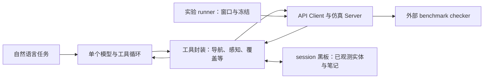

# 回到原版 B0：Benchmark 失败原因重审

日期：2026-10-06。研究对象为原版 Agent4Drone（B0，`1794e45` 对应的冻结执行源码），不是 B1 或新版 Harness。本轮不调用模型、不重跑仿真、不修改执行架构。

**当前应撤回“已经证明 B1 有益，可以在它上面继续堆新架构”的假设。** 代码缺陷存在、缺陷在失败轨迹中出现、修复能提升总体任务通过率，是三个不同命题。此前从前两个命题过快跳到了第三个，并把若干不同层次的问题统一交给强制合同/验证/修复框架，依据不足。

本轮重新固定首次执行分母，复查成功与失败两侧的工具轨迹，深入核对 12 个代表任务，并补读旧诊断遗漏的 13 条 DeepSeek 首次执行。结果支持：原版失分来自接口、任务执行、观测与目标理解、数值判题、数据规格和运行收尾等不同层次，尚不存在一个已证明能覆盖这些失败的共同架构修复方案。

## 1. 先把研究基线和数据边界固定下来

- **B0：研究基线。** 分析 `20261003-143255-full-5c501118`（DeepSeek）及 `20261004-142512-full-aca112a7`（Qwen）的首次执行。模型名相同不保证跨日期服务权重、采样及负载完全一致。
- **B1：待验证的工具修改候选。** 工作树保留上轮回退后的 B1 执行代码；本轮从冻结 B0 源码读机制，不以当前 B1 文件替代原代码，不把工作树位置当成方法有效性证据。
- **新版 Harness：已停止的负面试验。** 它的失败只说明该实现存在阻塞，不能倒推出 B1 优于 B0，也不能替代对 B0 的失败诊断。
- 数据入口为 [原首次部署账本](../baseline-deployment-20261005/tasks.json)，严格筛选 `cohort=first_attempt_no_replay`，各模型 1500 题、75 场景、9396 个检查，全部 generation=1。运行目录根 `results.json` 可能已经整合补跑，不能直接当首次执行结果。

| 互斥分类，固定每模型 1500 题 | DeepSeek | Qwen |
|---|---:|---:|
| 严格部署成功 | 1243 | 1150 |
| 已计分、worker 结束、无终止服务错误的任务失败 | **203** | **281** |
| 终止服务错误 | 37 | 0 |
| 已计分但 worker 退出未确认 | 0 | 13 |
| 执行中断、未计分 | 1 | 0 |
| 后续未执行 | 16 | 56 |

因此 257 / 350 个部署失败，不能直接解释为 Agent 的规划失败。203 / 281 也只是可以继续分析行为原因的集合，里面还包括判题数值问题和任务规格冲突。完整分母不删题，行为诊断则必须区分实际发生了什么。

203 个 DeepSeek 任务失败中有 34 个超时；281 个 Qwen 任务失败中有 192 个超时。超时是运行终态，原因可能是模型等待、路径受阻、重复搜索、动作量或收尾不及时，不能仅凭超时标签宣布需要预算型 Planner。服务故障及 worker 未退出另列于运行可靠性问题，不拿它们论证任务规划能力。

口径说明：Qwen 原任务判题口径有 1151 个计入成功，其中 1 个 worker 未确认退出；上表使用严格部署口径 1150。DeepSeek 有 12 个终止服务错误任务的外部环境检查仍然通过，这些不能算作本题 Agent 可靠执行成功。

## 2. 旧失败分析哪些能继续用，哪些需要撤回

旧 `failure-analysis-20261005` 使用 DeepSeek 选择恢复后的 1500 题与 Qwen 中期 1280 题，共 429 条失败机制记录。逐条核对 trace 哈希、指令、开始时间和所属执行目录后：

- 390 条能对应首次执行：DeepSeek 190、Qwen 200。
- 39 条来自其他 generation：DeepSeek 27、Qwen 12。同 task_id 不代表同一次执行，不能移植原因。
- 仍有 **94 条**首次可观察任务失败没有同代旧诊断：DeepSeek 13、Qwen 81。未覆盖清单已经逐题列出。

这次保留旧报告中的可核查原始事实，但撤回“429 条已完成首次全量根因归类”的任何印象。旧自动信号只是症状，不是互斥、穷尽的根因分类。新案例簿深读 12 个代表任务；另有补充报告逐题分析这 13 条 DeepSeek 漏诊执行。Qwen 的 81 条旧诊断缺口仍明确保留。即使 DeepSeek 的 203 条现均有同代症状材料或补充记录，也不能宣称 484 条任务失败全部完成了人工因果审查。

例如旧案例把 DeepSeek 某三机长航线的补跑 39/39 与 Qwen 首次 38/39 比较；DeepSeek 首次实际遇到服务错误，只有继承着地状态带来的 3/39。它不能用来证明两个模型在相同正常运行条件下的收尾能力差异。旧 Qwen “Drone 20 被替换成 Drone 18”案例来自 generation 2，也没有继续当作首次执行的证据。

详见 [分母与代际审计](COHORT_AUDIT_CN.md)、[607 条部署失败账本](failure-ledger.csv)。

## 3. 原版到底是什么架构

原版已经有 Agent harness：一个集中式模型工具循环，调用无人机工具，工具再经过 API Client 与仿真 Server 交互；session 黑板保留已感知实体和笔记；外层实验 runner 负责时间窗口、冻结、判题与收尾。多架 UAV 不是多个独立 LLM agent。

关键区分有三个：

1. 工具返回的 `success`、Agent 的终止标记、外部任务通过不是同一件事。
2. Server 允许某个接口，不等于 API Client 已封装它，更不等于模型能通过注册工具调用它。`/sessions/current/task-progress` 本来就允许 AGENT 角色访问；分析时不能把它说成平台权限绝对禁止的观测。本轮已核实 Client 中有 `get_task_progress`，但原版 29 个注册工具没有暴露它；未来接入属于改变模型可用工具集合，不能悄悄改变实验方法。
3. 场景按原序运行，保留前题位置、部分世界历史与黑板。检查通过可能包含先前贡献；最终检查失败也必须结合本题开局状态解释。不能把原序协议改成逐题重置后仍当成同一 benchmark。

架构源文件、注册工具边界和导航正反例详见 [原版架构与工具审计](ARCHITECTURE_AND_TOOL_AUDIT_CN.md)。

## 4. 当前证据实际支持的失败机制

### 4.1 导航反馈有确定缺陷，但缺陷出现次数不是可挽回任务数

原工具用 `success` 判断移动结果，Server 主要返回 `status`；工具还存在只用 XY 判断抵达的路径。这些是能由源码和隔离探针证明的确定性问题。

但本轮审计同时查成功轨迹。DeepSeek 原版有 **748 个最终有效成功任务**出现“`success=false`，`distance_remaining=0`，底层移动 `status=success`”。模型有时能结合当前位置或后续回执继续完成任务。因此这种信号不是失败专属特征，不能把旧失败报告中“115 题出现该信号”写成“B1 可提升 115 题”。

另外发现一条明确请求 z=15、实际 z=0 却返回成功的实例，而该题最终仍通过外部检查。它证明接口语义不正确，并不能单独证明当次任务失分由它造成。修复接口的合理性与修复总体通过率的收益，必须分别验证。

这使 B1 的正确定位变为：**有明确局部缺陷依据、尚无可靠总体收益结论的候选修改**。

### 4.2 一部分失分属于 benchmark 与数值问题

- `cc05a425/25d30560`：要求经过的点深入 height=0 障碍，进入检查容差范围也会碰撞。两模型均绕行并失去这一检查点。这里应先审计任务可满足性，不能把所有损失都算作规划器不够强。
- `c350908c/f30cc643`：用户要求起飞到 1 米，检查起飞事件的默认阈值却为 5 米。额外飞高可能满足检查，但不是自然语言要求本身；不能把隐藏阈值写进在线 Agent。
- `793e7745/f817698f`：原版确实发出北移 80 米并收到成功，端点相减得到 `79.99999999999999`；判题严格比较 `>=80`，输出却四舍五入成 `80.0`。Qwen 同题计算为 `80.00000000000001` 后通过。此项已从“数值边界候选”提升为具体的浮点比较证据。

这些情况应保留原始分数并单列诊断。若以后修 benchmark，必须另版本、另协议，不能用修改后的成绩冒充原始分数，也不需要为此给 Agent 增加整个形式化证明框架。

### 4.3 有些失败是局部任务语义或计算错误

`fb8971ec/82077301` 要求两机最终相距不超过 19 米。DeepSeek 停在 19.012 米，Qwen 则把最终距离关系执行成“朝另一架移动 19 米”，最终仍相距 194.378 米。相同检查失败，前者是计算/边界精度问题，后者是动作距离与终态关系混淆。

`93831d6d/7af66f50` 中，Qwen 已产生到达目标记录，但实际拍摄位置距目标过远；拍照 API 成功只意味着拍摄发生，不能证明照片包含所要求目标。

`ef36e27a/4ccc9027` 中，Qwen 使用了另一个目标并混用 target_id 与 coverage_plan_id，后续覆盖了错误对象。同题 DeepSeek 首次成功提供了任务可完成的对照。

这些证据支持检查实体映射、参数计算和动作效果语义。它们尚不能证明需要先把整份自然语言编译成不可修改的任务合同。

### 4.4 未发现目标被错误地当成完整世界知识

`76802002/55b61526` 原场景存在要求访问的 Waypoint 1，局部搜索没有找到。`3973d0d6/9c0b52a0` 的 Qwen 只发现一个目标，随后将已发现集合当成全部目标分母，最后进度仍为 66%。

这里可确认的是搜索未覆盖必要信息，以及“已知集合”被当作“完整集合”的推断错误。不能从目标不在最终黑板中，直接推出 Memory 遗忘；要先证明该目标曾被观测并正确写入。也不能仅靠增加一个完成条件表，让原先不可获得的信息自动出现。

对此应进一步还原感知范围、搜索路径、已访问区域和模型停搜依据，再判断是感知工具、搜索策略、上下文使用还是停止规则的主要问题。完整场景只供离线诊断，不能作为新 Agent 的特权输入。

### 4.5 超时和电量耗尽需要定位到执行阶段

Qwen 的 `35ce64d8/cf8ee51f` 已完成 38/39 检查，最后一架无人机未降落就达到时间窗口；另一类长航线是在到起点之前就耗尽时间。前者是收尾未完成，后者可能同时涉及路径受阻、调用长尾和导航恢复，不能给同一个“加预算管理”的标签便认为已解释清楚。

DeepSeek `640b66d4/d46027e4` 明确报告 **PARTIALLY COMPLETED — battery exhausted**，但 runtime 的 `success` 仍为 true。将它统计为“自判标志与外判不一致”是准确的，将它描述成模型谎称整题完成则不准确。完成状态语义应与实际自然语言、工具证据分别核对。

这也说明“严格禁止宣布完成”不一定能增加任务通过率：此题模型已经知道未完成，缺的是可行的后续执行资源或方案。

13 条 DeepSeek 补充记录还发现：目标已经被发现后，指定无人机未继续前往、拍照，模型却一直搜索其他目标。这个执行调度缺口与“根本没有找到目标”不同，单靠扩大 Memory 或增加感知次数不能解释如何补上。另有将西向净位移当作符合指定航向的累计航段距离的实例。逐题证据见 [DeepSeek 漏诊补充](NEW_DEEPSEEK_CASES_CN.md)，其分类频数仅描述这 13 条选样，不外推到全部 203 题。

### 4.6 早停是实在现象，根因仍有待确认

Qwen `35ce64d8/cba90ef3` 只有初始化读取便终止，同题 DeepSeek 首次有真实起飞、到点和五次广播，且正常收尾。可以确认本次任务没有被执行，不能仅凭无工具步骤就断定是 JSON 解析错误、Planner 能力不足或服务故障。需要原始模型返回、停止原因和 runtime 分支证据。

本轮只记录证据支持的停止位置，不用一个新架构名称填补原因空白。

## 5. 现在可以判断什么，不能判断什么

| 命题 | 当前判断 |
|---|---|
| 原版工具/API 存在确定性的契约问题 | 有代码和轨迹依据 |
| 契约问题造成了所有出现它的任务失败 | 不成立；大量成功任务也出现 |
| B1 的修复一定提高总体通过率 | 未证实 |
| 所有 near-miss 都能通过终止验证挽回 | 不成立；混有障碍、数值、规格与资源问题 |
| 所有 `agent_success=true` 的外判失败都是虚假完成宣称 | 不成立；存在明确承认部分完成的回答 |
| 所有未发现目标都是 Memory 缺陷 | 未证实；观测缺失与记忆丢失不同 |
| Qwen 更多超时说明需要统一重写 Planner | 证据不足；要分离模型等待和实际执行阶段 |
| 当前失败足以支持一个全新 UAV Agent 架构 | 不足；先需要清楚的机制假设和可解释对照 |

固定 500 秒窗口下的成功优先，意味着资源分析服务于任务完成。调用数、token 和“少做无用操作”可以作为次要证据，不能变成取代外部任务成功率的优化目标。

## 6. 改进方向先写成待验证假设，不提前选择架构

下一步决策应要求同一条证据链：**首个偏离发生在哪里 → 为什么导致这一项失败 → 原有成功任务怎样避开它 → 最小改动能否消除偏离 → 是否引入新的回归。**

| 候选方向 | 已有依据 | 决定修改前还缺什么 |
|---|---|---|
| B1 或更小的导航接口修正 | Server/tool 字段和 XYZ 判断确有缺陷 | 对照原始观测下 B0/B1 的工具行为；逐项识别改动范围，之后再决定是否做在线配对验证 |
| 实体与参数的局部确定性检查 | 错目标、错 handle、最终距离计算实例 | 首次执行中的覆盖数、合法绑定变化、成功对照；不先升级为全任务合同 |
| 目标搜索和已知/未知的表达 | 未发现目标、错误封闭分母实例 | 感知覆盖重建、目标是否曾见、停搜依据；判断信息缺失还是信息使用错误 |
| 局部动作完成与收尾 | 拍照语义、最后一次降落缺失 | 检查所需事实是否通过原工具可观测，是否还有可用时间/电量，是否能在原预算内修复 |
| 请求截止与 worker 回收 | 13 个未退出请求及后续未执行 | 请求层时间线与取消机制；作为可靠性分支，不混同任务 Planner 改进 |
| benchmark 规格与数值审计 | 障碍航点、1m/5m、80m浮点案例 | 保留原评分，明确一致性规则与独立修正版，不向在线 Agent 泄露隐藏判据 |

这些是待检验的方向，不是已确认有效的方案。本轮不实施上述修改，也不启动 B1/B0 或新版模型实验。本轮已补读 13 条 DeepSeek 缺口；其余 Qwen 缺口与各机制的成功侧对照仍应继续补齐，再决定先动哪一个最小环节；不再以“设计看起来更完整”作为升级架构的理由。

## 7. 交付物与核验范围

- [首次执行分母审计](COHORT_AUDIT_CN.md)：互斥分类、旧诊断代际核对和复现命令。
- [原版架构与工具审计](ARCHITECTURE_AND_TOOL_AUDIT_CN.md)：冻结源码与导航成功/失败两侧对照。
- [12 个任务的因果案例簿](CASEBOOK_CN.md)：任务要求、允许观测、实际动作、首个偏离、外判与竞争解释。
- [13 条 DeepSeek 首次漏诊补充](NEW_DEEPSEEK_CASES_CN.md)：逐题回到原始轨迹，保留不能确认的原因。
- [607 行部署失败账本](failure-ledger.csv)、[机器汇总](cohort-summary.json)、[输入哈希](input-sha256.json)。
- [首次执行重审脚本](../../../experiments/analysis/reassess_b0_failures.py)。

本轮核对 3000 条首次原记录、2927 条已计分任务的保存检查值与冻结屏障、2914 条 worker 退出确认及消费输入哈希。没有重跑模型或物理仿真，也没有把逐叶一致性核对冒充重新执行全部检查树；完整原 Checker 的既有回放记录作为核验输入保留。工具审计和案例簿另记录自己的精确输入与证据范围。最终联合复核 15981 个唯一输入哈希，统计输出重复生成字节一致；见 [最终核验记录](verification.json)。

分析成果独立归档在 `codex/b0-failure-reassessment`，现有执行代码与其他未提交工作保持原状。B1 的有效性继续保持“未验证”，不因本轮分析提交而改变。
