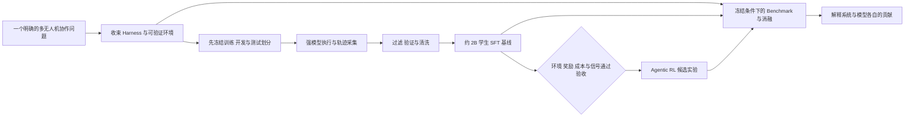

# Research 研究总览与状态记录

更新日期：**2026-10-25（北京时间）**。本文件统一记录当前研究背景、决策及证据边界；阶段实施顺序见 [Roadmap](CSCWD2027_INCREMENTAL_RESEARCH_ROADMAP_CN.md)，Agent 稳定上下文见 [AGENTS.md](../AGENTS.md)。后续更新优先维护这两个入口，不另建内容重复的总览。

首轮更新仅同步研究文档与上下文，未修改实验代码、模型权重、数据集或历史计分。随后用户补充授权：盘点尚未完成但可能有收益的 Harness 验证，允许有界改进和补验证，再依据证据决定收束边界，不要求立即冻结。以下历史成果仍按原报告的条件解释；新增验证独立归档，不与旧批次混合。

## 1. Confirmed Decisions — 已确定的研究方向

### 1.1 研究问题与技术路线

**研究主题：面向多无人机协作任务的 LLM Agent 系统及小模型后训练。** 应用仍是多无人机协作任务部署，研究任务规划、分配、协作执行和动态重规划，以及 Agent Harness 如何组织任务、管理状态、协调多个智能体。

主线调整为 **Harness + SFT + RL 的研究闭环**。纯规则、提示词、状态管理和工作流改造仍有工程价值，但不再作为论文全部贡献。Harness 要提供稳定的运行环境、轨迹收集、数据生成与训练评估基础设施，最终检验训练是否让小模型获得可验证的多轮决策能力。

| 环节 | 当前定位与预期产物 | 当前状态 |
| --- | --- | --- |
| Harness / Environment | 可复用的任务状态、公开工具、执行反馈、轨迹及结果验证；明确 reset、终止和预算语义 | 每 trial 新进程的完整链已通过受控本地验收；自然模型、多任务族及训练环境验收仍未完成 |
| Teacher 与数据构建 | 强模型执行任务；记录规划、工具调用、协作决策与结果；过滤、验证、清洗并冻结数据版本 | 规划；既有日志不自动等于合格训练集 |
| 蒸馏与 SFT | 蒸馏是整体能力迁移思路；用教师轨迹做 SFT 是具体方式之一。首先建立约 2B 学生的可复现 SFT 基线 | 规划；未确定基座和训练配置 |
| Agentic RL | 在 SFT 基础上，以环境反馈优化多轮决策、工具调用和长期任务完成；GRPO、PPO 等仅为候选 | 待验证环境、奖励、训练成本和信号质量后进入 |
| Benchmark Evaluation | 以端到端任务成功率为主，结合工具正确性、token、执行效率、训练成本和复杂场景泛化 | 已有评测基础；后训练对照尚未完成 |

图中后训练环节均为路线规划，不表示已实现。SFT 重点学习任务理解与决策格式、工具/API 调用、任务分配及局部协作，以及如何根据状态与工具反馈继续行动。

### 1.2 Harness 的保留范围

保留已有 Agent Loop、执行证据与任务义务、协作发现与责任交接、验证反馈及有界修复、降低无必要调用等思路，作为候选能力和可复用组件。近期先回答“哪些问题稳定解决、哪些只在窄条件下有效、哪些尚未实现”，而不是默认完成旧方案的全部架构扩张。

任务义务驱动架构仍是有价值的候选：持续维护谁还欠什么任务，使发现、责任和执行衔接。它尚不能单凭方案描述成为已完成系统或已成立创新。可继续补齐已有明确失败证据、潜在任务收益和可控成本的机制验证，同时处理训练所需的正确性、接口、记录和评估缺口；不因准备收束而跳过有价值的验证，新模块必须对应可观察失败与可验证需求。

### 1.3 小论文与硕士论文

| 层级 | 目标 | 边界 |
| --- | --- | --- |
| 第一篇小论文 | 围绕一个明确协作问题，形成 Harness → 数据构建/蒸馏 → SFT → RL → 评测；交付针对性 Harness、可复现后训练流程、约 2B 模型、消融和能力来源分析 | 完整闭环是目标；尚未实现。三种技术叠加或分数提高本身不等于创新 |
| 投稿 | 计划评估 CSCWD 2027 的匹配度和可完成性 | 截稿、证据成熟度与工作量共同决定；不能写成已投稿或必定完成 |
| 硕士论文 | 更真实环境与 Benchmark；高时延、丢包、带宽不足、断连重连；局部信息不完整、动态任务与复杂协作；后训练与泛化；多无人机智能任务指挥平台 | 形成更完整研究体系，包含 Agent、前后端、任务可视化及执行控制，不仅扩大第一篇实验规模 |

执行顺序为：**近期盘点并补齐有价值的 Harness 验证，再根据证据收束；随后进入 SFT，在条件成熟后探索 Agentic RL，最后通过系统实验形成论文。** 不急于马上冻结，也不并行扩张多个研究分支。

### 1.4 当前学习起点

用户于 2026-10-23 明确说明：对蒸馏、SFT、Agentic RL 的理解仍在建立，尚未掌握完整后训练工程体系；已完成过 TRL + GRPO + Qwen 小模型的强化学习入门实验。这是**用户报告的学习经历**，本次未取得该实验的配置、日志及评测归档，不能当作当前多无人机 Agentic RL 系统已经完成的证据。下一阶段学习应围绕数据构建、训练框架、LoRA/QLoRA、评估和第一个 SFT 闭环展开。

## 2. Verified Results — 已有实验与实现证据

本地证据支持的范围如下。失败、中断、成本退化与无增益结果同样保留，不把不同模型、协议或选择性子集的成绩合成一个“当前最好分数”。

| 证据 | 已观察到的结果 | 能说明什么 / 不能说明什么 |
| --- | --- | --- |
| [两模型首次部署计分报告](results/baseline-deployment-20261005/REPORT_CN.md) | 各以 1500 个计划任务为分母：`deepseek-flash` 1243/1500（82.87%），`qwen3.8-flash` 1151/1500（76.73%）；严格部署成功 Qwen 为 1150/1500（76.67%） | 是既有 Agent4Drone、500 秒窗口、场景顺序及状态继承下的本地参考；未执行缺口/服务失败按报告记零，计分收束不等于全部任务实际执行或 runner 有效封存。两模型外围与服务条件不同，不能用其差值归因于 Harness 或训练 |
| [B1 中断试点收束](results/b1-remedies-closeout-20261006/DECISION_CN.md) | 已计分同 57 题，B1 50 题成功、历史 B0 45 题成功；计划 60 题另有 1 中断、2 未执行 | 工具补救的局部正向观察；非同期完全受控比较，不是完整 60 题封存，也不是稳定泛化 |
| [最小 Harness 五臂探索](results/minimal-harness-online-20261015/FINAL_ANALYSIS_CN.md) | 每臂 100 题：适用性方案 85、R2 参照 83、失败交接 84 题成功 | 固定运行顺序、继承初态及相同循环预算被不同策略消耗，限制因果解释；R2 参照另含技能接口和提示差异。只是探索性结果，不能当作完整整合架构的因果收益 |
| [v2 受控机制实验](results/minimal-harness-v2-mechanism-20261016/FINAL_ANALYSIS_CN.md) | 96 次受控执行；其中 8 对起飞失败案例动作端点、参数、顺序及回执状态一致，双方成功；模型调用 failure 41→applicability 23 | 支持已选定计划条件下的调用节省，不等于模型自主选择技能有效或整任务成功率提高 |
| [自然入口校准](results/minimal-harness-full100-calibration-20261016/FINAL_ANALYSIS_CN.md) | 20 对 / 40 次：两调度方案成功 16/20 与 15/20；没有真正可恢复的暂停机会 | 仅校准，不能写成 full100 或恢复收益；剩余 360 次未启动。调用减少也未保证 token 减少 |
| [执行记忆 v5](results/execution-memory-v5-20261016/REPORT_CN.md) | 原六个开发场景各三轮，v4/v5 各 18 次且均 18/18 成功；已知完成后额外工具调用 7→0 | 支持局部完成证据表达与减少冗余调用；没有成功率提升证据 |
| [执行记忆 v6](results/execution-memory-v6-20261016/REPORT_CN.md) | 同六场景三轮，v5 18/18、v6 14/18；线段线索被误解为端点导致失败 | 说明统一压缩提示有回归风险；负结果不能因 v7 出现而删除 |
| [执行记忆 v7](results/execution-memory-v7-20261016/REPORT_CN.md) | 新的两轮对照共 24 次，v5/v7 均 12/12；六次路线任务 token 46,751→44,113（−5.64%），调用次数相同 | 只支持原六个开发场景中路线子集的局部用量改善；没有成功率提升或独立任务泛化证据。非路线逻辑相同，其随机差异不归因于 v7 |
| [入口契约 v2 补验证](results/harness-entry-contract-20261023/REPORT_CN.md) | 7 个固定任务 × 两版本，共 14 次真实模拟器离线执行，协议核验全部通过；三个搜索任务两版均未通过原检查，新版公开进度为 33%、5%、75%。两道短技能正对照两版均成功，两个不支持语法均正确拒绝；另有 191 个不重复回归测试通过 | 支持有效空观察可启动搜索、终止计划控制明确且无重放；不支持整任务成功率提升。脚本显式选择技能，无 LLM、无原工具接手，不是自然入口或泛化实验。候选 opt-in，默认仍为 legacy |
| [执行记忆 v7 跨任务回放](results/execution-memory-v7-cross-task-20261023/REPORT_CN.md) | 固定 14 道原任务、11 个场景，355 条历史公开回执、369 个读取点；v5/v7 全部逐字一致、检查无失败，但原文 compact 资格为 0/14。另列 84 组合成派生探针、472 个读取点，语义检查无失败 | 原任务结果支持保守回退兼容，不能证明 compact 分支跨任务有效；派生指令和合成回执仅检验语义边界。未预载私有初态，缺原 call ID/并发分组，只按归档顺序串行回放；未调用模型/仿真器，不是新成功率、token 或泛化结果 |
| [飞行状态 v3 最小修复对照](results/harness-flight-state-20261023/REPORT_CN.md) | 原 7 题 × v2/v3 共 14 次真实模拟器离线执行，同初态同预算。`24ac1838` 的 IDLE move 错误 1→0、进度 5%→33%，动作尝试 45→137、API 169→533；仍未通过原检查，改为修复预算耗尽。另两搜索及正负对照的动作和结果不变；259 项不重复代码测试通过 | 支持按最新公开状态决定起飞/移动的功能正确性与一个已知实例的部分进度提升；搜索整题成功仍 0/3→0/3。真实正高度 idle 触发仅一机一次，其余边界靠脚本测试；无 LLM，不是自然模型收益或泛化。v3 保留为 opt-in，默认不变 |
| [目的点屏蔽 v4 最小修复对照](results/harness-blocked-candidate-20261023/REPORT_CN.md) | 先精确重放两题的公开轨迹，确认失败键含起点导致目的点再次可选；原 7 题 × v3/v4 共 14 次同初态同预算执行。`24ac1838` 同机同目的点重复 2→0、进度 33%→38%；`b1ad4f3e` 重复 1→0、进度 75%→80%。两题总障碍错误均仍 17、仍因修复预算耗尽退出；API 分别 533→600、429→478。313 项不重复代码测试通过 | 支持本计划内、同 actor、固定 z=20 的明确目的点冲突记忆能消除本批重复；路径错误仍按起点处理。搜索整题成功仍 0/3→0/3，另 5 对动作/结果不变，无效率收益证据。静态 fixture、无 LLM；动态障碍更新未覆盖。v4 保留 opt-in，默认 legacy，不据此宣称泛化 |
| [跨机目的点共享 v5 最小修复对照](results/harness-shared-endpoint-20261023/REPORT_CN.md) | 执行契约确认目的点碰撞只依赖 XYZ 与障碍几何；原 7 题 × v4/v5 共 14 次，同初态同预算，显式隔离障碍写入。`24ac1838` 跨机重复 1→0、进度 38%→38%、总错误 17→17；`b1ad4f3e` 重复 7→0、进度 80%→100%、总错误 17→10，原整题检查失败→通过。API 分别 600→612、478→818；376 项不重复代码测试通过 | 三个搜索题的原检查器通过数 0/3→1/3，另 5 对动作/结果不变；支持一个已知静态实例的完整任务收益，不能宣称泛化或效率提升。成功题的 Harness 仍返回 `needs_replan/no_public_candidate`，缓存进度未在退出前刷新；不能混同环境完成和技能完成。共享仅同计划/场景/epoch、精确 XYZ、固定 z=20，依赖无障碍写入契约；v5 opt-in，默认 legacy，无 LLM |
| [退出前进度确认 v6 最小修复对照](results/harness-terminal-progress-20261023/REPORT_CN.md) | 新批原 7 题 × v5/v6 共 14 次，同初态同预算。`b1ad4f3e` 在无候选出口增加一次技能公开进度读取，缓存 95%→100%，由 `needs_replan/no_public_candidate` 变为 `completed/skill_public_stop_condition`；API 818→819。七对动作序列、路径、访问数及原检查结果不变；其余六对未触发新读取。既有 376＋专项 61，共 437 项不重复代码测试通过 | 支持完成报告缺口修复；原搜索整题成功仍 1/3→1/3，不能当新增任务收益。真实任务只触发一次已完成分支；未完成、读取失败、预算不足由脚本测试覆盖，分母单列。仅无候选出口确认一次、严格 >95，不重试或越预算；v6 继承静态共享前提、保持 opt-in。无 LLM；墙钟驱动的微小耗电差不归因为节能 |
| [已观察目标跟进 v7 独立对照](results/harness-observed-target-20261024/REPORT_CN.md) | 先公开回放两题，再新增发现者正常动作槽中的一次 fixed 目标跟进；原 7 题 × v6/v7 共 14 次，同初态同预算。`7eba7390` 1/3→2/3、API 346 不变，但错误 0→2；`24ac1838` 38/100→51/100、API 612→657、错误仍17；`b1ad4f3e` 均20/20，动作191→125、API819→499。532 项不重复代码测试通过 | 搜索整题成功仍1/3→1/3，只支持两个已知题的部分进度及一个成功题的成本改善；两失败题未解决。正名字/true标志仅抑制定向，false不推remaining；每ID一次、公开来源、正常槽、共享/路径屏蔽及原终止守卫均保留。v7 opt-in、默认legacy，无LLM；不是自然决策、泛化或后训练成果，与执行记忆v7是不同组件 |
| [单 Agent 回合隔离修复](results/harness-episode-contract-20261024/REPORT_CN.md) | 固定线程顺序反例确认共享Agent重叠execute会使A归档/关闭B的Harness；新增execute/reset/refresh/summary同实例互斥、服务busy处理及异常收尾。66项独立前后对照、32项新增＋738项既有代码测试通过；忙时无状态/API改写，A实际退出后B可运行 | 这是生命周期正确性，不是新任务成功率或模型收益。取消flag不释放占用，清理失败禁止复用；完整世界reset、跨实例隔离和模型正文归档仍未完成。没有重跑Benchmark、调用真实模型、改搜索预算或启用新默认Harness；现有hash-only日志不能直接当Teacher数据 |
| [实际模型 I/O 归档本地验收](results/harness-model-io-20261024/REPORT_CN.md) | 新增默认关闭的独立 JSONL：实际请求字节、被动响应流、结构化消息、logical/attempt/tool ID 关联及闭合隔离。真实 Agent/SDK＋MockTransport 专项49项、既有回归776项，共825项不重复pytest通过；无外部网络或provider调用 | 只支持本地模型交互层的可重建性，不是完整Teacher回合或任务成功率。未耗尽SSE、缺响应、工具关系不明及归档错误显式partial；worker/Ollama未支持完整wire。未改变实验预算、默认Harness、训练状态或历史成绩 |
| [完整回合新进程本地验收](results/harness-full-episode-20261025/REPORT_CN.md) | 同一原任务固定9回合、9 worker＋9独立scorer，96项链路检查通过；四种终态后的B初态、实际模型输入、动作和评分均与独立B一致。71项父协调器纯测试通过；私有canary评分侧阳性、策略侧阴性，原预算不变 | 本地脚本模型＋真实SDK/Agent/模拟器，不是自然模型或Benchmark成绩。3种失败A均先真实起飞，再按预定边界终止并保留partial；不证明进程池复用、真实远端动作撤销、泛化或RL奖励可靠。首批导入失败及后续独立批次均保留 |
| [自然Agent协议与本地准备](results/harness-natural-agent-preparation-20261025/REPORT_CN.md) | 已落地回合复用约定、原7题×A/F的14槽拟议协议及只含prepare/verify的准备器；实际输入/hash校验通过，67项合成纯测试通过。只读审计从既有三题脚本轨迹关联27个受阻后可修复检查点候选 | — |

执行记忆 v5–v7 pilot 使用报告中的 `deepseek-flash`、temperature 0.1、关闭 thinking，每次最多 6 次模型调用、12 次工具调用、90 秒及 60,000 token。这与全量 500 秒协议及本轮无 LLM 的 Harness v2–v7 对照不同，结果不能直接横向比较。

**实现状态也按版本区分：** [执行记忆 v7 说明](EXECUTION_MEMORY_V7_CN.md)及当前 `uav_agent.py`、`execution_memory*.py`、`harness_integration.py` 已有执行记忆和可选 Harness 接线，`evidence_memory_v7` / `evidence_memory_v7_harness` 未替换默认配置。10 月 16 日早期[组件审计](HARNESS_COMPONENT_AUDIT_AND_INTEGRATION_PLAN_CN.md)中“R3 与 Harness 分离”的描述是当时原模式的状态，不能覆盖后续 v1–v7 接线。该旧方案中的统一 `TaskState`、`TaskCoordinator`、完整 `VerificationReport` 与通用剩余义务修复仍不能视为已完成整合。

**文献数字单列：** MultiUAV-Plat 原论文的 57.9%（表中 57.93%，doubao-2-pro）是上游参考基线；README 的上游排行榜也不代表本项目当前成绩。论文阅读与翻译见 [阅读记录](MULTIUAV_PLAT_READING_CN.md)及[全文翻译](MULTIUAV_PLAT_FULL_TRANSLATION_CN.md)。本项目数字须引用上表所列本地报告及其口径。

**后训练状态：尚无可归入本节的本项目 Teacher 数据集、SFT、Agentic RL 或约 2B 训练后模型成果。** 不能将已有教师候选模型的在线调用、HTML 中外部论文结果或个人入门实验替代这些交付物。

### 2026-10-23–24 补验证后的 Harness 边界

新增 `entry_contract_v2` 只调整入口观察与计划控制契约，不更改搜索策略、任务语法或原检查器。三例残余失败已用公开回执定位：`7eba7390` 搜索 16 轮后只访问 1/3 目标（感知见过两个不同目标），不能保证覆盖与发现后访问；`24ac1838` 对高度 57 m、状态 idle、电量 100% 的无人机直接移动被拒；`b1ad4f3e` 第 17 次障碍失败触发原 16 次局部修复预算退出。它们分别提示覆盖/目标利用、飞行状态语义、障碍修复方面的待验证问题，**不意味着已有统一解决方案**。

本轮保留入口修复候选及完整负结果，尚不切换默认配置、不启动自然模型对照或旧 360 次队列。后续验证优先围绕明确缺口预先固定协议；不能用增加搜索预算或挑选重跑把本批改写为成功。

随后按用户要求完成 `flight_state_v3` 最小修复：在原有公开状态读取处以 `idle/ready` 判定需要起飞，以 `hovering/flying/moving` 判定可移动；成功起飞后沿用位置核验并增加状态核验。旧 `legacy` 和 `entry_contract_v2` 行为保留，搜索候选、20 m 高度、16 轮及修复/API 预算不变。受影响任务从 5/100 到访增加到 33/100，但二维路径 1.66→9.86 km、模拟耗电 18.90→73.51 mAh，最终因第 17 次障碍失败退出。**本次解决了非法状态动作，尚未增加整题成功，也没有效率收益证据。** 保留该版本作为后续受控实验基准；随后完成了下述目的点屏蔽验证，没有增加预算或扩大在线实验。

随后完成 `blocked_candidate_v4`：仅对一致 actor 的 `move_to` 明确 error、受支持的目的点碰撞全文回执，在后读 XYZ 未变后保存精确候选点及原动作证据。旧失败边 `(actor, start, candidate)` 并未过期或删除；换起点使键不再匹配，且回执对应障碍几何未被公开感知。新增屏蔽在本计划暂停/恢复、换起点和空感知后保留，不跨 actor/计划；场景 epoch、相关外部动作等沿用原守卫阻止继续使用。未改路径重试、几何、排序、范围或预算，也未实现动态障碍更新失效契约。两题消除全部 3 次同机目的点重复后分别多访问 5/100、1/20 个目标，但新增独立失败耗尽原预算；动作 137→153、108→120，二维路径 9.86→12.00 km、11.18→13.54 km。**该批只支持重复失败的功能修复和部分进度改善，整题完成率与总错误数仍未改善。** 历史 v3 的动作/初态/检查器均复现，只有一题模拟耗电有微小差异，详见报告；不以耗电逐字一致作为已满足条件。候选日志中两题另有 1 次、7 次“此前其他 actor 已在同 XYZ 发生目的点冲突”的后续失败，随后按用户要求完成下述共享契约审计及对照。

`shared_endpoint_v5` 的共享依据来自当前服务实现：目的点碰撞不读取 actor、起点或机型，但依赖障碍几何不变。仅在调用端显式保证静态障碍、无外部写入后，复用本计划中原 actor 的合格公开错误及后读位置核验，排除其他 actor 的同一精确 XYZ；路径错误、相邻点和其他命令高度不推广。计划/epoch/相关外部动作沿用原失效边界；观察到同 ID 几何变化或已知实体从黑板消失，直接退出计划。空感知、新 ID 或时间流逝不撤销旧证据；不可见地图更新仍须靠写入隔离保证，不能声称已支持动态地图。默认不启用，未声明静态契约时 v5 搜索在首个 API 前拒绝。

v5 批两题跨机重复均清零；`b1ad4f3e` 在原修复预算内完成 20/20 目标，通过原检查，三个搜索题由 0/3 到 1/3；`24ac1838` 仍停在 38/100 并耗尽修复预算。动作分别 153→156、120→191，二维路径 12.00→12.42 km、13.54→30.81 km，**有单个已知任务的完成收益，但实际成本增加**。历史 v4 的七题初态、动作、结果和成本字段均复现，elapsed 不同；不将同初态等同于每次执行时刻完全一致。该批终止契约缺口保留原样：成功题最后一次技能进度读取后继续执行，最终无候选时提前退出，未刷新进度；终态后评估端公开读取为 100%，原 checker 通过，Harness 本身仍 `needs_replan`。没有将随后修复混入该批成绩。

随后单独完成 `terminal_progress_v6`。只在 `no_public_candidate` 出口前，通过原 runtime 追加一次公开进度确认，校验当前会话、公开来源、无错误/矛盾标志及有效数值，保存该次读取的证据引用。严格 >95 才正常完成；≤95 仍无候选退出；读取失败返回 `public_progress_unavailable`，不以旧缓存兜底；API 已满不派发，截止/取消/epoch 变化仍阻止确认。常规读取周期、round/repair 出口、候选与静态共享范围不变。

新批 `b1ad4f3e` 的技能读取 #834 明确观察 100%、20/20，证据 `e1635` 先于 completed；后续独立评估读取 #835 与原 checker #836 单列，不倒灌为技能输入。两版均 191 次动作、176 次移动尝试、10 次修复、30.81 km 二维路径，新增一次只读调用而非执行能力提升；原检查均成功。其他六对行为不变。历史 v5 的初态、动作、结果复现，但新基准两题耗电与旧批略异，且本批两臂耗电也有微小差异；实际值及墙钟推进限制见报告，不作节能主张。**这项已知终止缺口可以归档为受限功能修复；两个未完成搜索的覆盖与新障碍/路径失败仍未解决。**

2026-10-24 继续审计两个残余搜索题，公开纯策略回放分别80/80、126/126一致。7eba存在“感知固定目标但未跟进”的明确缺口；24ac的17次失败所指障碍此前均未被公开感知，三条路径无同边/反向边复用机会，未据此扩展路径共享或planner。仅对前一缺口完成独立 `observed_target_v7`：当前计划有效nearby给出fixed点，由首次发现者在正常槽最多尝试一次；名字正证据或明确true标志仅保守抑制，不建立ID完成事实，false不作为未完成依据。位置/name/type变化或同名歧义时禁用，目标和格点的同坐标索引不能绕过失败屏蔽；高度、原预算、静态障碍契约及终止规则保留。

本批38次实际定向动作均返回成功及对应目标名字，但不等于相对基准新增38个目标。三个搜索题为2/3、51/100、20/20，整题仍1/3；7eba新增两次不同终点障碍错误，24ac增加45次API，b1ad减少320次API及约15.25km二维路径。七个历史v6基准的初态、动作、进度和checker复现，两个耗电有墙钟推进差异；不借旧批数值替代本批成本。新增结果只支持局部作用，不宣称稳定通用搜索器。当时建议保留可选候选，暂不继续围绕这三道开发题叠搜索机制，优先收束episode reset和可重建模型输入/轨迹；相关受控本地验收随后完成，见下文，仍不急于启动SFT。详见[本批报告](results/harness-observed-target-20261024/REPORT_CN.md)及[收束审查](results/harness-residual-audit-20261024/CLOSEOUT_REVIEW_CN.md)。

同日进入接口收束，先完成[单 Agent 回合隔离](results/harness-episode-contract-20261024/REPORT_CN.md)。公开服务共用同一个Agent，原重叠execute可覆盖Harness引用并串归档；现对execute、证据reset、会话refresh/summary统一非重入准入，busy在命令状态改写前拒绝，直到执行和归档真实退出才释放。逃逸BaseException关闭旧Harness并停记录，清理失败则拒绝复用。66项受控前后检查及770项代码测试通过，未跑新的任务成绩。**只验收同实例生命周期，不等于完整世界reset或跨Agent隔离。**

前一轮[模型输入审计](results/harness-episode-contract-20261024/MODEL_INPUT_AUDIT_CN.md)确认当时的请求hash不能还原正文/工具schema，steps导出丢失调用ID。现已完成[默认关闭的独立模型I/O归档](results/harness-model-io-20261024/REPORT_CN.md)：SDK请求原字节、正常消费的响应字节、结构化消息及调用/回执关联可在本地核对；49项专项＋776项既有回归通过。请求owner按原回合绑定、关闭后拒写，同Request复用隔离；消息附件/响应头元数据不进入模型轨迹。**完整性标记仅属于模型交互层，不能把旧steps或新partial档案直接当Teacher数据。** SSE遇DONE但未到EOF、ReadTimeout缺响应、worker/Ollama无wire等仍显式不完整。随后已用已有新进程隔离方式完成下述受控完整episode链验收，不承诺进程池复用或进入训练。

2026-10-25 完成[完整回合本地验收](results/harness-full-episode-20261025/REPORT_CN.md)：恢复原初态、实际模型请求与公开行动、终止、worker退出后独立scorer、下一新进程已串联。固定一个原短链任务的独立成功B与四组A→B，共9回合；原500秒等预算保持，超时用验证时钟触发，取消在真实起飞提交后生效。四个B与参考B输入/动作/结果一致，96项检查通过；三种非成功A均只完成起飞、原checker为1/2且整题失败，归档valid但partial。评分私有树的canary只在独立评估侧出现；策略正文/工具回执/日志无泄漏，闭合文件后续hash不变。**只支持每trial新进程路径的受控完整链，不是可直接训练的Teacher数据或自然模型成功率。** 首次依赖加载失败停批并保留，新批未续跑旧尝试；生产默认与旧成绩不变。

随后完成[复用接口与自然Agent协议](HARNESS_NATURAL_AGENT_VALIDATION_CN.md)的本地准备。旧40次自然校准没有真实paused；旧v2部分故障夹具会增删障碍，不能直接沿用到当前静态契约。只读审计原v7静态轨迹，在7eba/24ac/b1ad分别关联2/16/9个受阻后可修复检查点；24ac第17次错误在yield前耗尽repair，不算恢复机会。**这是27个潜在分支的既有证据，不是新自然恢复结果。** 拟议7题×applicability/failure仅改变scheduler，固定AF4/FA3单次顺序，按实际机会计数，机会不足不自动加题。准备包已核验，67项纯测试通过；公开目录仅task/scene/command/hash，分组和私有注释留评估侧。真正provider运行器还需墙钟截止、硬准入、排空和独立评分的本地验证；上一批60秒watchdog/虚拟时钟/脚本断言不能原样上线。

执行记忆 v7 补验证也已完成：原 R3 筛查中全部 14 道局部几何合法路线均保留全文，没有删导语或缩小义务。它们全部触发 v5 回退，故未产生压缩收益；补充合成探针虽通过，也不能补足真实 compact 任务的证据。断言是定向检查，未独立证明自然语言解析完整性或模型视图的全部必要字段，详见报告的审计边界。下一步先明确实际适用范围与独立完整任务，再决定是否值得在线验证，不为让这 14 题进入压缩分支而直接放宽语法。

## 3. Working Hypotheses — 待验证假设

| 假设 | 应如何检验 | 当前结论 |
| --- | --- | --- |
| 用任务状态与执行证据组织教师轨迹，可让约 2B 模型更好学习责任执行和反馈后的下一步 | 固定学生、Harness、数据量与测试条件，比较受验证数据组织方式及相应消融 | 尚未构建对照数据，也无训练结果 |
| SFT 能将强模型的任务理解、工具调用和局部协作能力迁移到小模型 | 同 Harness 下比较基座与 SFT，报告端到端成功及错误类型；独立留出测试 | 尚未验证 |
| 在可靠 SFT 起点上，Agentic RL 能改善长程完成与失败恢复 | 固定 Harness 与评测，比较 SFT 与 SFT+RL，审查奖励与真实任务成功是否一致 | 尚未验证；不保证 RL 必定优于 SFT |
| 义务、证据和执行反馈可同时服务于运行、数据筛选与训练评估 | 选一个有足够失败证据的协作问题，验证系统表示、示范与奖励是否围绕同一问题工作 | 是统一方法的候选联系，不是已确定创新点 |
| 小模型能力能扩展到通信受限、动态环境及局部信息不完整 | 后续冻结新的场景/通信条件，测分布变化与失败边界 | 硕士阶段方向，当前没有泛化结论 |

确定性检查器不自动等于可靠奖励；叶子通过数不自动等于整任务成功。需检查 AND/OR、时序、历史事件/最终状态、可利用漏洞、奖励稀疏性、回合重置和隔离。环境吞吐、训练显存与成本都应实测，不能沿用 HTML 估算当已验证容量。

## 4. Open Questions — 尚待确定

1. **小论文的唯一核心问题：**优先选择责任交接、剩余任务推进、工具反馈后的重规划，还是另一种已有充分失败证据的问题？需结合数据可得性和可训练性收敛，暂不指定算法创新。
2. **学生职责及组织：**约 2B 模型负责全局任务规划、局部决策、工具选择或其中一部分？集中式还是每 UAV/角色分工？最终部署在工作站、边缘端还是机载端？
HTML 已记录 DeepSeek 教师与单卡 80 GB 上限（40 GB 更好），继续作为已有依据；新信息未直接否定的约束不自动撤销。具体部署仍按用户最新说明保持未定。
4. **数据和评测：**哪些日志含完整可重建的策略输入、工具 schema、调用与回执 ID、状态及终止结果？训练/开发/独立测试如何按场景、种子、任务族隔离？已有开发集不能重新命名为未见测试。
5. **RL 进入条件：**任务是否可重置并隔离，SFT 是否有有效探索起点，奖励与端到端成功是否一致，rollout 失败/超时如何处理，预算是否可承担？确认后再选择算法与配置。
6. **投稿与毕业约束：**是否继续争取 CSCWD 2027，完整闭环与截止冲突时如何取舍？导师期望、可用研究时间和硕士阶段节点仍需结合实际安排。当前截稿核验与建议见 Roadmap。

## 5. Next Actions — 按依赖执行

| 顺序 | 具体工作 | 可审查的完成标志 |
| --- | --- | --- |
| 1 | 在已准备协议上实现真实墙钟的自然入口worker与独立scorer适配，先作本地验证 | 复用新进程/初态/封存边界；去掉本地脚本的虚拟时钟、固定应答和动作数量断言，明确500秒任务窗、请求时限、排空和watchdog。先用MockTransport验证，不续跑360次或增加线上额度 |
| 2 | 保持模型I/O归档默认关闭，按完整/partial与终态使用轨迹 | 完整回合已接上实际正文、调用ID、效果和隔离评分；3个故障A显式partial。没有真实provider或Teacher数据质量验收，不以归档完整代表任务完成，不将私有评分目录并入示范文本 |
| 3 | — | — |

收束范围与学生职责明确后，再核对模型和资源、按场景冻结划分、采集并清洗一小批 Teacher 轨迹，跑通第一个约 2B SFT 的训练、导出和回接评测；学习围绕数据构建、框架、LoRA/QLoRA、评估展开，不要求先掌握整个后训练生态。之后审查 RL 的奖励、reset、超时、rollout 信号和成本，形成进入/暂缓依据；通过后才定算法。阶段细分、消融矩阵及论文进入条件统一放在 Roadmap。

## 6. 旧材料的效力与保留方式

| 旧材料 / 设定 | 本次处理 | 仍可复用的内容 |
| --- | --- | --- |
| [纯 Harness 论文方案](HARNESS_ARCHITECTURE_PAPER_PLAN_CN.md)、[架构提案](PROPOSED_EVIDENCE_SCOPED_HARNESS_CN.md) | 原 C1/C2/C3、完整架构整合不再自动成为论文全部贡献或近期必做项；保留历史正文 | 义务/证据语义、执行边界、失败反馈、受控消融思路 |
| [组件审计](HARNESS_COMPONENT_AUDIT_AND_INTEGRATION_PLAN_CN.md) | 保留审计时点及提案；不能用旧“尚未接线”覆盖后来代码，也不默认实施所有新增组件 | 复用清单、权限约束、状态与回执接口风险 |
| [原 CSCWD Roadmap](CSCWD2027_INCREMENTAL_RESEARCH_ROADMAP_CN.md) | 顶部更新为当前阶段；原 10/6–10/31 架构倒排保留在历史章节，不再执行旧里程碑 | 配对账本、初态控制、预算、冻结及失败计分原则 |
| [预算研究方案](BUDGET_AWARE_AGENT_RESEARCH_PLAN_CN.md)、[改进意见](改进意见.md) | 作为历史候选，不新增并行预算优化或通用规则架构分支 | 成本指标与具体失败模式 |
| [10 月 16 日阶段汇报](MULTIUAV_RESEARCH_SUMMARY_20261016_CN.md)及 `docs/results/`、`docs/audit/` | 保留时点记录和原始分母，不改写历史实验结论 | 正负结果与轨迹证据 |
| [小模型后训练 HTML，2026-10-17 修订版 2](SMALL_MODEL_POSTTRAINING_SURVEY_CN.html) | **原文件原样保留，作为引入后训练的调研基础；后续信息对具体决策作增量修订，不否定整篇** | 未与新决策冲突的文献依据、方法候选、数据格式与成本风险提示；外部结果不等于本项目验证 |
| 云端 Research 最早会话中的 `YMT-Research_MultiUAV_Agent_Harness_Project_Handoff_2026-10-08.md` | 原附件保留；“当前小论文聚焦 Harness，SFT 与 RL 留后续”被本轮闭环目标取代 | 任务级规划、责任与证据、公平对照，以及不把仿真成绩当真机部署证明的边界 |

用户随后澄清：所称 HTML 是最初决定加入后训练阶段的调研文档，后续补充是在思考、验证与调研基础上的小幅更新。故按“调研基础 + 增量修订”使用，保留不冲突依据。以下仅说明已被明确修正或重新开放的具体设定：

- “不投 CSCWD 2027”被“CSCWD 2027 为重新评估中的投稿目标”取代。
- “Qwen3.5-4B 为主、再下放 0.8–2B”被“约 2B 学生为目标，具体基座未定”取代；不保留多尺寸并行训练作为当前默认计划。
- “教师只用 DeepSeek”“单卡 80 GB 上限/40 GB 更好”与最新补充没有直接冲突，保留为已有选型与资源依据；“笔记本不量化部署”则服从最新“部署位置尚未确定”的边界，保留为候选。
- 固定 GiGPO/状态锚点、奖励势函数、LoRA 秩/学习率、训练步数/周数和成本数值均降为历史候选或估算；不能当作已选算法、已证明创新或可完成承诺。
- “检查树可直接当奖励”“吞吐只受推理限制”等不能替代奖励与系统验收；教师输出中也不能包含测试答案或隐藏状态。

## 7. 持久化与核查范围

- **本地：**检查仓库及适用父目录（含隐藏文件）未发现此前的 `AGENTS.md`、`CLAUDE.md`、`GEMINI.md` 或独立 Research 记忆文件，因此新增根 `AGENTS.md`。检查可访问的 Codex 本地记忆目录，未找到 Research/MultiUAV/Harness 相关记录，未改动无关全局记忆。`execution_memory*.py` 是被研究系统的运行记忆，不是研究助手的持久记忆；本轮读取并回放其行为，没有修改其生产实现。
- **云端：**[Research 项目](https://chatgpt.com/g/g-p-6ac70320b3848191bbab66cf1b8f90f4/project)的 Instructions 原为空。2026-10-23 已写入稳定研究背景，保存后重新打开设置核验，全文与提交文本一致。项目默认背景已同步；未修改账户级 Memory 设置或声称改写不可见的全局记忆。
- **上传材料：**云项目 Sources 为空；在[最早的“科研项目规划总结”会话](https://chatgpt.com/g/g-p-6ac70320b3848191bbab66cf1b8f90f4/c/6ac703ab-8970-83ee-a0bc-bab7f6e4415e)中读取到 10 月 8 日 Markdown 附件。本地 10 月 17 日后训练 HTML 已找到并原样保留；用户已澄清所称 HTML 的研究阶段定位，不再把云端原始上传位置作为继续工作的前提。
- **命名与边界：**旧交接附件曾把 SAVER-UAV 列为第一篇、Harness 列为第二篇；本文“第一篇小论文”沿用本轮用户定义，指当前目标论文，不据此改写既往成果。相邻 `agent- research/` 工程发现旧研究 Markdown，本次未改动该独立工程；当前仓库与云端 Research 是本轮实际同步位置。

保留的本地研究 HTML SHA-256：`ec01c042e0d5345205965ebbb825b6b5aedcc448d02d84858442c83c7c21e88b`。原 HTML、上传附件和历史实验报告均保持原样。
