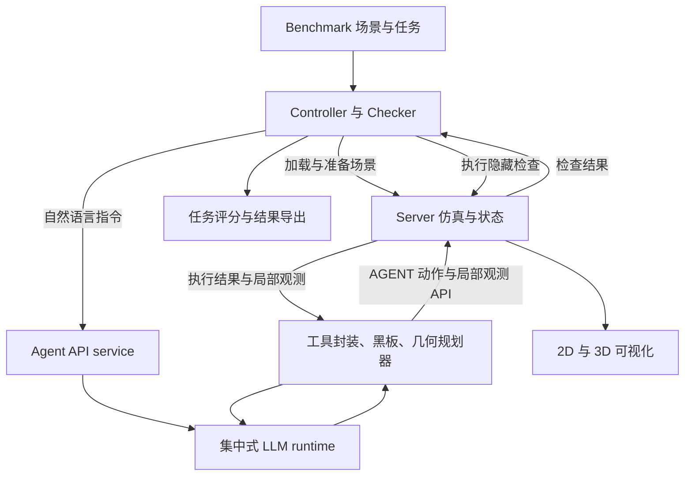

# MultiUAV-Plat 精读摘要：论文脉络、实现与 Agent Harness 研究启发

阅读日期：2026-09-28。

阅读对象：Sheng Zhang 等，*MultiUAV-Plat: An LLM-Oriented Platform, Benchmark and Framework for Multi-UAV Collaborative Task Planning*，arXiv:2606.31073v1，2026-06-30。已通读本地归档的全部 13 页，包含正文、图表与参考文献；该版本没有独立附录。[官方条目](https://arxiv.org/abs/2606.31073v1)。

本文区分三类依据：**论文陈述**来自归档 PDF；**实现核对**来自当前工作区源码和 benchmark.zip；**研究判断**是结合前两者对 agent harness 项目的分析。本轮没有启动仿真服务、调用 LLM 或复现论文分数。此前的 源码审查报告（已退役，原件见[清理记录](../maintenance/cleanup-20261028.json)） 用作阅读线索，本文提到的关键运行入口、工具和数据规模已重新核对。

**1. 最值得先抓住的中心思想**

这篇论文把“语言模型能否指挥无人机”具体化成一个可执行、可计分的问题：当 agent 只能通过受限 API 控制多架无人机、只能获得局部感知、不能查看隐藏评分规则时，它能否持续完成“理解任务—收集信息—分配无人机—执行动作—检查结果—修正计划”的闭环？

我的判断是，它的主要价值在于提供任务级 agent 研究基础设施，并用一个领域工作流展示这套基础设施能区分方法的能力。研究对象是自然语言任务在环境中的执行结果；语言规划、空间决策、工具使用和多机协作都要通过环境状态接受检验。

对 agent harness 研究而言，可以把它理解为三个相互配合的部分：

| 组成 | 回答的问题 | 具体内容 |
| --- | --- | --- |
| MultiUAV-Plat 平台 | Agent 在什么环境里、能看什么、能做什么？ | 仿真实体、受限 API、局部观测、角色权限、执行反馈 |
| MultiUAV-Plat Benchmark | 给什么任务、怎样判断完成？ | 场景、自然语言指令、隐藏验证树、评测协议与统计指标 |
| Agent4Drone | 怎样组织模型与工具，才能更可靠地做完任务？ | 观察、理解、记忆、规划、执行、验证与重规划 |

这里“harness”是本文采用的分析视角。论文对 Agent4Drone 的原始定位是任务特定的 LLM-agent 工作流。

**2. 全文的论证脉络**

引言（第 1–2 页）提出研究缺口：传统多无人机规划积累了分配、路径、覆盖、避障等方法，但一般依赖明确的问题形式和结构化状态；LLM 能处理自然语言目标，但必须进一步验证它在局部信息、受限动作和持续反馈下是否能真正完成任务。

相关工作（第 2–4 页、表 1）把已有研究分为多机规划、仿真器、agent benchmark 和 LLM 机器人框架。作者强调的组合是：多无人机场景、面向 LLM 的工具接口、部分可观测性、实际动作执行、隐藏任务评分。“首个”属于作者的定位声明，本文没有独立验证其优先权；表 1 也不意味着被比较的仿真器无法扩展出类似功能。

方法部分（第 4–9 页）依次建立平台、benchmark、Agent4Drone。这个顺序很关键：先约定信息与动作边界，再规定评测任务，最后提出在这一边界内运行的方法。图 2 是三者关系，图 4 是 Agent4Drone 的闭环。

实验（第 9–11 页）先比较总体成绩，再按场景难度、场景家族、任务模板和验证端点拆分结果。这样可以区分“更会执行移动命令”与“更能完成整个协作任务”。结论（第 11–12 页）指出剩余困难集中在目标定位与对应、最终条件验证和协调执行，并把更丰富动力学、消融和更多模型比较列为后续工作。

**3. 平台到底模拟了什么**

平台有模型层、控制层、服务层，权限机制贯穿三层，2D/3D 视图用于观察与调试。

模型层包含六类实体：Drone、Target、Obstacle、Environment、Session、Task。Drone 包含位置、电量、状态、感知范围以及动作能力；Target 表示离散目标或圆形、多边形区域；Obstacle 表示空间约束；Environment 保存天气等环境条件；Session 组织一套完整场景；Task 保存该场景中的一条自然语言任务。

控制层负责命令处理、状态更新、几何约束和相关事件记录。服务层将它们包装成 REST API，供 agent 查询状态、局部感知、起降、移动、拍照、通信等。角色权限把场景管理和全局信息与普通 agent 操作隔离。

**部分可观测性的含义是：世界里存在目标，不代表 agent 已经知道其位置。** Agent 必须移动无人机，让目标或障碍进入感知范围，再据此更新计划。已发现目标可以记入记忆，但“最后一次看见的信息”不能直接视为永远准确的当前状态。

平台同时区分感知范围与任务作用范围。因而看见目标、到达目标、拍到目标、覆盖完区域是不同事件，不能凭一次 API 成功就相互替代。

从源码看，当前主线是结构化状态与几何规则驱动的轻量仿真。移动命令在处理过程中更新状态和历史，路径规划也主要使用二维几何；后台另有移动目标更新。论文和这些实现没有提供真实飞行验证，不能据此推导飞控稳定性、真实传感器鲁棒性或物理通信约束下的性能。3D 展示的存在也不意味着论文实验使用了视觉模型从画面识别目标。

**4. Benchmark 的结构与容易误读的协议**

论文表 2 的数据与本地 benchmark.zip 重新统计一致：

| 场景家族 | 场景数 | 任务数 | 隐藏检查数 | 核心要求 |
| --- | ---: | ---: | ---: | --- |
| Area Search | 25 | 500 | 3009 | 对圆形或多边形区域进行探索与覆盖 |
| Area Assignment and Patrol | 25 | 500 | 2813 | 协调点目标、区域覆盖和巡逻任务 |
| Target Assignment | 25 | 500 | 3574 | 目标与无人机分配，以及访问、拍照、投送等执行 |
| 总计 | 75 | 1500 | 9396 | 受限信息下的任务执行 |

组织方式是 3 个场景家族 × 5 档场景难度 × 5 个独立种子场景 × 20 条任务。场景难度为 Easy、Intermediate、Moderate、Hard、Extreme，整体范围为 3–30 架无人机、3–100 个目标、6–100 个障碍物。

场景家族不是每条任务的唯一类型。Area Search 场景内也会有起飞、导航、拍照等任务。场景难度也不同于单条指令的 easy/medium/hard 标签；本地任务标签分布是 206/567/727。因此，Easy 场景不意味着其中所有任务都简单。

每条任务有 1–39 个叶子检查，中位数 4，均值 6.264，共涉及 21 类验证端点。检查数反映条件数量，不能直接当作工具调用数或执行轨迹长度。

**任务通过取决于整棵隐藏验证树的逻辑。** 当前数据中 26 条任务含 OR 组，所以“任务成功”等同于“每个叶子检查都成功”的说法不够准确。另一方面，单个叶子检查还可能要求某个状态为假，例如无人机不在地面。

论文第 6 页明确规定：同一 session 的任务顺序执行；每题之前恢复电量、强制降落，**保留上一题结束时的位置**。各题独立计分，环境初始状态并非每题都独立重置。

这带来一个直接的实验后果：同一个 task ID 在两个方法的运行中，可能因之前轨迹不同而具有不同的实际起点。论文的 paired comparison 是相同任务集合上的对应比较，不能自动理解为每道题都从完全相同的世界状态开始。任务顺序、reset 语义、跨任务记忆和累计覆盖数据都需要记录；如果改成每题从原始 JSON 完整恢复，应单独命名为另一种协议。

**5. 四个指标分别在量什么**

设共有 N 条任务，第 i 条任务有 k_i 个叶子检查，其中 p_i 个满足预期；V_i 表示整棵验证树是否通过。

| 指标 | 计算方式 | 含义 |
| --- | --- | --- |
| Task Pass Rate | Σ 1[V_i 通过] / N | 严格任务成功率，是主要指标 |
| Avg. Check Pass Rate | Σ (p_i / k_i) / N | 每条任务等权的平均部分完成度 |
| Global Check Pass Rate | Σ p_i / Σ k_i | 所有检查合并后的通过率，检查多的任务权重大 |
| Total Failed Task Rate | Σ 1[p_i = 0] / N | 连一个检查都未通过的任务比例 |

举例：一条任务 1/1 通过，另一条 5/10 通过，Avg. Check 是 75%，Global Check 是 6/11 ≈ 54.55%。二者不能互换。

Total Failed 也不是 1 − Task Pass：一条复杂任务可能做对很多步骤，却仍因某项必要条件不满足而失败。

本地数据中，访问位置与定向移动距离两类检查共有 5609 个，占 9396 个检查约 59.7%。因此 Global Check 的上涨需要结合端点分布解读，不能单凭该数值就断言所有目标理解和协作能力都同幅度增强。这是数据分布带来的权重效应，并不否定这些检查的价值。

**6. Agent4Drone 的方法：围绕状态变化组织短程决策**

论文第 8 页用以下形式描述 agent：

\[
\pi_\theta(T, O_t, M_t) \to (q_t, C_t)
\]

T 是自然语言任务；O_t 是当前合法观测；M_t 是记忆；q_t 是下一项高层子任务；C_t 是执行该子任务的有限工具链。工具链中的一步由“负责的无人机或机群、动作、动作参数”组成。

执行后，反馈 r_t 用于更新下一轮观测和记忆：

\[
(O_{t+1}, M_{t+1}) = \Phi(O_t, M_t, C_t, r_t)
\]

这里的 r_t 是执行与验证反馈；论文没有据此给出强化学习训练算法。π_θ 的记号也不代表论文训练了一个新的模型。

六个概念模块分别承担以下职责：

| 模块 | 实际作用 |
| --- | --- |
| Observation | 查无人机状态、局部目标与障碍；必要时通过行动主动获取信息 |
| Task Understanding | 理解目标、对象、空间约束、指定无人机和协作要求 |
| Memory | 保存合法获得的局部信息、操作结果与任务相关记录 |
| Planning | 选无人机、分配子任务，形成短程计划与预期状态变化 |
| Execution | 将子任务落实为有限的工具调用序列 |
| Verification | 对照预期与实际状态，决定完成、重试或重规划 |

这些是概念职责。论文明确说明它们不需要成为重量级软件组件；六个模块也不是六个独立 LLM agent。

方法核心可以概括为：观察当前世界，推进一小段计划，再检查这一段是否改变了预期状态。多机分配时考虑位置、电量、可用状态、已感知目标等；简单任务优先避免不必要的协作，覆盖、编队或明确多机指令才组织多机动作。

以“让两架无人机覆盖某区域并返回”为说明性例子：先发现区域并核对名称与 ID，获取两机位置和电量，分配覆盖路径，执行后检查遗漏，再补充执行并验证返回状态。这个例子用于解释工作流，并非论文报告的一条完整实验轨迹。

**最重要的语义区分是：工具调用被接受、无人机发生运动、自然语言任务完成，是三个不同层次的事实。** 这也是 Verification 在架构中的必要性。

**7. 当前仓库怎样把它实现出来**

当前参考实现由一个集中式 LLM runtime 管理多个无人机对象。无人机之间有通信 API，但这不意味着每架无人机运行自己的 LLM、拥有独立决策循环或进行了分布式协商。

| 目录 | 实际职责 | 阅读入口 |
| --- | --- | --- |
| server | 保存世界、执行动作、限制观测、提供检查端点 | [server.py](../../server/api/server.py)，controllers/ 与 models/ |
| agent4drone | 模型调用、工具循环、局部记忆、导航与覆盖 | [uav_agent.py](../../agent4drone/uav_agent.py#L507) |
| controller | 场景编辑、任务生成、评测队列、检查树执行与导出 | [agent_checker.py](../../controller/check_ui/agent_checker.py#L1458) |
| benchmark | 75 个场景 JSON 与配套图像 | [benchmark.zip](../../benchmark/benchmark.zip) |
| view3d | 读取服务端状态的三维查看器 | [view3d README](../../view3d/README.md) |

主调用链是：Checker 提交任务 → agent service → UAVAgent.execute → LangChain create_agent → 工具封装 → UAVAPIClient → Server → 动作与观测反馈 → 下一轮模型决策。结束后 Checker 按隐藏验证树检查世界。

实现中值得理解的四个机制：

- **领域提示词。** [system_prompt.py](../../agent4drone/template/system_prompt.py#L12) 明确要求先查状态与局部感知、区分实体名称与 ID、记住已发现障碍，并给出导航和覆盖流程。
- **局部感知黑板。** [blackboard.py](../../agent4drone/blackboard.py#L25) 主要保存已感知的目标、障碍、无人机及注释。当前黑板的字段比论文概念中的完整任务、分配、验证、重试状态更窄，其他信息可能留在单次 runtime 的消息中，不能假定已有完整持久任务状态机。
- **导航工具内含传统规划。** [path_finder.py](../../agent4drone/path_planning/path_finder.py#L400) 对已知障碍扩张安全缓冲，使用可见图 A*，复杂或失败时回退到栅格 A*，再平滑和分段。LLM 负责目标与工具选择，几何计算由程序完成。
- **覆盖工具内含分区与分配。** [coverage_planner.py](../../agent4drone/path_planning/coverage_planner.py#L310) 生成扫描线，通过动态规划划分路径工作量，再按起点分配；不超过 8 架时枚举分配，更多时使用贪心。该覆盖规划函数本身不接收障碍物，因此生成路径不保证障碍环境中可以完整执行。

这意味着实际系统性能同时受模型、提示词、工具粒度、几何规划器、记忆与任务协议影响。评估新 harness 时，需要明确哪些组件相同、哪些组件发生变化。

**8. 论文描述与当前代码需要分开理解的地方**

第一，论文描述了执行期间利用平台验证反馈的闭环。Server 确实有 [当前任务检查接口](../../server/api/server.py#L4188)：AGENT 能收到结果，但隐藏规则与细节会被遮罩。隐藏评分规则与提供受限通过/未通过反馈可以同时成立。

不过，当前 [29 个注册工具](../../agent4drone/uav_langchain_tools.py#L1474) 没有任务检查工具，当前 UAVAPIClient 也未提供对应封装。能直接确认的是 Checker 在 agent 执行后评分。要确认论文实验中如何实现在线任务验证，需要对应实验版本、提示词和调用轨迹；不能把服务端存在接口等同于 agent 已经使用接口。

第二，提示词描述 navigate_to 会在局部执行后重规划，但当前 [导航函数](../../agent4drone/uav_langchain_tools.py#L356) 的主要逻辑是直接移动，失败后感知和规划一次，再执行回退路径。更多重试依赖外层 LLM 再调用工具，函数内部不是持续重规划循环。

第三，当前每次 execute 会重新创建 runtime，黑板是否跨任务共享由 share_blackboard_by_session 控制。持久黑板与完整的跨任务对话记忆不是同一件事。

第四，当前 runtime 明确使用固定领域提示词与这套工具。保留的旧 ReAct 模板不足以确定论文 ReAct 对照的准确运行配置。本轮没有确认可直接一键切换并复跑论文两种方法的完整实验入口。

以上是当前版本的实现边界，不足以推断论文历史实验实际采用了什么配置。它们是复现前需要追溯的具体问题。

**9. 实验结果应该怎样读**

论文表 4 的完整汇总如下；所有行均覆盖 1500 条任务。模型名称按论文原样记录。

| 方法 | 后端模型 | 通过任务数 | Task Pass | Avg. Check | Global Check | Total Failed |
| --- | --- | ---: | ---: | ---: | ---: | ---: |
| ReAct | doubao-2-pro | 459 | 30.60% | 47.91% | 43.15% | 32.40% |
| ReAct | qwen3.5 | 629 | 41.93% | 59.42% | 56.29% | 22.20% |
| ReAct | deepseek-v4-pro | 954 | 63.60% | 79.72% | 73.09% | 7.87% |
| Agent4Drone | doubao-2-pro | 869 | 57.93% | 74.58% | 71.96% | 12.93% |
| Agent4Drone | deepseek-flash | 1044 | 69.60% | 83.40% | 80.76% | 6.80% |
| Agent4Drone | deepseek-v4-pro | 1054 | 70.27% | 84.86% | 82.82% | 6.20% |

同后端比较才适合讨论工作流增益。doubao-2-pro 下提升 27.33 个百分点；deepseek-v4-pro 下提升 6.67 个百分点。前者说明领域工作流可以显著改善这一后端的表现，后者表明强后端下仍有收益，但收益规模不同。qwen3.5 和 deepseek-flash 在表中没有各自完整的方法配对，不能用跨模型差异替代方法效果。

图 5 进一步表明，平均提高伴随任务回退：doubao 下有 441 条由失败变成功、31 条由成功变失败；deepseek-v4-pro 下有 211 条改善、111 条回退。因此，更结构化的工作流没有逐任务单调优于 ReAct。

图 7 中，deepseek-v4-pro 的 Agent4Drone 在 Area Search、Area Assignment and Patrol、Target Assignment 三类场景的成功率分别为 79.8%、75.0%、56.0%。表 5 中多机协作类别只有 54.09%，基本操作则为 97.95%。这说明基本动作可靠性和复杂任务完成能力之间仍有很大距离。

表 6 给出更具体的证据。同为 deepseek-v4-pro：

| 验证端点 | 检查数 | ReAct | Agent4Drone | 解读 |
| --- | ---: | ---: | ---: | --- |
| 定向移动距离 | 1917 | 77.99% | 98.85% | 移动执行改善明显 |
| 访问指定位置 | 3692 | 73.10% | 80.55% | 路径执行改善 |
| 指定无人机到达目标 | 1049 | 66.35% | 65.40% | 目标与无人机对应仍有困难 |
| 指定无人机拍到目标 | 465 | 40.00% | 51.61% | 有改善，但成功率仍有限 |
| 目标被到达 | 317 | 93.38% | 84.54% | 部分最终条件出现回退 |
| 区域被完全搜索 | 171 | 85.38% | 80.12% | 整体完成度没有同步改善 |
| task_progress | 83 | 77.11% | 50.60% | 回退明显，但样本量较小 |

因此，最有依据的机制性描述是：框架明显增强了移动和路径执行的稳定性，但目标对应、完整覆盖、最终状态和提前结束仍是薄弱点。仅凭总体成功率，不能证明六个模块都有效，更不能确定其中哪个模块贡献最大。

它是作者特定模型、缓存与运行条件下的资源记录，不是当前报价或本项目复现成本保证，也不构成与 ReAct 的完整成本效率对比。

**10. 论文证明了什么，证据还缺什么**

已有证据支持：该平台可以定义一套受限信息下的可执行多机任务；这套 benchmark 能通过隐藏检查区分方法表现；Agent4Drone 在已报告的两组同后端比较中提高总体任务通过率，并能用任务和端点拆分定位剩余问题。

论文尚未给出模块消融，因而没有分离记忆、规划、验证、提示词、工具封装等因素的独立贡献。各场景有不同随机种子，不等同于每个方法在同一任务上做了多次随机运行；文中没有报告相应重复试验方差或置信区间。它也没有完整展示各方法的逐任务预算、精确工具配置、跨任务记忆配置与历史版本对应关系。

公式为方法提供了闭环决策的表述，没有给出最优性、收敛性、无碰撞保证或任务成功保证。本文将其视为工作流规范及实验基础，而非上述保证的证据。

**11. 对你的 agent harness 论文项目，最值得继承和推进的内容**

值得继承的是清楚的环境边界和环境侧判据：agent 获得合法观测，工具改变世界，评分器根据实际结果判断成功。这样，新方法可以围绕可观测的失败提出机制，而不只比较最终文本。

结合论文结果与当前实现，我认为以下研究方向最有依据：

| 候选机制 | 对应问题 | 有区分度的评估方式 |
| --- | --- | --- |
| 持久化的任务义务记录 | 长指令中遗漏某架无人机、某个目标或某一步 | 测量遗漏约束率、完整任务成功率；义务只能从指令与合法观测提取 |
| 有前置条件和完成条件的技能接口 | 工具返回成功，却未满足任务所需状态 | 固定底层技能实现，比较是否检查前置与完成条件 |
| 主动寻找目标与更新记忆 | 无法定位目标、名称与 ID 对应错误、使用过期信息 | 统计首次发现目标前的动作成本、错误绑定次数与更新后的成功率 |
| 分阶段验证与失败恢复 | 部分执行后过早结束或重复无效操作 | 固定反馈权限与调用预算，比较恢复率、回退数和额外成本 |
| 显式多机任务依赖与同步 | 多架无人机各自移动正确，整体协作条件仍失败 | 重点评估协作、编队与 Target Assignment，不仅报告移动端点 |

这些是研究建议，并非论文已经实现或验证的能力。

比较新 harness 时，应固定后端模型、环境、观测权限、底层技能、任务顺序与执行预算，再改变任务状态、记忆、调度或验证机制。若同时增加规划器或更强技能，应把技能效果单独拆开。尤其在强模型下，应同时报告总体增益与由成功变失败的回退任务，避免整体平均值掩盖新的失误。

一个有针对性的研究假设是：**在相同模型和技能条件下，显式维护任务义务、验证完成条件并根据失败原因恢复，能否把“很多检查已完成、整个任务仍失败”的情况转化为完整成功？** 这正对论文暴露的最终条件与协作短板，也能与简单更换模型区分开。

后续精读最有价值的顺序是：第 3.2 节的任务与评分协议 → 第 3.3 节及图 4 的状态、工具链和反馈 → 表 4–6 的证据 → 一条真实 benchmark 任务的指令、工具轨迹、隐藏验证树三方对照。下一步把这三者放在一起，才能看清“模型理解了什么、实际做了什么、评分器最终检查了什么”。

**核验记录**

本轮核对 benchmark.zip 的 SHA-256：`b5040097d2bfdd44600f3bf486fdb43ee3eb1247fec9c67900b5fcda6feb94a3`。重新读取全部 75 个 JSON，统计任务数、检查数、场景分布、任务难度、端点分布及 OR 检查树；未修改归档数据。源码核对范围集中在运行入口、提示词、黑板、注册工具、导航与覆盖规划、权限遮罩及评测调用链；不代表对全仓库完成新的测试或完整审计。
