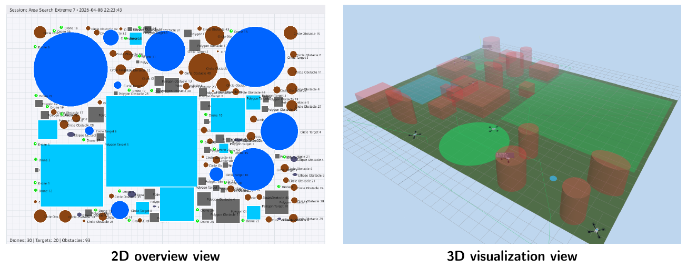
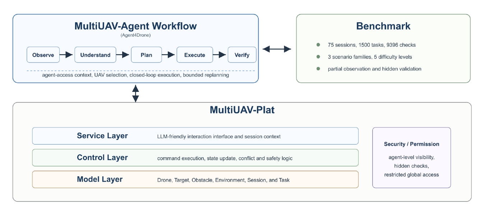
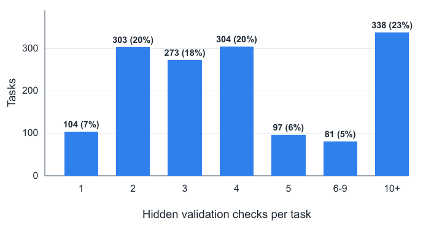
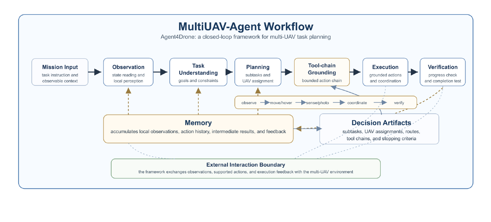
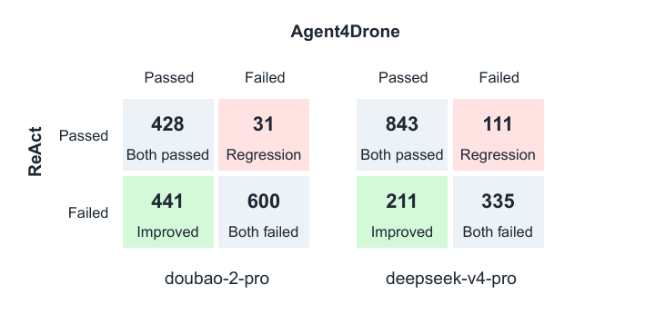
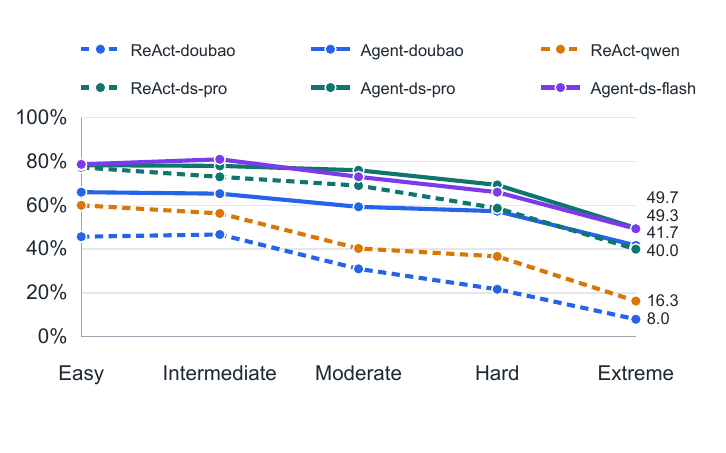
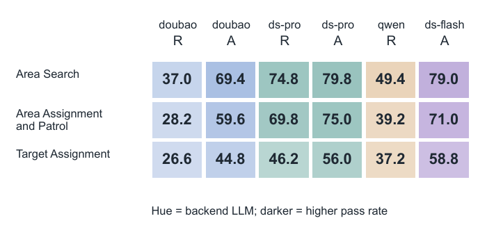

# MultiUAV-Plat：面向大语言模型的多无人机协同任务规划平台、基准与框架

**原文题名：** MultiUAV-Plat: An LLM-Oriented Platform, Benchmark and Framework for Multi-UAV Collaborative Task Planning

**作者：** Sheng Zhangᵃ、Qinglin Liᵃ、Yuechao Zangᵃ、Xueqin Huangᵃ、Yijia Fuᵃ、Cheng Zhuᵃ,*

**单位：** ᵃ 国防科技大学信息系统工程全国重点实验室，中国湖南省长沙市德雅路，410073。

**版本：** arXiv:2606.31073v1 [cs.AI]，2026 年 6 月 30 日。[原文页面](https://arxiv.org/abs/2606.31073v1)。

**开源平台：** [MultiUAV-Plat 代码仓库](https://github.com/zhangsheng93/MultiUAV-Plat)。

**通讯作者：** * Cheng Zhu。

**电子邮箱：** zhangsheng@nudt.edu.cn（S. Zhang）；liqinglin@nudt.edu.cn（Q. Li）；zangyuechao@nudt.edu.cn（Y. Zang）；hxq@nudt.edu.cn（X. Huang）；fuyijia20@nudt.edu.cn（Y. Fu）；zhucheng@nudt.edu.cn（C. Zhu）。

> 译文说明：本文件根据本地归档的 13 页论文全文翻译，保留原文章节、引文编号、5 个公式、6 张表、7 幅图及 36 条参考文献。图像保留原图，图题、图例及主要图内文字另附中文；表格转写为 Markdown。作者姓名、方法名、模型名、API 标识及文献检索信息保留原文。原文的论断、数字和限定条件按原意翻译，不混入源码审查或精读评论。仅省略重复页眉、页脚及排版性断行。文献题名附中文译名并保留英文原题。翻译日期：2026-09-28。

## 文章信息

**关键词：** 多无人机协同；大语言模型智能体；无人机任务规划；多无人机协同基准。

## 摘要

大语言模型（LLM）为高层机器人任务规划提供了一种具有前景的交互接口，但其在多无人机协同中的应用仍然难以得到系统评估。现有无人机仿真器主要关注动力学、感知或底层控制，而现有 LLM 智能体基准很少涵盖部分可观测性、空间覆盖、无人机分配和多机协调等空中机器人约束。为弥合这一差距，我们提出 MultiUAV-Plat：一个轻量、易用、面向 LLM 智能体的多无人机协同任务规划仿真平台。该平台提供简洁的 RESTful API、面向智能体的观测、基于角色的信息访问、隐藏验证逻辑，以及可选的二维和三维可视化，使智能体能够通过贴近实际的工具交互完成任务，而不是依赖对仿真器的特权访问。

在此平台基础上构建的 MultiUAV-Plat Benchmark 包含 75 个任务会话、1500 条自然语言任务和 9396 个验证检查，覆盖目标分配、区域搜索以及区域分配与巡逻三类场景。我们进一步提出 Agent4Drone，这是一个面向特定任务的 LLM 智能体框架，将多无人机行为组织为记忆、观测、任务理解、规划、执行和验证。在完整基准的配对比较中，Agent4Drone 的任务通过率为 57.9%，平均任务检查通过率为 74.6%，全局检查通过率为 72.0%，显著优于 ReAct 基线的 30.6%、47.9% 和 43.1%。Agent4Drone 还将完全失败任务率从 32.4% 降低到 12.9%。这些结果表明，MultiUAV-Plat 及 MultiUAV-Plat Benchmark 为研究现实信息与执行约束下的 LLM 驱动多无人机自主性提供了可复现的基础。

## 1. 引言

多无人机（multiUAV）系统已经成为一项具有变革性的技术，广泛应用于环境监测、空中搜索、应急响应和物流等真实场景。它们具备快速覆盖、灵活部署和可扩展感知能力，因而在民用和工业领域都不可或缺。尽管应用日益广泛，多无人机系统的控制与协调仍然具有很大挑战。现有任务规划与路径规划研究已经为分配、路径安排、覆盖、避障和能量感知协调奠定了坚实基础 [24, 20, 9]。然而，传统方法通常依赖专家设计的问题形式化和耗费大量人力的手动控制流程，这往往导致效率未达最优、适应性受限以及较高的操作开销。随着任务复杂度增加，这些局限会更加突出。

大语言模型的出现为智能多无人机协调带来了一种具有前景的范式转变。LLM 智能体具备较强的自然语言理解能力、丰富的世界知识和不断增强的工具使用接口，已经展现出推理任务结构、规划高层策略和执行复杂动作序列的显著潜力 [34, 1, 11]。近期的多机器人与多无人机研究进一步表明，LLM 能够分解高层指令、组建协作联盟、协调多个机器人，并支持以自然语言进行空中控制 [8, 15, 14, 17]。然而，这些能力能否迁移到需要通过受限机器人接口进行闭环交互的多无人机任务中，仍不明确。

一个面向实际运行的 LLM 控制无人机智能体不能假设自己掌握完整的仿真器状态：它必须理解自然语言目标、选择合适的无人机、主动获取缺失的局部观测、发出可执行的 API 调用、协调多架无人机，并在隐藏任务条件下验证进展。由此引出本文的核心研究问题：**当 LLM 智能体通过受限无人机 API、局部感知和隐藏任务验证器开展工作时，应如何系统评估其多无人机协同任务规划能力？**

为解决这一问题，我们提出 MultiUAV-Plat。这是一个轻量、易用、开放且可扩展的仿真平台，专门面向 LLM 智能体驱动的多无人机协同任务规划与控制。图 1 展示了该平台针对同一任务状态同步呈现的二维总览视图与三维可视化视图。与主要提供物理、感知和控制接口的高保真无人机仿真器 [22, 25, 19] 不同，该平台提供统一且对 LLM 友好的 API 接口。智能体可通过这些接口发出无人机动作、接收面向智能体的观测，并依据变化中的任务状态迭代调整计划，而无须与仿真器内部结构或底层飞控代码交互。

**图 1：** 面向无人机任务规划的 MultiUAV-Plat 平台视图。二维和三维视图表示同一个底层任务状态。二维视图用于快速总览、场景检查和任务级空间推理；三维视图用于直观呈现无人机执行过程与环境几何结构。

*图内文字：* 2D overview view：二维总览视图；3D visualization view：三维可视化视图。界面中的 Session、Drones、Targets、Obstacles 分别为会话、无人机、目标、障碍物；Drone、Circle/Polygon Target、Circle/Polygon Obstacle 分别为无人机、圆形/多边形目标、圆形/多边形障碍物，编号与场景标识保留原图。

通过抽象底层系统集成，同时保留闭环动作控制，MultiUAV-Plat 使研究人员不仅能够评估高层规划，还能够评估智能体的执行、反馈处理与重规划能力。据我们所知，MultiUAV-Plat 是首个面向 LLM 智能体、用于可执行多无人机协同任务规划的仿真与基准测试平台。它通过受限无人机 API、局部观测、闭环执行以及隐藏的任务级验证器评估智能体。该基准覆盖广泛的难度范围，从简单的 API 调用测试，到具有挑战性的单无人机任务，再到充分协作的多无人机任务。

除平台和基准外，我们进一步提出 Agent4Drone，这是一个专门用于多无人机协同任务规划的框架。Agent4Drone 旨在增强 LLM 在不同任务模式中的泛化能力，通过结构化指导帮助 LLM 智能体更有效地分解任务、管理工具调用以及协调多架无人机。实验结果表明，在完整基准上，Agent4Drone 的任务通过率比 ReAct 提高了 27.33 个百分点。这建立了一个有力的任务特定框架，并为未来研究 LLM 控制的空中机器人提供了实用起点。

综上，本文贡献如下：（1）MultiUAV-Plat，一个轻量、易用、面向 LLM 智能体的多无人机协同任务规划仿真平台；（2）MultiUAV-Plat Benchmark，一套用于在受限 API 访问、局部感知和隐藏验证条件下，对 LLM 智能体进行可复现评估的基准；（3）Agent4Drone，一个参考 LLM 智能体框架，并提供其与 ReAct 在完整基准上的配对比较。这些贡献共同为空中多机器人自主系统与大规模语言模型交叉领域的新兴研究方向奠定了基础。

## 2. 相关工作

### 2.1. 多无人机任务规划

多无人机系统研究长期以来将任务规划视为任务分配、路径规划、覆盖、协调和约束满足相互耦合的问题。近期关于多无人机任务规划 [24] 和多无人机路径规划 [20] 的综述总结了广泛的方法，包括数学规划、启发式与元启发式方法、基于协商的分配，以及基于学习的方法。这些方法为目标分配、区域覆盖、碰撞避免、能量感知路径规划和协同执行提供了重要基础。Kong 等人 [9] 进一步将动态障碍和部分可观测条件下的同时目标分配与路径规划表述为学习问题，利用深度强化学习结合分配决策与运动决策。

然而，大多数已有研究假设存在预定义的优化目标、专用控制器，或能够直接访问结构化状态信息。因此，仍有一个问题尚待解决：如何评估基于语言的智能体是否能够理解自然语言任务、主动收集缺失信息、使用受限平台 API，并通过闭环工具交互协调多架无人机。

### 2.2. 无人机与集群仿真平台

仿真平台是无人机研究的另一项重要基础。AirSim [22]、Flightmare [25] 和 gym-pybullet-drones [19] 等通用机器人及无人机仿真器提供高保真视觉仿真、快速四旋翼动力学、强化学习接口和多智能体控制支持。Chen 等人 [3] 进一步从真实性、传感器、性能、编程接口和集群支持等方面，比较了 Webots、Gazebo、CoppeliaSim、ARGoS、MORSE 及相关工具等开源无人机集群仿真环境。这些平台极大地推动了算法开发和仿真到现实的实验，但其主要抽象仍然是物理、感知、控制或强化学习任务。

相比之下，面向 LLM 的多无人机研究需要不同的接口层：自然语言任务指令、智能体可见状态的边界、简单的工具调用 API、隐藏验证逻辑，以及可复现的基准会话。这些会话需要评估任务级推理，而不仅仅是底层控制。

**表 1：与代表性仿真器、基准和框架的比较。** “隐藏任务验证”指平台侧对可执行任务结果进行自动验证，而非离线问答、对话指令遵循，或仅提供底层奖励。

| 平台／基准／框架 | 领域 | 面向 LLM | 多智能体 | 无人机／空中 | 部分可观测 | 工具／API 动作 | 隐藏任务验证 |
| --- | --- | --- | --- | --- | --- | --- | --- |
| AirSim [22] | 无人机／自动驾驶车辆仿真 | 否 | 部分 | 是 | 否 | 是 | 否 |
| Flightmare [25] | 四旋翼仿真 | 否 | 部分 | 是 | 否 | 是 | 否 |
| gym-pybullet-drones [19] | 多无人机强化学习 | 否 | 是 | 是 | 否 | 是 | 基于奖励 |
| ALFWorld [23] | 家庭场景具身人工智能 | 是 | 否 | 否 | 部分 | 是 | 是 |
| WebShop [32] | 网页交互 | 是 | 否 | 否 | 部分 | 是 | 是 |
| AgentBench [13] | 通用 LLM 智能体 | 是 | 部分 | 否 | 部分 | 是 | 混合 |
| EmbodiedBench [31] | 多模态具身人工智能 | 是 | 否 | 否 | 是 | 是 | 是 |
| SafeAgentBench [35] | 安全具身规划 | 是 | 是 | 否 | 是 | 是 | 是 |
| MAP-THOR [16] | 多智能体家庭场景规划 | 是 | 是 | 否 | 是 | 是 | 是 |
| SMART-LLM [8] | 多机器人任务规划 | 是 | 是 | 否 | 否 | 否 | 数据集 |
| RoCo [15] | 多机器人协作 | 是 | 是 | 否 | 部分 | 是 | 基于任务 |
| AirCopBench [36] | 多无人机感知 | 是 | 是 | 是 | 是 | 否 | 基于问答 |
| MM-UAVBench [4] | 无人机多模态推理 | 是 | 否 | 是 | 是 | 否 | 基于问答 |
| UAVBench [5] | 无人机场景数据集 | 是 | 部分 | 是 | 否 | 否 | 风险标签 |
| α³-Bench [6] | 无人机网络化智能体 | 是 | 是 | 是 | 部分 | 是 | 对话式 |
| 提示驱动的多无人机规划 [14] | 多无人机任务规划 | 是 | 是 | 是 | 部分 | 否 | 否 |
| UAV-CodeAgents [21] | 无人机任务生成 | 是 | 是 | 是 | 部分 | 部分 | 否 |
| TACOS [17] | 多无人机自然语言控制 | 是 | 是 | 是 | 否 | 是 | 演示 |
| Web-of-Drones [7] | 无人机集群执行 | 是 | 是 | 是 | 否 | 是 | 否 |
| MultiUAV-Plat | 多无人机任务规划 | 是 | 是 | 是 | 是 | 是 | 是 |

### 2.3. LLM 智能体与具身基准

近年来，大语言模型被作为融合推理、工具使用和环境反馈的交互式智能体进行评估。ALFWorld [23] 和 WebShop [32] 等基准在交互式家庭或网页环境中评估与环境交互相结合的语言智能体；AgentBench [13] 则通过测量 LLM 智能体在多种决策场景中的表现，拓展了这一方向。近期的具身智能体基准进一步评估多模态具身推理、安全感知任务规划和部分可观测条件下的多智能体规划，例如 EmbodiedBench [31]、SafeAgentBench [35] 和 MAP-THOR [16]。MovingAI 基准 [27] 和 MAPF 基准 [26] 等经典寻路资源，为算法比较提供了广泛使用的栅格地图、多智能体寻路地图及场景，但它们聚焦于寻路实例，而不是面向 LLM、部分可观测且可执行的无人机任务。

近期的空中智能体基准更加接近多无人机场景。AirCopBench [36] 面向多模态大语言模型，评估多无人机协同具身感知与推理。MM-UAVBench [4] 基于真实低空无人机数据评估多模态感知、认知与规划。UAVBench [5] 提供结构化无人机场景和多项选择推理任务；α³-Bench [6] 则在网络、安全、鲁棒性与效率约束下，评估具备工具调用和智能体间协调能力的对话式无人机智能体。

与这些基准相比，MultiUAV-Plat Benchmark 聚焦于闭环、可执行的多无人机任务规划：智能体通过受限 API 交互、接收局部观测，并由隐藏任务验证器进行评估。表 1 汇总了代表性仿真器、智能体基准、具身基准、空中基准，以及多机器人或多无人机框架之间的这些差异。

### 2.4. 基于 LLM 的多机器人与空中智能体

基础 LLM 智能体框架为推理和动作选择提供了通用机制。思维链提示（Chain-of-Thought）[30] 可引导模型为复杂任务生成中间推理步骤；思维树（Tree of Thoughts）[33] 和思维图（Graph of Thoughts）[2] 则通过搜索分支结构或图结构的推理状态扩展了这一思想。ReAct [34] 将推理轨迹与动作交织起来，表明语言模型能够通过反复观测与行动改善交互式决策。这些框架提供了有用的通用基础，但本身并未规定如何分配无人机、收集局部空中观测、协调多架无人机或验证可执行任务的进展。

面向机器人的 LLM 框架进一步建立语言与动作之间的落地联系。SayCan [1] 利用可供性评分为语言模型规划提供行动依据；Code as Policies [11] 使用代码生成模型，将自然语言指令合成为机器人策略程序；Sun 等人 [28] 研究了部分可观测条件下基于 LLM 的任务规划，在这种情形中，机器人必须先收集缺失信息，再选择动作。

基于 LLM 的多机器人研究还使用语言模型进行任务分解、角色分配、通信与协调。SMART-LLM [8] 通过任务分解、联盟形成和任务分配，将高层指令转化为多机器人任务计划。RoCo [15] 利用 LLM 介导的对话实现多机器人协作，并结合碰撞检查等环境反馈优化计划。近期的综述和框架进一步研究了 LLM 在多机器人任务分配、依赖关系建模、异构协作和端到端执行中的应用，包括 Li 等人的多机器人 LLM 综述 [10]、LiP-LLM [18]、COHERENT [12] 和 DART-LLM [29]。

在空中机器人领域，提示驱动的多无人机规划 [14] 探索了自然语言任务规划；UAV-CodeAgents [21] 将多智能体 ReAct 与视觉语言落地相结合，用于无人机任务生成；TACOS [17] 通过无人机 API 库执行多无人机计划。更近的 Web-of-Drones 框架 [7] 展示了通过标准化 MCP 和 Web-of-Things 接口，基于函数调用实现闭环无人机集群执行。这些系统证明了 LLM 能够规划和执行部分选定的多无人机任务，但其评估形式是任务特定框架，而不是具备大规模任务集合和隐藏任务级验证器的可复用基准套件。这一区别促使我们构建一个可执行基准，以便在一致的任务、观测、动作和评分协议下开展系统比较。

## 3. 方法

如图 2 所示，我们的方法由三个紧密关联的组成部分构成：平台、基准和工作流框架。平台提供仿真基础，基准定义评测协议，Agent4Drone 则将所提出的 MultiUAV-Agent Workflow 实例化，用于多无人机协同中的 LLM 智能体研究。

**图 2：** 方法总览。MultiUAV-Plat 提供交互基础，MultiUAV-Plat Benchmark 提供标准化任务与自动验证，所提出的 MultiUAV-Agent Workflow（名为 Agent4Drone）在智能体级部分可观测条件下进行闭环多无人机任务规划。

*图内文字译文：*

- **MultiUAV-Agent Workflow（Agent4Drone）：** 观测 → 理解 → 规划 → 执行 → 验证；智能体可访问的上下文、无人机选择、闭环执行、有界重规划。
- **基准：** 75 个会话、1500 条任务、9396 个检查；3 个场景家族、5 个难度等级；部分观测与隐藏验证。
- **服务层：** 对 LLM 友好的交互接口与会话上下文。
- **控制层：** 命令执行、状态更新、冲突与安全逻辑。
- **模型层：** 无人机、目标、障碍物、环境、会话和任务。
- **安全／权限：** 智能体级可见性、隐藏检查、受限的全局访问。

### 3.1. 平台

为系统应对大语言模型驱动的多无人机协同任务规划与控制在开发和评估方面的挑战，我们提出 MultiUAV-Plat。这是一个轻量、模块化、开源、面向 LLM 智能体的多无人机仿真交互环境。该平台以低配置成本和直接集成智能体为设计目标：智能体接收自然语言任务指令、面向智能体的观测及环境反馈；通过简洁的 RESTful API 和简单动作原语发出具体无人机动作；观测状态变化；并根据不断演化的任务上下文调整后续计划。

平台的核心架构包括三个主要层次、一套贯穿各层的安全与权限管理机制，以及可选的可视化仿真界面。这些组件共同建立了从物理实体到智能控制的完整闭环，为开发、测试和评估基于 LLM 的自主智能体提供易用的实验环境，用户无须处理仿真器内部结构或底层飞控代码。

**模型层**是平台的基础，为系统中的核心实体提供形式化定义和封装，并作为上层使用的最小仿真交互单元。该层主要包含六个模型：Drone（无人机）、Target（目标）、Obstacle（障碍物）、Environment（环境）、Session（会话）和 Task（任务）。前四者是具体模型，后两者是抽象模型。

无人机模型是 LLM 智能体的主要交互实体，封装无人机动态属性、位置、速度、电量和传感器状态等实时状态信息，以及起飞、降落和航点导航等基本动作命令。目标模型为任务目标提供通用表示，既可以表示静态或动态的离散目标点，也可以表示需要检查或覆盖的目标区域。这种灵活的模型设计能够有效支持从简单导航到复杂区域巡逻的多种任务场景。障碍物模型定义环境中的静态威胁，例如建筑物、山体和禁飞区；它包含几何形状和空间占据信息，作为无人机路径规划或碰撞检测中必须避开的约束。

环境模型表示风、天气和光照等宏观物理条件，从而增强仿真的真实性与不确定性。会话模型实例化一个完整任务场景，聚合上述所有模型实体，并定义它们之间的空间与逻辑关系。会话模型包含一系列任务模型，为会话中的预配置场景提供具体的自然语言任务指令，从而为 LLM 智能体提供明确的规划和执行目标。

在模型层之上，**控制层**是平台的逻辑处理核心。它负责底层操作执行、模型状态更新和决策仲裁，以确保仿真一致性和有效任务执行。其功能主要包括模型实体的生命周期管理，为所有模型实体提供创建、更新、查询和删除等标准化操作管理。它还处理复杂的逻辑判断与处理，例如无人机与障碍物之间或无人机彼此之间的碰撞检测、无人机间任务分配冲突的逻辑判断，以及对子任务执行状态的持续跟踪。

**服务层**提供标准化应用程序编程接口（API），将平台连接到外部智能体。该层遵循对 LLM 友好的设计理念，提供符合 RESTful 规范的 API，使智能体能够通过简洁的工具式调用控制无人机，而无须接触仿真器内部结构或底层飞控代码。这些 API 以 LLM 智能体可直接使用的形式，提供观测、起飞、降落、航点导航、感知、拍照和验证反馈等动作原语。此外，服务层为每个活跃智能体维护独立的会话上下文，以支持多轮复杂任务规划与决策。

**安全与权限管理机制**通过请求级授权和基于角色的信息边界控制平台访问。每个 API 请求都会经过身份认证及权限等级检查，使特权用户能够访问场景配置和全局管理功能，而 LLM 智能体则被限制在智能体级操作接口内。特别是，智能体请求仅返回相应无人机局部感知范围内的信息，不会暴露全局目标、障碍物或隐藏验证数据。这种权限设计提高了系统安全性与可靠性，防止智能体利用特权全局信息，并更好地反映真实无人机运行情况：每架无人机都必须基于有限局部感知作出决策。

可选用户界面通过同步的二维总览和三维可视化视图，进一步增强了平台的易用性。二维界面使用 pygame 实现，动态显示无人机、目标和障碍物的实时位置与状态，以及外部智能体和仿真实体之间的交互。三维可视化则在直观的三维场景中呈现无人机执行过程、目标和障碍物几何结构及空间关系，补充了自上而下的二维视图。两种视图共同为用户提供任务执行进展的直接反馈，并支持场景检查、算法调试、性能分析和结果验证，从而高效开展人在回路中的 LLM 智能体框架开发。

总体而言，MultiUAV-Plat 为 LLM 驱动的多无人机协同研究提供了一组独特优势。其轻量实现、预配置会话、可复用模板、API 文档、可选二维／三维可视化以及隐藏验证器，使构建、测试和比较 LLM 智能体更加容易。其对 LLM 友好的 API 设计让研究人员能够专注于决策算法，而无须处理底层仿真细节；可视化层则使抽象任务状态和三维执行过程都更易于检查。

平台的人机交互能力既支持完全自主的无人机控制，也支持通过人工干预构建场景、调整任务和实时监测。平台还提供可复用场景资源与任务模板机制，引导用户配置场景、设计任务并快速生成定制测试用例。此外，其稳健的权限系统确保了多用户与多智能体场景中的数据隔离和操作安全，使该平台适用于协作研究与大规模实验。

### 3.2. 基准

作为平台的配套组成，我们构建了 MultiUAV-Plat Benchmark，用于评估 LLM 智能体在多无人机协同任务规划中的表现。据我们所知，MultiUAV-Plat Benchmark 是首个专门在部分可观测条件下，评估 LLM 智能体多无人机协同任务规划能力的可执行基准。与离线问答或对话评估不同，智能体必须通过受限无人机 API 行动，并满足隐藏的任务级验证器要求。该基准包含 75 个任务会话、1500 条自然语言任务和 9396 个隐藏验证检查。与单独评估语言理解或底层运动控制的基准不同，本基准聚焦任务规划层；在这一层中，自然语言推理、工具使用、空间决策和多智能体协调必须结合起来。

该基准旨在弥合语言智能体评估与真实多无人机任务执行之间的差距。在实际无人机运行中，智能体不仅必须理解自然语言目标，还必须选择合适的无人机、发出可执行动作、解释局部感知反馈，并在信息不完整时修正计划。静态语言任务或全信息仿真器难以衡量这些要求。因此，本基准强调三个设计目标：通过自然语言任务指令评估任务级推理，通过受限平台接口实施智能体级部分可观测性，以及通过隐藏自动验证支持可复现评分。这种设计使基准能够衡量 LLM 智能体能否通过闭环交互完成无人机任务，而不是依赖特权全局状态或纯文本推理。

#### 3.2.1. 基准设计

每个基准会话定义一个完整任务场景，包括无人机、目标、障碍物、环境设置和一组任务指令。每条任务作为独立单元评分，而同一会话内的任务按顺序执行。在开始下一条任务之前，电池状态会被重置，所有无人机都会被强制降落，但其最终位置会保留。因此，前一条任务可能影响后一条任务中无人机的初始位置，不过每条任务的通过或失败仍由其自身验证条件分别确定。最终基准分数根据这些任务级结果计算，而不是根据是否满足某种规定的任务顺序来计算。

本基准遵循面向智能体的协议，而非全知仿真器协议。LLM 智能体能够查看任务描述、检查无人机状态、发出无人机动作，并且仅接收每架无人机周围的局部感知信息。它不能直接感知全局目标或障碍物；只有当目标和障碍物进入无人机感知半径时，它们才变得可见。相较于全信息规划，这种部分观测设置使基准更加贴近现实，也显著增加了难度：智能体必须主动收集信息、根据不完整局部观测进行推理，并在无法直接读取完整任务地图的情况下协调无人机。

这一设计也将任务求解与任务评分分离。任务以自然语言目标的形式呈现给智能体，而任务完成情况由平台侧自动检查评估。这些检查是隐藏验证点，仅用于任务规划与执行后的可复现评分。该基准的 1500 条任务共包含 9396 个隐藏检查：每条任务有 1–39 个检查，中位数为 4，平均值为 6.26。如图 3 所示，检查较多的任务包含更多必须满足的条件，因此通常需要更多执行、观测与验证步骤。

检查数量并不是轨迹长度的精确度量，因为一个动作可能满足多个条件，而一个条件也可能需要多个动作才能满足。这些检查分布于 21 类端点，覆盖移动、感知、目标、区域、状态与协调要求，使任务成功依赖于持续状态跟踪、多步执行以及避免部分完成导致的失败。

**图 3：** 每条任务的隐藏验证检查数量分布。更多检查通常意味着更多任务条件，以及更多执行、观测和验证步骤，但检查数量并不是轨迹长度的精确度量。

*图内文字：* 纵轴 Tasks：任务数；横轴 Hidden validation checks per task：每条任务的隐藏验证检查数。各柱标注依次为：1 个检查，104 条任务（7%）；2 个，303 条（20%）；3 个，273 条（18%）；4 个，304 条（20%）；5 个，97 条（6%）；6–9 个，81 条（5%）；10 个及以上，338 条（23%）。百分比按原图保留。

#### 3.2.2. 场景家族与难度设计

基准包含三个场景家族：区域搜索（Area Search）、区域分配与巡逻（Area Assignment and Patrol）以及目标分配（Target Assignment）。每个家族包含 25 个会话和 500 条任务。在每个家族内，会话分为五个难度等级：简单（Easy）、进阶（Intermediate）、中等（Moderate）、困难（Hard）和极难（Extreme）。每个难度等级包含五个使用独立随机种子生成的会话，每个会话包含 20 条任务。

场景家族表示会话中的主要任务配置和评估重点，但并不限制该会话只能包含一种任务。例如，区域搜索会话仍可包含基础导航、拍照、降落或到达目标等子任务。这种混合组成更好地反映了真实多无人机任务：高层目标通常通过不同类型的操作子任务实现。

**区域搜索**评估面状目标上的空间探索与覆盖。智能体必须指挥一架或多架无人机完整搜索圆形或多边形区域、查看相关区域几何信息，并在不假设事先完全了解环境的情况下完成覆盖类目标。该家族测试 LLM 智能体能否超越点到点导航，开展系统化信息收集与区域级搜索。

**区域分配与巡逻**将点目标分配与区域搜索目标结合起来。智能体必须协调无人机处理混合任务目标，既包括需要到达或搜索的离散点，也包括需要覆盖或巡逻的圆形或多边形区域。该家族强调分工、多无人机协调，以及在同一共享环境中处理异构目标类型时保持结构化行为。

**目标分配**评估智能体能否在多架无人机之间分配大量目标，并完成到达、检查、拍照、投送至这些目标或从目标处返回等目标导向任务。该家族强调离散空间目标上的分配与执行，尤其关注无人机和候选目标数量很多、但仅能访问局部感知的情形。

**表 2：基准概览。** 每个场景家族包含五个难度等级（Easy、Intermediate、Moderate、Hard、Extreme），每个难度有五个会话，每个会话有 20 条任务。

| 场景类型 | 会话数 | 无人机数 | 目标数 | 障碍物数 | 任务数 | 检查数 |
| --- | ---: | ---: | ---: | ---: | ---: | ---: |
| 区域搜索 | 25 | 3–20 | 3–15 | 6–100 | 500 | 3009 |
| 区域分配与巡逻 | 25 | 5–30 | 3–20 | 6–100 | 500 | 2813 |
| 目标分配 | 25 | 5–30 | 3–100 | 6–100 | 500 | 3574 |
| 合计 | 75 | 3–30 | 3–100 | 6–100 | 1500 | 9396 |

基准难度在会话层面定义，反映任务世界的整体复杂度。随着难度增加，会话通常包含规模更大的机群、更多目标、更密集的障碍物和更大的任务区域。在所有会话中，无人机数量范围为 3–30，目标数量为 3–100，障碍物数量为 6–100。此外，各会话中的目标和障碍物几何结构也有所不同：目标在形状、大小和空间范围上可能不同，障碍物则在形状、大小、密度和分布上存在差异。这些变化迫使智能体针对不同空间布局调整规划策略，而不能依赖固定任务模板。

单条任务还带有局部任务复杂度标签，例如 easy、medium 和 hard。这些标签描述会话内某条具体指令的复杂程度，而五个基准难度等级描述全局场景复杂度。这一区分很重要，因为真实任务通常同时包含简单操作原语和困难的协作子任务。一个稳健的 LLM 智能体应当可靠地完成底层操作指令，同时适应更大机群、更密集环境、异构目标与障碍物布局以及有限可观测性所带来的更高规划要求。

#### 3.2.3. 评测协议与指标

基准使用隐藏的平台侧检查来评估每条自然语言任务。主要指标是**任务通过率（Task Pass Rate）**：只有当任务的验证逻辑通过时，该任务才被计为成功。由于复杂任务可能包含多个检查，我们还报告检查级指标，以衡量部分进展。这些检查级指标十分重要，因为长时程任务可能整体失败，但仍完成了所需验证链中的一部分。

**平均检查通过率（Average Check Pass Rate，Avg. Check）**对每条任务内部的检查通过率取平均，使每条任务具有相同权重。**全局检查通过率（Global Check Pass Rate，Global Check）**将通过检查的数量在全部检查中汇总，因此更偏重包含较多验证条件的任务。**完全失败任务率（Total Failed Task Rate）**衡量没有任何检查通过的任务比例，以区分完全失败和部分完成的任务。表 3 汇总了这些指标。

**表 3：基准支持的评测指标。** Avg. Check 表示逐任务检查通过率的平均值，Global Check 表示全部验证检查汇总后的通过率。

| 指标 | 层级 | 定义 |
| --- | --- | --- |
| 任务通过率（Task Pass Rate） | 任务 | 通过任务数／任务总数 |
| 平均检查通过率（Avg. Check Pass Rate） | 任务 | 各任务检查通过率的平均值 |
| 完全失败率（Total Failed Rate） | 任务 | 零个检查通过的任务数／任务总数 |
| 全局检查通过率（Global Check Pass Rate） | 检查 | 所有任务中通过的检查数／检查总数 |

除汇总评分外，基准结构还为衡量基于 LLM 的多无人机规划进展提供了一条诊断路径。简单任务评估智能体能否可靠地将语言转化为基本无人机动作；中等任务测试导航、检查和顺序操作；更困难的会话则引入更大机群、更多目标、更密集障碍物、区域覆盖、巡逻和协同分配。这样的递进设计使我们能够识别当前 LLM 智能体在哪些方面成功或失败，并在共享的任务分布与评分协议下比较未来方法。

通过结合自然语言任务描述、隐藏自动验证器、局部感知约束和逐步变难的协作场景，该基准为面向 LLM 的空中机器人建立了一种新的评测设置。它比全信息提示更接近真实无人机运行，因为智能体必须主动将无人机作为感知和行动实体使用，而不能假设直接访问完整世界状态。因此，该基准为未来研究 LLM 控制的多无人机自主性提供了可复用基础，包括智能体工作流设计、部分可观测条件下的规划、任务分配和协同任务执行。

### 3.3. 框架

为给基准提供一个有效且可复现的框架，我们提出了一个用于基于 LLM 的多无人机任务规划的轻量级 MultiUAV-Agent Workflow。我们将所提出的工作流称为 Agent4Drone。该工作流专门针对 MultiUAV-Plat 设计，而不是一种通用提示策略。思维链提示或 ReAct 等通用 LLM 工作流可以改善推理和工具使用，但没有显式建模多无人机协同的关键要求，包括局部感知、无人机选择、任务分解、协同动作执行以及基于状态的验证。相比之下，Agent4Drone 围绕平台的任务结构和受限信息边界组织智能体，使其易于实现，同时仍然涵盖 LLM 控制空中协作的核心挑战。

该工作流有意定位于任务规划层，而不是底层无人机控制器。它不处理飞行稳定、连续轨迹优化或形式化运动规划。相反，它将自然语言任务与当前可见的场景状态转化为一段简短、可执行的动作序列，通过平台执行该序列，并利用反馈决定结束、重试还是重规划。这种设计使 Agent4Drone 适合进行系统比较，因为它与通用智能体基线运行在相同的平台、基准、可见性约束和验证协议下。

**图 4：** Agent4Drone 的框架结构。MultiUAV-Agent Workflow 将任务输入和可观测上下文转化为闭环的观测、任务理解、规划、工具链落地、执行与验证。记忆保存局部观测、动作历史、中间结果和反馈；决策产物则组织子任务、无人机分配、有界工具／动作链和停止条件，以支持反馈驱动的重规划。

*图内文字译文：*

- **MultiUAV-Agent Workflow：** 多无人机智能体工作流。副标题：Agent4Drone，一个用于多无人机任务规划的闭环框架。
- **任务输入（Mission Input）：** 任务指令与可观测上下文。
- **观测（Observation）：** 状态读取与局部感知。
- **任务理解（Task Understanding）：** 目标与约束。
- **规划（Planning）：** 子任务与无人机分配。
- **工具链落地（Tool-chain Grounding）：** 有界动作链。
- **执行（Execution）：** 已落实的动作与协调。
- **验证（Verification）：** 进度检查与完成测试。
- **动作链示例：** 观测 → 移动／悬停 → 感知／拍照 → 协调 → 验证。
- **记忆（Memory）：** 累积局部观测、动作历史、中间结果和反馈。
- **决策产物（Decision Artifacts）：** 子任务、无人机分配、路线、工具链和停止条件。
- **外部交互边界（External Interaction Boundary）：** 框架通过这一边界，与多无人机环境交换观测、受支持的动作和执行反馈。

#### 3.3.1. 问题形式化

我们将每条基准任务形式化为一个部分可观测的多无人机决策问题。一条任务由自然语言指令 $T$、步骤 $t$ 时智能体可访问的观测 $O_t$、平台支持的动作集合 $\mathcal{A}$，以及隐藏验证函数 $V$ 指定。观测 $O_t$ 只包含智能体能够获得的信息，包括任务文本、可见的无人机状态、命令反馈、局部感知和累积交互历史。它不包含全局目标列表、全局障碍物列表和验证规则等特权场景信息。动作集合 $\mathcal{A}$ 包括受约束的若干动作类别：观测、运动、感知与拍照、通信与协调，以及验证反馈。

基于 LLM 的多无人机智能体可以描述为如下闭环决策规则：

$$
\pi_\theta:(T,O_t,M_t)\rightarrow(q_t,C_t),
\tag{1}
$$

其中，$M_t$ 表示智能体的记忆，$q_t$ 是下一个高层子任务，$C_t$ 是对应的有界可执行工具链。工具链由平台所支持动作步骤的有限序列构成：

$$
C_t=(c_t^1,\ldots,c_t^{L_t}),
\tag{2}
$$

其中，上标 $l$ 表示工具链内的步骤索引。每一步定义为：

$$
c_t^l=(u_t^l,a_t^l,p_t^l),
\tag{3}
$$

其中，$u_t^l$ 是负责执行的无人机或无人机组，$a_t^l\in\mathcal{A}$ 是平台支持的动作，$p_t^l$ 包含动作参数。高层子任务被落实为其可执行工具链：

$$
q_t\Rightarrow C_t.
\tag{4}
$$

执行一段工具链后，智能体接收执行与验证反馈 $r_t$，并更新其观测与记忆：

$$
(O_{t+1},M_{t+1})=\Phi(O_t,M_t,C_t,r_t).
\tag{5}
$$

随后，智能体使用更新后的观测和记忆再次应用该决策规则。在 $t=1,2,\ldots$ 上反复应用这一规则，就形成了完整的任务求解轨迹。其目标是在遵守平台支持的动作、智能体级信息访问以及有界执行与重规划要求的同时，最大化隐藏验证器 $V$ 下的任务完成情况。这种形式化不同于全信息规划，因为智能体在完成或验证任务之前，可能需要通过无人机移动和局部感知主动收集缺失信息。

#### 3.3.2. 工作流设计

如图 4 所示，Agent4Drone 框架由六个概念模块构成：观测、任务理解、记忆、规划、执行和验证。这些模块并非意在成为重量级软件组件；它们定义的是一种最小结构，使 LLM 智能体的推理过程更加稳定、可解释和可复现。

**观测模块**收集当前任务描述、无人机状态、电量、位置和局部感知信息。由于目标和障碍物只有在无人机感知半径内才可见，观测是规划中的主动环节，而非一次性查询。

**任务理解模块**将每条指令转化为结构化解释。它识别可能的任务意图、候选动作类型、可见任务对象、空间约束，以及任务需要一架还是多架无人机。

**记忆模块**采用共享黑板机制，框架各模块通过它在多轮推理之间读取和更新紧凑状态。黑板记录当前任务、可见环境上下文、无人机状态与分配、局部感知实体、动作与命令结果、先前验证结果以及重试状态。它仅限于通过智能体访问接口可获得的信息，不包含隐藏验证规则，也不包含智能体无法在全局访问的目标和障碍物。这使框架与基准的部分观测设置保持一致，同时使观测、规划、执行和验证能够通过共同的状态表示协同工作。

**规划模块**选择合适的无人机，并将任务分解为带有预期状态变化的一小段子任务序列。选择无人机时，会考虑可见位置、电量、运行状态、已感知的邻近实体、与相关可见目标的接近程度，以及任务是否能从协作中受益。对于简单操作任务，框架倾向于使用一架主要无人机，以避免不必要的协调开销。对于区域覆盖、巡逻、编队或明确要求多无人机的指令，框架会分配多架无人机，同时避免相互冲突的命令与冗余覆盖。计划被有意设计为短时域：在执行有意义的动作之后，智能体会重新观测环境、更新记忆，然后再继续。

**执行模块**使用平台支持的动作类别，将每个计划中的子任务落实为一条有界工具链。这些动作类别包括观测、运动、感知与拍照、通信或协调，以及验证反馈。Agent4Drone 执行少量动作，观测更新后的状态，验证进展，再决定继续、重试还是重规划。**验证模块**比较预期状态变化与观测到的状态变化，并利用平台侧任务验证反馈决定任务是否通过。如果验证失败，框架会分析预期状态与观测状态之间的差异，更新记忆，并在有限预算内重试或重规划。

#### 3.3.3. 闭环执行

整个框架以闭环方式运行。首先，智能体观测当前任务和可见会话上下文。其次，它理解任务意图并识别相关约束。第三，选择合适的无人机并生成简短的子任务序列。第四，执行一个或少量动作。第五，重新观测场景并验证任务是否已满足。如果任务通过，框架记录成功并转入下一条任务。如果任务未通过，框架根据更新后的观测进行有界重试或重规划。

这种闭环设计对 MultiUAV-Plat 非常重要，因为命令成功与任务成功并不等价。一个命令可能被平台接受，但由于接近程度不足、缺少感知、无人机选择错误、区域覆盖不完整或协调失败，任务仍未完成。通过在短时域规划与观测、验证之间交替进行，框架降低了长串推测性动作链的风险，并使智能体能够从部分失败中恢复。

失败处理遵循保守原则。如果命令失败或验证仍未通过，智能体首先刷新可见状态，而不是假定失败原因。如果反复尝试未能改善任务状态，框架会记录失败原因，例如未感知到目标、移动不足、电量低、无人机分配错误，或协作条件未满足。在不确定性较高时，智能体优先选择悬停、返航或降落等安全回退动作，而不是继续不受控的探索。这些规则使框架适用于可复现实验，并为后续分析提供可解释的失败轨迹。

总体而言，Agent4Drone 为 LLM 驱动的多无人机协同提供了一个简单但面向特定任务的框架。它仅依赖智能体可访问的信息和平台支持的动作，因此易于实现；同时，它显式建模了局部感知、无人机选择、协作分解、反馈驱动执行和有界重规划，因而比通用 LLM 工作流更适合这一问题。因此，它为未来在 MultiUAV-Plat 及其基准上研究 LLM 智能体提供了实用起点。

## 4. 实验

实验在相同的 MultiUAV-Plat Benchmark 协议下，将 Agent4Drone 与通用 ReAct 智能体进行比较。分析首先比较整体任务完成情况和部分验证成功情况，再考察性能增益是否在不同场景家族与难度等级中保持一致。随后，进一步研究任务类别和生成模板，以识别仍然困难的案例，并利用验证端点统计刻画主要的剩余失败模式。

### 4.1. 实验设置

所有实验都使用 MultiUAV-Plat Benchmark 作为评估环境。完整基准包含 75 个会话、1500 条任务和 9396 个自动验证检查。基准由目标分配、区域搜索以及区域分配与巡逻三个场景家族组成，每个家族包含五个难度等级。除非另有说明，智能体均以平台的 AGENT 角色接受评估。因此，智能体可以观测任务描述、无人机状态、命令反馈和局部感知，但无法访问隐藏验证规范、全局目标列表、全局障碍物列表或场景创建与编辑 API。

每条任务都由平台侧任务检查器评估。只有当隐藏检查逻辑得到满足时，该任务才被计为通过。API 返回状态不作为独立成功指标评分：被接受或失败的 API 调用，通过任务条件是否得到满足来影响结果。除任务级成功情况外，我们还报告检查级成功情况，以刻画复杂任务内部的部分进展。例如，一条多无人机编队任务可能整体失败，但仍满足若干针对单架无人机的移动或距离检查。

**比较方法。** ReAct 是当前完整配对比较所使用的基线方法。它遵循通用的“观测—推理—行动”循环，模型交替读取可见任务状态、推理下一步、发出动作并观测反馈。Agent4Drone 是我们提出的任务特定框架。它通过显式的记忆、观测、任务理解、规划、执行和验证模块增强闭环行动，这些模块专为多无人机任务分配、局部感知和基于状态的恢复设计。两种方法都以相同的 AGENT 角色运行，并使用相同的观测、动作和验证接口；任何一种方法都不能访问隐藏验证规范或特权全局状态。为使最终评估更加全面，表 4 纳入了多个后端 LLM 上已完成的基准结果。

**指标。** 我们采用第 3.2.3 节定义的任务级与检查级指标，包括任务通过率、平均任务检查通过率（Avg. Check）、全局检查通过率，以及完全失败任务率。

### 4.2. 主要结果

**表 4：MultiUAV-Plat Benchmark 在多个后端 LLM 上的主要基准结果。** “后端 LLM”列标明每次运行使用的模型。数值由 `tools/recompute_results.py` 生成。

| 方法 | 后端 LLM | 通过任务数 | 完全失败任务数 | 任务通过率 | 平均检查通过率 | 全局检查通过率 | 完全失败率 |
| --- | --- | ---: | ---: | ---: | ---: | ---: | ---: |
| ReAct | doubao-2-pro | 459 | 486 | 30.60% | 47.91% | 43.15% | 32.40% |
| ReAct | qwen3.5 | 629 | 333 | 41.93% | 59.42% | 56.29% | 22.20% |
| ReAct | deepseek-v4-pro | 954 | 118 | 63.60% | 79.72% | 73.09% | 7.87% |
| Agent4Drone | doubao-2-pro | 869 | 194 | 57.93% | 74.58% | 71.96% | 12.93% |
| Agent4Drone | deepseek-flash | 1044 | 102 | 69.60% | 83.40% | 80.76% | 6.80% |
| Agent4Drone | deepseek-v4-pro | **1054** | 93 | **70.27%** | **84.86%** | **82.82%** | 6.20% |

表 4 汇总了在完整 MultiUAV-Plat Benchmark 上已完成的主要基准结果。在使用 doubao-2-pro 的配对比较中，Agent4Drone 通过了 1500 条任务中的 869 条，而 ReAct 通过了 459 条。这使任务通过率从 30.60% 提高到 57.93%，增加了 27.33 个百分点。Agent4Drone 还将平均任务检查通过率从 47.91% 提高到 74.58%，将全局检查通过率从 43.15% 提高到 71.96%。

在更强的 DeepSeek 后端上，Agent4Drone 使用 deepseek-v4-pro 时的任务通过率达到 70.27%，使用 deepseek-flash 时达到 69.60%。更新后的 deepseek-v4-pro ReAct 基线达到 63.60%，高于 doubao-2-pro 和 qwen3.5 的 ReAct 基线，但仍低于采用相同后端的 Agent4Drone。

该次运行使用了约 1500 万输出 token、9000 万缓存未命中的输入 token，以及 20 亿缓存命中的输入 token。这些数字为使用 deepseek-v4-pro 上的 Agent4Drone 执行完整 1500 条任务基准提供了实用的资源消耗参考。

图 5 中的配对转移分析比较了同时具备 ReAct 和 Agent4Drone 运行结果的两个后端 LLM。在 doubao-2-pro 下，Agent4Drone 将 441 条 ReAct 失败任务转为通过，同时仅有 31 条 ReAct 通过任务转为失败。在 deepseek-v4-pro 下，净增益较小，但仍为正：Agent4Drone 将 211 条 ReAct 失败任务转为通过，同时出现 111 条回退。

**图 5：** 在 doubao-2-pro 和 deepseek-v4-pro 下，ReAct 与 Agent4Drone 之间的配对任务级结果转移矩阵。

*图内文字：* 行表示 ReAct 结果，列表示 Agent4Drone 结果；Passed：通过；Failed：失败；Both passed：两者均通过；Regression：回退；Improved：改善；Both failed：两者均失败。doubao-2-pro 的四格依次为两者均通过 428、回退 31、改善 441、两者均失败 600；deepseek-v4-pro 则分别为 843、111、211、335。

图 6 报告了所有已完成的“方法—后端”运行在各难度等级下的任务通过率。曲线同时呈现了模型能力效应和方法效应：更强的后端显著改善 ReAct 基线，而 Agent4Drone 在所有难度等级上都保持竞争力，并且对较弱后端上的困难任务尤为重要。

**图 6：** 所有已完成“方法—后端”运行按难度等级划分的任务通过率。采用相同后端 LLM 的运行使用相同颜色；虚线表示 ReAct，实线表示 Agent4Drone。

*图内文字：* 纵轴为任务通过率；横轴依次为简单（Easy）、进阶（Intermediate）、中等（Moderate）、困难（Hard）和极难（Extreme）。图例中的 Agent 指 Agent4Drone，doubao、ds-pro、qwen、ds-flash 分别对应 doubao-2-pro、deepseek-v4-pro、qwen3.5、deepseek-flash。极难等级右侧的数值标签按原图保留为 49.7、49.3、41.7、40.0、16.3 和 8.0，单位为百分比。

图 7 汇总了所有已完成“方法—后端”运行在各场景家族中的任务通过率。色相标识后端 LLM，颜色越深表示通过率越高。在配对的 doubao-2-pro 和 deepseek-v4-pro 各列中，Agent4Drone 在每个场景家族上都优于 ReAct；doubao-2-pro 上的提升更大，deepseek-v4-pro 上也仍然表现出稳定增益。目标分配仍是最困难的家族，表明更强的后端推理能力有所帮助，但未能消除目标匹配和目标验证的困难。

**图 7：** 已完成“方法—后端”运行在各场景家族中的任务通过率。色相表示后端 LLM，颜色深浅表示通过率。

*图内文字：* 三行依次为区域搜索、区域分配与巡逻、目标分配；R 表示 ReAct，A 表示 Agent4Drone；后端缩写与图 6 相同。“Hue = backend LLM; darker = higher pass rate”意为“色相表示后端 LLM；颜色越深，通过率越高”。六列顺序为 doubao/ReAct、doubao/Agent4Drone、ds-pro/ReAct、ds-pro/Agent4Drone、qwen/ReAct、ds-flash/Agent4Drone。三行数值分别为：37.0、69.4、74.8、79.8、49.4、79.0；28.2、59.6、69.8、75.0、39.2、71.0；26.6、44.8、46.2、56.0、37.2、58.8，单位均为百分比。

### 4.3. 任务类型与模板分析

针对配对的 doubao-2-pro 和 deepseek-v4-pro 运行，我们使用任务模板系统中定义的生成器类别分析任务类型。这比仅依赖表面任务名称更稳定，因为它遵循了基准预设的任务生成结构。表 5 报告了各方法和后端的任务通过率。在两个后端上，Agent4Drone 在大多数类别中均高于 ReAct；而在 deepseek-v4-pro 下，通信类别已经接近饱和。

**表 5：配对后端运行按生成任务类别划分的任务通过率。** 通过率单位为百分比。

| 类别 | 任务数 | doubao-2-pro：ReAct | doubao-2-pro：Agent4Drone | deepseek-v4-pro：ReAct | deepseek-v4-pro：Agent4Drone |
| --- | ---: | ---: | ---: | ---: | ---: |
| 基本操作（Basic Operations） | 146 | 79.45 | 93.84 | 86.99 | 97.95 |
| 导航（Navigation） | 339 | 31.56 | 64.60 | 61.95 | 74.63 |
| 搜索（Search） | 396 | 23.74 | 53.79 | 69.70 | 70.20 |
| 多无人机协调（Multi-Drone Coordination） | 514 | 17.12 | 39.88 | 48.05 | 54.09 |
| 投送（Delivery） | 73 | 47.95 | 91.78 | 86.30 | 97.26 |
| 通信（Communication） | 32 | 59.38 | 87.50 | 96.88 | 96.88 |

模板级结果为这些类别提供了更细致的视角。Agent4Drone 在以导航和编队为主的模板上取得了尤其明显的提升，包括五架无人机的“机群协同起飞与编队”（Fleet Coordinated Takeoff and Formation）、“飞行马拉松导航”（Flight Marathon Navigation）、“飞经多个航点”（Fly Several Waypoints）以及“复杂障碍场导航”（Complex Obstacle Course Navigation）。

相比之下，即使采用更强的后端，目标分配完成、区域搜索完成、顺序访问多个目标，以及部分巡逻或扫描任务仍然困难。这些困难模板中有许多呈现出较高的平均检查完成率，但严格任务通过率较低，表明 Agent4Drone 经常完成了部分任务，却遗漏了至少一个必需的无人机—目标条件或机群级条件。

### 4.4. 失败分析

配对运行的端点级验证揭示了剩余失败发生的位置。表 6 报告了代表性验证端点的检查通过率。最稳定的改善发生在移动与路径跟随检查上：在 doubao-2-pro 和 deepseek-v4-pro 两个后端下，Agent4Drone 的定向距离检查和访问位置检查通过率都高于 ReAct。这些改善解释了导航、投送和编队模板中相当大一部分增益。

**表 6：配对后端运行的端点级检查通过率。** “检查数”表示每个端点对应的验证检查数量；通过率单位为百分比。

| 端点 | 检查数 | doubao-2-pro：ReAct | doubao-2-pro：Agent4Drone | deepseek-v4-pro：ReAct | deepseek-v4-pro：Agent4Drone |
| --- | ---: | ---: | ---: | ---: | ---: |
| `drone_has_moved_directed_distance` | 1917 | 48.83 | 90.14 | 77.99 | 98.85 |
| `drone_has_visited_position` | 3692 | 39.52 | 69.07 | 73.10 | 80.55 |
| `target_is_reached_by_drone` | 1049 | 31.17 | 51.38 | 66.35 | 65.40 |
| `target_in_photo_taken_by_drone` | 465 | 14.62 | 37.20 | 40.00 | 51.61 |
| `drone_position` | 214 | 23.83 | 56.07 | 49.07 | 69.63 |
| `task_progress` | 83 | 21.69 | 10.84 | 77.11 | 50.60 |
| `target_is_reached` | 317 | 54.57 | 65.93 | 93.38 | 84.54 |
| `target_is_fully_searched` | 171 | 15.79 | 63.16 | 85.38 | 80.12 |

*端点名称中文对应：* 无人机已沿指定方向移动规定距离；无人机已访问指定位置；目标已被指定无人机到达；目标出现在指定无人机拍摄的照片中；无人机位置；任务进度；目标已被到达；目标已被完整搜索。

剩余瓶颈包括目标落地、最终进度检查，以及部分目标完成端点。在 deepseek-v4-pro 下，尽管 Agent4Drone 改善了移动、访问位置、拍照和无人机位置检查，但在 `task_progress`、`target_is_reached` 和 `target_is_fully_searched` 上的通过率低于 ReAct。这说明未来的改进应聚焦于主动目标定位、最终条件验证，以及避免过早或不一致的完成声明。对 `task_progress` 的比较应谨慎解读，因为该端点仅出现了 83 次。

## 5. 结论

本文提出了 MultiUAV-Plat，一个面向 LLM、用于可执行多无人机协同任务规划的仿真平台与基准。该平台提供受限无人机控制 API、智能体级局部观测、局部感知、可选可视化和隐藏任务验证器，使 LLM 智能体能够通过闭环交互接受评估，而不是依靠特权仿真器状态。在此基础上，MultiUAV-Plat Benchmark 提供了 75 个任务会话、1500 条任务和 9396 个验证检查，覆盖目标分配、区域搜索以及区域分配与巡逻三类场景。

我们还提出了 Agent4Drone，一个面向特定任务的 LLM 智能体框架，围绕观测、记忆、规划、执行和验证组织多无人机行为。在完整基准的配对实验中，Agent4Drone 在 doubao-2-pro 下相较 ReAct 将任务通过率提高了 27.3 个百分点，并在更强的 DeepSeek 后端上保持竞争力，在移动和路径跟随任务上取得了一致的检查级增益。剩余失败凸显了部分可观测条件下目标落地、最终条件验证和协同执行所面临的持续挑战。

未来工作将通过更丰富的动力学、更强的目标定位策略、消融研究，以及更广泛的后端比较，扩展平台与基准。

## 参考文献

**[1]** Ahn, M., Brohan, A., Brown, N., Chebotar, Y., Cortes, O., David, B., Finn, C., Fu, C., Gopalakrishnan, K., Hausman, K., Herzog, A., Ho, D., Hsu, J., Ibarz, J., Ichter, B., Irpan, A., Jang, E., Jauregui Ruano, R., Jeffrey, K., Jesmonth, S., Joshi, N.J., Julian, R., Kalashnikov, D., Kuang, Y., Lee, K.H., Levine, S., Lu, Y., Luu, L., Parada, C., Pastor, P., Quiambao, J., Rao, K., Rettinghouse, J., Reyes, D., Sermanet, P., Sievers, N., Tan, C., Toshev, A., Vanhoucke, V., Xia, F., Xiao, T., Xu, P., Xu, S., Yan, M., Zeng, A., 2022。**按我能做的行动，而非仅按我所说的行动：将语言落实于机器人可供性。** 原题：*Do as I can, not as I say: Grounding language in robotic affordances.* arXiv 预印本 arXiv:2204.01691。[论文](https://arxiv.org/abs/2204.01691)；[DOI: 10.48550/arXiv.2204.01691](https://doi.org/10.48550/arXiv.2204.01691)。

**[2]** Besta, M., Blach, N., Kubicek, A., Gerstenberger, R., Podstawski, M., Gianinazzi, L., Gajda, J., Lehmann, T., Niewiadomski, H., Nyczyk, P., Hoefler, T., 2024。**思维图：使用大语言模型解决复杂问题。** 原题：*Graph of thoughts: Solving elaborate problems with large language models.* 载于《AAAI 人工智能会议论文集》（Proceedings of the AAAI Conference on Artificial Intelligence），第 17682–17690 页。[论文](https://arxiv.org/abs/2308.09687)；[DOI: 10.1609/aaai.v38i16.29720](https://doi.org/10.1609/aaai.v38i16.29720)。

**[3]** Chen, Z., Yan, J., Ma, B., Shi, K., Yu, Q., Yuan, W., 2023。**多旋翼无人机集群开源仿真平台综述。** 原题：*A survey on open-source simulation platforms for multi-copter UAV swarms.* Robotics，12，53。[DOI: 10.3390/robotics12020053](https://doi.org/10.3390/robotics12020053)。

**[4]** Dai, S., Ma, Z., Luo, Z., Yang, X., Huang, Y., Zhang, W., Chen, C., Guo, Z., Xu, W., Sun, Y., Sun, M., 2025。**MM-UAVBench：多模态大语言模型在低空无人机场景中的观察、思考与规划能力如何？** 原题：*MM-UAVBench: How well do multimodal large language models see, think, and plan in low-altitude UAV scenarios?* arXiv 预印本 arXiv:2512.23219。[论文](https://arxiv.org/abs/2512.23219)；[DOI: 10.48550/arXiv.2512.23219](https://doi.org/10.48550/arXiv.2512.23219)。arXiv 预印本，发表于 2025 年 12 月 29 日。

**[5]** Ferrag, M.A., Lakas, A., Debbah, M., 2025。**UAVBench：通过 LLM 生成飞行场景，面向自主与智能体式人工智能无人机系统的开放基准数据集。** 原题：*UAVBench: An open benchmark dataset for autonomous and agentic AI UAV systems via LLM-generated flight scenarios.* arXiv 预印本 arXiv:2511.11252。[论文](https://arxiv.org/abs/2511.11252)；[DOI: 10.48550/arXiv.2511.11252](https://doi.org/10.48550/arXiv.2511.11252)。arXiv 预印本，发表于 2025 年 11 月。

**[6]** Ferrag, M.A., Lakas, A., Debbah, M., 2026。**α³-Bench：面向 6G 网络中基于 LLM 的无人机智能体的安全性、鲁棒性与效率统一基准。** 原题：*α³-Bench: A unified benchmark of safety, robustness, and efficiency for LLM-based UAV agents over 6G networks.* arXiv 预印本 arXiv:2601.03281。[论文](https://arxiv.org/abs/2601.03281)；[DOI: 10.48550/arXiv.2601.03281](https://doi.org/10.48550/arXiv.2601.03281)。arXiv 预印本，发表于 2026 年 1 月 1 日。

**[7]** Iannoli, A., Gigli, L., Sciullo, L., Trotta, A., Di Felice, M., 2026。**说出任务，执行集群：无人机之网中由智能体增强的 LLM 推理。** 原题：*Say the mission, execute the swarm: Agent-enhanced LLM reasoning in the web-of-drones.* arXiv 预印本 arXiv:2605.03788。[论文](https://arxiv.org/abs/2605.03788)；[DOI: 10.48550/arXiv.2605.03788](https://doi.org/10.48550/arXiv.2605.03788)。已被第 27 届 IEEE 无线、移动与多媒体网络世界国际研讨会（WoWMoM 2026）接收并安排报告。

**[8]** Kannan, S.S., Venkatesh, V.L.N., Min, B.C., 2023。**SMART-LLM：使用大语言模型进行智能多智能体机器人任务规划。** 原题：*SMART-LLM: Smart multi-agent robot task planning using large language models.* arXiv 预印本 arXiv:2309.10062。[论文](https://arxiv.org/abs/2309.10062)；[DOI: 10.48550/arXiv.2309.10062](https://doi.org/10.48550/arXiv.2309.10062)。

**[9]** Kong, X., Zhou, Y., Li, Z., Wang, S., 2024。**动态多障碍物环境中基于深度强化学习的多无人机同时目标分配与路径规划。** 原题：*Multi-UAV simultaneous target assignment and path planning based on deep reinforcement learning in dynamic multiple obstacles environments.* Frontiers in Neurorobotics，17，1302898。[DOI: 10.3389/fnbot.2023.1302898](https://doi.org/10.3389/fnbot.2023.1302898)。

**[10]** Li, P., An, Z., Abrar, S., Zhou, L., 2025。**面向多机器人系统的大语言模型：综述。** 原题：*Large language models for multi-robot systems: A survey.* arXiv 预印本 arXiv:2502.03814。[论文](https://arxiv.org/abs/2502.03814)；[DOI: 10.48550/arXiv.2502.03814](https://doi.org/10.48550/arXiv.2502.03814)。

**[11]** Liang, J., Huang, W., Xia, F., Xu, P., Hausman, K., Ichter, B., Florence, P., Zeng, A., 2022。**代码即策略：用于具身控制的语言模型程序。** 原题：*Code as policies: Language model programs for embodied control.* arXiv 预印本 arXiv:2209.07753。[论文](https://arxiv.org/abs/2209.07753)；[DOI: 10.48550/arXiv.2209.07753](https://doi.org/10.48550/arXiv.2209.07753)。

**[12]** Liu, K., Tang, Z., Wang, D., Wang, Z., Li, X., Zhao, B., 2024。**COHERENT：利用大语言模型实现异构多机器人系统协作。** 原题：*COHERENT: Collaboration of heterogeneous multi-robot system with large language models.* arXiv 预印本 arXiv:2409.15146。[论文](https://arxiv.org/abs/2409.15146)；[DOI: 10.48550/arXiv.2409.15146](https://doi.org/10.48550/arXiv.2409.15146)。

**[13]** Liu, X., Yu, H., Zhang, H., Xu, Y., Lei, X., Lai, H., Gu, Y., Ding, H., Men, K., Yang, K., Zhang, S., Deng, X., Zeng, A., Du, Z., Zhang, C., Shen, S., Zhang, T., Su, Y., Sun, H., Huang, M., Dong, Y., Tang, J., 2023。**AgentBench：将大语言模型作为智能体进行评估。** 原题：*AgentBench: Evaluating LLMs as agents.* arXiv 预印本 arXiv:2308.03688。[论文](https://arxiv.org/abs/2308.03688)；[DOI: 10.48550/arXiv.2308.03688](https://doi.org/10.48550/arXiv.2308.03688)。

**[14]** Liu, Y., 2024。**一种基于大语言模型、由提示驱动的多无人机任务规划方法。** 原题：*A prompt-driven task planning method for multi-drones based on large language model.* arXiv 预印本 arXiv:2406.00006。[论文](https://arxiv.org/abs/2406.00006)；[DOI: 10.48550/arXiv.2406.00006](https://doi.org/10.48550/arXiv.2406.00006)。

**[15]** Mandi, Z., Jain, S., Song, S., 2023。**RoCo：借助大语言模型开展辩证式多机器人协作。** 原题：*RoCo: Dialectic multi-robot collaboration with large language models.* arXiv 预印本 arXiv:2307.04738。[论文](https://arxiv.org/abs/2307.04738)；[DOI: 10.48550/arXiv.2307.04738](https://doi.org/10.48550/arXiv.2307.04738)。

**[16]** Nayak, S., Orozco, A.M., Ten Have, M., Thirumalai, V., Zhang, J., Chen, D., Kapoor, A., Robinson, E., Gopalakrishnan, K., Harrison, J., Ichter, B., Mahajan, A., Balakrishnan, H., 2024。**LLaMAR：部分可观测环境中的多智能体机器人长时域规划。** 原题：*LLaMAR: Long-horizon planning for multi-agent robots in partially observable environments.* arXiv 预印本 arXiv:2407.10031。[论文](https://arxiv.org/abs/2407.10031)；[DOI: 10.48550/arXiv.2407.10031](https://doi.org/10.48550/arXiv.2407.10031)。该工作提出了 MAP-THOR 基准。

**[17]** Nazzari, A., Rubinacci, R., Lovera, M., 2026。**TACOS：多无人机系统的任务无关协调器。** 原题：*TACOS: Task agnostic coordinator of a multi-drone system.* Drones，10，251。[论文](https://www.mdpi.com/2504-446X/10/4/251)；[DOI: 10.3390/drones10040251](https://doi.org/10.3390/drones10040251)。

**[18]** Obata, K., Aoki, T., Horii, T., Taniguchi, T., Nagai, T., 2024。**LiP-LLM：将线性规划、依赖图与大语言模型相结合以实现多机器人任务规划。** 原题：*LiP-LLM: Integrating linear programming and dependency graph with large language models for multi-robot task planning.* arXiv 预印本 arXiv:2410.21040。[论文](https://arxiv.org/abs/2410.21040)；[DOI: 10.48550/arXiv.2410.21040](https://doi.org/10.48550/arXiv.2410.21040)。

**[19]** Panerati, J., Zheng, H., Zhou, S., Xu, J., Prorok, A., Schoellig, A.P., 2021。**学习飞行：一个使用 PyBullet 物理引擎、用于多智能体四旋翼控制强化学习的 Gym 环境。** 原题：*Learning to fly—a gym environment with PyBullet physics for reinforcement learning of multi-agent quadcopter control.* 载于 2021 年 IEEE/RSJ 智能机器人与系统国际会议（IROS），第 7512–7519 页。[论文](https://arxiv.org/abs/2103.02142)；[DOI: 10.1109/IROS51168.2021.9635857](https://doi.org/10.1109/IROS51168.2021.9635857)。

**[20]** Rahman, M., Sarkar, N.I., Lutui, R., 2025。**多无人机路径规划综述：分类、算法、开放研究问题与未来方向。** 原题：*A survey on multi-UAV path planning: Classification, algorithms, open research problems, and future directions.* Drones，9，263。[DOI: 10.3390/drones9040263](https://doi.org/10.3390/drones9040263)。

**[21]** Sautenkov, O., Yaqoot, Y., Mustafa, M.A., Batool, F., Sam, J., Lykov, A., Wen, C.Y., Tsetserukou, D., 2025。**UAV-CodeAgents：通过多智能体 ReAct 与视觉语言推理实现可扩展的无人机任务规划。** 原题：*UAV-CodeAgents: Scalable UAV mission planning via multi-agent ReAct and vision-language reasoning.* arXiv 预印本 arXiv:2505.07236。[论文](https://arxiv.org/abs/2505.07236)；[DOI: 10.48550/arXiv.2505.07236](https://doi.org/10.48550/arXiv.2505.07236)。

**[22]** Shah, S., Dey, D., Lovett, C., Kapoor, A., 2017。**AirSim：面向自主车辆的高保真视觉与物理仿真。** 原题：*AirSim: High-fidelity visual and physical simulation for autonomous vehicles.* 载于《野外与服务机器人》（Field and Service Robotics），Springer，第 621–635 页。[论文](https://arxiv.org/abs/1705.05065)；[DOI: 10.1007/978-3-319-67361-5_40](https://doi.org/10.1007/978-3-319-67361-5_40)。

**[23]** Shridhar, M., Yuan, X., Cote, M.A., Bisk, Y., Trischler, A., Hausknecht, M., 2021。**ALFWorld：对齐文本与具身环境以实现交互式学习。** 原题：*ALFWorld: Aligning text and embodied environments for interactive learning.* 载于第 9 届国际学习表征会议论文集（ICLR）。[论文](https://openreview.net/forum?id=0IOX0YcCdTn)。

**[24]** Song, J., Zhao, K., Liu, Y., 2023。**多无人机任务规划综述。** 原题：*Survey on mission planning of multiple unmanned aerial vehicles.* Aerospace，10，208。[DOI: 10.3390/aerospace10030208](https://doi.org/10.3390/aerospace10030208)。

**[25]** Song, Y., Naji, S., Kaufmann, E., Loquercio, A., Scaramuzza, D., 2020。**Flightmare：一种灵活的四旋翼仿真器。** 原题：*Flightmare: A flexible quadrotor simulator.* 载于第 4 届机器人学习会议论文集（CoRL）。[论文](https://arxiv.org/abs/2009.00563)。

**[26]** Stern, R., Sturtevant, N.R., Felner, A., Koenig, S., Ma, H., Walker, T.K., Li, J., Atzmon, D., Cohen, L., Kumar, T.K.S., Boyarski, E., Bartak, R., 2019。**多智能体寻路：定义、变体与基准。** 原题：*Multi-agent pathfinding: Definitions, variants, and benchmarks.* 载于国际组合搜索研讨会论文集（Proceedings of the International Symposium on Combinatorial Search），第 151–158 页。[基准页面](https://movingai.com/benchmarks/mapf.html)。

**[27]** Sturtevant, N.R., 2012。**基于栅格的寻路基准。** 原题：*Benchmarks for grid-based pathfinding.* IEEE Transactions on Computational Intelligence and AI in Games，4，第 144–148 页。[基准页面](https://www.movingai.com/benchmarks/)；[DOI: 10.1109/TCIAIG.2012.2197681](https://doi.org/10.1109/TCIAIG.2012.2197681)。

**[28]** Sun, L., Jha, D.K., Hori, C., Jain, S., Corcodel, R., Zhu, X., Tomizuka, M., Romeres, D., 2024。**利用大语言模型为部分可观测机器人任务进行交互式规划。** 原题：*Interactive planning using large language models for partially observable robotic tasks.* 2024 年 IEEE 机器人与自动化国际会议（ICRA）。[论文](https://arxiv.org/abs/2312.06876)；[DOI: 10.1109/ICRA57147.2024.10610981](https://doi.org/10.1109/ICRA57147.2024.10610981)。

**[29]** Wang, Y., Xiao, R., Kasahara, J.Y.L., Yajima, R., Nagatani, K., Yamashita, A., Asama, H., 2024。**DART-LLM：利用大语言模型进行依赖感知的多机器人任务分解与执行。** 原题：*DART-LLM: Dependency-aware multi-robot task decomposition and execution using large language models.* arXiv 预印本 arXiv:2411.09022。[论文](https://arxiv.org/abs/2411.09022)；[DOI: 10.48550/arXiv.2411.09022](https://doi.org/10.48550/arXiv.2411.09022)。

**[30]** Wei, J., Wang, X., Schuurmans, D., Bosma, M., Ichter, B., Xia, F., Chi, E., Le, Q., Zhou, D., 2022。**思维链提示激发大语言模型的推理能力。** 原题：*Chain-of-thought prompting elicits reasoning in large language models.* arXiv 预印本 arXiv:2201.11903。[论文](https://arxiv.org/abs/2201.11903)；[DOI: 10.48550/arXiv.2201.11903](https://doi.org/10.48550/arXiv.2201.11903)。

**[31]** Yang, R., Chen, H., Zhang, J., Zhao, M., Qian, C., Wang, K., Wang, Q., Koripella, T.V., Movahedi, M., Li, M., Ji, H., Zhang, H., Zhang, T., 2025。**EmbodiedBench：面向视觉驱动具身智能体的多模态大语言模型综合基准评估。** 原题：*EmbodiedBench: Comprehensive benchmarking multi-modal large language models for vision-driven embodied agents.* arXiv 预印本 arXiv:2502.09560。[论文](https://arxiv.org/abs/2502.09560)；[DOI: 10.48550/arXiv.2502.09560](https://doi.org/10.48550/arXiv.2502.09560)。[代码与数据集](https://github.com/EmbodiedBench/EmbodiedBench)。

**[32]** Yao, S., Chen, H., Yang, J., Narasimhan, K., 2022。**WebShop：通过具备环境落地能力的语言智能体，实现可扩展的真实世界网页交互。** 原题：*WebShop: Towards scalable real-world web interaction with grounded language agents.* 载于《神经信息处理系统进展》（Advances in Neural Information Processing Systems），第 20744–20757 页。[论文](https://arxiv.org/abs/2207.01206)。

**[33]** Yao, S., Yu, D., Zhao, J., Shafran, I., Griffiths, T.L., Cao, Y., Narasimhan, K., 2023a。**思维树：使用大语言模型进行审慎的问题求解。** 原题：*Tree of thoughts: Deliberate problem solving with large language models.* arXiv 预印本 arXiv:2305.10601。[论文](https://arxiv.org/abs/2305.10601)；[DOI: 10.48550/arXiv.2305.10601](https://doi.org/10.48550/arXiv.2305.10601)。

**[34]** Yao, S., Zhao, J., Yu, D., Du, N., Shafran, I., Narasimhan, K., Cao, Y., 2023b。**ReAct：在语言模型中协同推理与行动。** 原题：*ReAct: Synergizing reasoning and acting in language models.* 载于第 11 届国际学习表征会议论文集（ICLR）。[论文](https://openreview.net/forum?id=WE_vluYUL-X)。

**[35]** Yin, S., Pang, X., Ding, Y., Chen, M., Bi, Y., Xiong, Y., Huang, W., Xiang, Z., Shao, J., Chen, S., 2024。**SafeAgentBench：具身 LLM 智能体安全任务规划基准。** 原题：*SafeAgentBench: A benchmark for safe task planning of embodied LLM agents.* arXiv 预印本 arXiv:2412.13178。[论文](https://arxiv.org/abs/2412.13178)；[DOI: 10.48550/arXiv.2412.13178](https://doi.org/10.48550/arXiv.2412.13178)。

**[36]** Zha, J., Fan, Y., Zhang, T., Chen, G., Chen, Y., Gao, C., Chen, X., 2025。**AirCopBench：多无人机协同具身感知与推理基准。** 原题：*AirCopBench: A benchmark for multi-drone collaborative embodied perception and reasoning.* arXiv 预印本 arXiv:2511.11025。[论文](https://arxiv.org/abs/2511.11025)；[DOI: 10.48550/arXiv.2511.11025](https://doi.org/10.48550/arXiv.2511.11025)。由于核查时题名与出版元数据和 AAAI 页面存在差异，此处采用预印本元数据。
